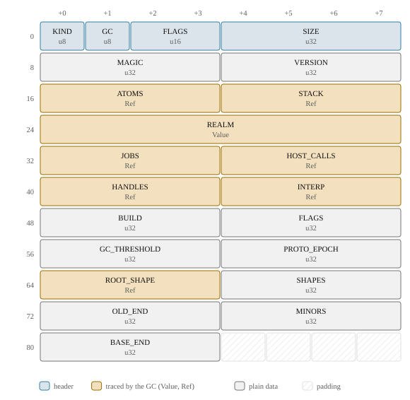
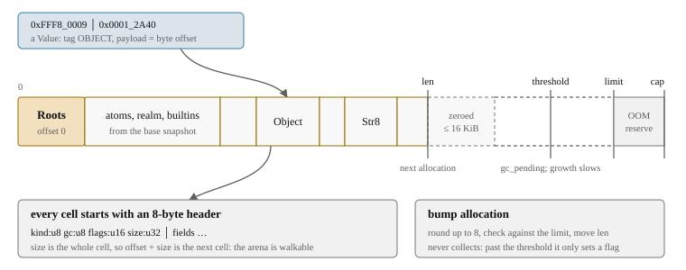

# One arena: all state in a byte array

Most engines spread a running program over the process: objects on a garbage-collected
heap, frames on the native stack, bytecode and job queues in the engine's own data
structures, all held together by pointers. djs keeps all of it in one place, a
contiguous array of bytes called the **arena**. This page shows what the arena holds, how
memory in it is handed out, and why the rest of the design depends on it. The next two
chapters go inside it: [the 64-bit values](values.md) stored in it, and [the cells](heap.md)
that make up JavaScript's strings and objects.

> **In short.** Everything a VM knows lives in one growable `Vec<u8>` addressed by `u32`
> offsets: objects, strings, bytecode, the value stack, frames, the job queue, pending
> host calls. Memory is handed out by bumping an offset, and allocation never collects.
> Because there are no pointers in the bytes, a copy of the arena is a complete image of
> the VM, the host can read it, and a bad offset cannot reach memory outside the VM.

## Everything, in one place

The list of what lives in the arena is the list of what a suspended VM needs to resume:

- objects, strings, symbols, BigInts, shapes and property tables;
- compiled code: function templates, bytecode, constant pools, line tables;
- the **value stack** with every call frame, and the interpreter's registers, flushed
  into a cell whenever `run` returns;
- the promise job queue, the table of pending host calls and the inbox of their results;
- atoms (interned property keys), the realm with its intrinsics, and the handle table
  through which the embedder holds values.

Rust data structures (`Vec`, `Box`) hold only transient state: the compiler's working
state while it compiles, and scratch space inside one native operation. Neither survives
past a point where the VM could suspend. Native code is never referenced by pointer
either: a native builtin is an index into a static table, and a host function is a `u32`
id that the host assigned.

The arena starts with the **`Roots`** cell at offset 0. Everything live is reachable
from it:

<!-- gen:cell Roots -->


<!-- /gen -->

Most of its fields are references: the atom table, the realm, the job queue, the host
call table, the handles, the interpreter state, the root of the shape tree. The others
are small pieces of VM state that must survive an image, so that a restored VM behaves
exactly like the one that was saved: the GC threshold and the collector's schedule
(`OLD_END`, `MINORS`), the inline cache epoch (`PROTO_EPOCH`), the number of shapes
created (`SHAPES`), the end of the builtin prefix (`BASE_END`), the key of the VM's
string hash (`HASH_KEY`) and a few flags. `VERSION`, `COMPAT`, `OPS`, `INTRINSICS`,
`RECORDS` and `FEATURES` together are the image's dependency descriptor: hashes of the
tables whose numbers the image holds, so that an image never loads into an engine that
would read its bytecode or its records differently ([what an image depends
on](snapshots.md#what-an-image-depends-on)).

## Cells, back to back

The arena is a sequence of **cells**. Each starts at an 8-aligned offset with an 8-byte
header, and the cells sit back to back with no gaps:



The header's `size` is the size of the whole cell, so `offset + size` is the next cell,
and anyone holding the bytes can walk the heap from 0 without knowing any cell kind. The
garbage collector, the image verifier and the host all do. On the docs site, the *Heap*
tab of a live example walks the arena of the wasm VM in your browser this way, in a
short loop of JavaScript, and counts the cells by kind. It separates what the example
allocated from what every VM starts with, the few thousand cells of the base realm
(builtins, their code and their names) copied from the base snapshot:

```js live
const rows = [];
for (let i = 0; i < 1000; i++) rows.push({ id: i, name: "row " + i });
let text = "";
for (const r of rows) text += r.name + "\n";
console.log(rows.length, "rows,", text.length, "characters");
```
<!-- gen:run -->
```text
1000 rows, 7890 characters
```
<!-- /gen -->

Those base cells come in two parts. The first, the **builtin prefix**, holds the builtin
objects, their code and their names. Using the builtins never writes there, no
collection moves or frees it, and every VM of a build has the same bytes at the same
offsets in it ([the base snapshot](snapshots.md#the-base-snapshot)). After it comes a
short **tail** of the cells every VM writes: the realm record, the global object, the
atom table with room for the VM's own atoms, the value stack.

Offset 0 doubles as "null", because nothing ever refers to the roots cell. The all-zero
bit pattern is also a valid "nothing" for every traced field: as a value it is the
number `+0`, and as a reference it is null. Freshly zeroed memory is therefore always
safe for the collector to scan, which lets allocation hand out zeroed bytes that the
caller fills in afterwards.

## Allocation is a bump

Allocating a cell rounds the size up to 8, checks it against the cap, moves the end of
the used region (`len`) and writes the header:

<!-- gen:excerpt crates/djs-core/src/heap/mod.rs "impl Heap" "pub fn alloc_cell(" 10 -->
[`crates/djs-core/src/heap/mod.rs`](../../crates/djs-core/src/heap/mod.rs#L549-L558), lines 549–558:

```rust
pub fn alloc_cell(&mut self, kind: CellKind, size: u32) -> Result<u32, HeapError> {
    let size = align8(size.max(kind.min_size()));
    let off = self.arena.alloc(size)?;
    if self.arena.len() >= self.gc_threshold {
        self.gc_pending = true;
    }
    self.arena.set(off, Header::KIND, kind as u8);
    self.arena.set(off, Header::SIZE, size);
    Ok(off)
}
```
<!-- /gen -->

The arena keeps a **zeroed frontier** up to 16 KiB beyond `len`, so most allocations are
a compare and an add and never touch the `Vec`. Data that arrives with the allocation (a
string's bytes, a cell the collector copies) is appended at the frontier instead of
zeroed first and copied afterwards, so it is written once.

The important line is the one that is missing: **allocation never collects.** Crossing
the GC threshold only sets `gc_pending`. The collection runs at the next **safepoint**:
an instruction boundary, a frame entry, a backward jump, a state transition of a native
builtin. Between safepoints, Rust code can keep raw offsets in local variables without
rooting them, because nothing moves them. This keeps the native builtins and the
interpreter's slow paths simple; [the garbage collector](gc.md) explains the rest.

> **Trade-off.** Collect only at safepoints, not when an allocation runs short. Otherwise
> a Rust function that allocates twice would have to root the result of the first
> allocation before making the second, at every one of hundreds of call sites in the heap
> code. The cost: the arena can overshoot the threshold between two safepoints, and an
> operation that hits the memory cap cannot collect and continue. It fails, and the
> interpreter collects and runs the whole instruction once more.

## Growing, and the cap

The arena grows like a `Vec`, by reallocating, with a few twists, all aimed at the peak
of wasm memory: wasm linear memory never shrinks, so the peak is what a run costs.

- **It starts small.** A VM made from the base or restored from an image reserves the
  image plus one 64 KiB page, not room up to its first collection threshold: most
  sandboxes never need more, and the rest grow in place. Only a host that says how big
  the heap will get (one that runs a large script of its own right after creating the
  VM, say) gets that room up front.
- **It stops at the GC threshold.** Below the threshold, growth doubles but never
  reserves past the threshold and a small slack for what is allocated before the next
  safepoint. Past it, a collection is pending and growth is by a quarter. Thresholds are
  whole 64 KiB wasm pages.
- **In wasm it grows in place.** The module's allocator keeps big blocks, the arena among
  them, as runs of whole pages. When the pages after the arena are free or memory ends
  there, a growth adds pages instead of copying the arena into a new block, which would
  hold the old and the new copy at once. The allocator works to keep the arena at the
  end of memory: the general-purpose allocator's first pages come before it, and
  mid-sized blocks that the general allocator cannot hold get page runs of their own,
  which go back when freed instead of staying behind the arena for good.
- **It has a cap.** The embedder sets a memory limit. The arena may grow to the limit
  minus a reserve of `min(cap / 32, 1 MiB)`. Reaching that point is the catchable
  `InternalError: out of memory`, a preallocated object, as in QuickJS. Throwing it
  opens the reserve, so that the script's handler has room to run, and the VM collects
  when the handler is reached. What a script sees is on [Limits](limits.md#memory).

When the *host* refuses memory below the cap (the `Vec` cannot grow), that is not the
program's doing, so it is not a JavaScript error: the run stops with
`Status::HostOutOfMemory`, and the VM stays valid and idle. Keeping the two apart makes
the out-of-memory point a function of the program and the cap alone, which
[deterministic runs](determinism.md) rely on.

Because the arena can be reallocated, nothing outside it may keep a pointer into it
across a VM call. The host's reader takes a fresh view of wasm memory after every call,
which wasm hosts do anyway, since linear memory itself can grow.

## Offsets, not pointers

Every reference in the arena is a `u32` offset from its start: in a [value](values.md)
the payload, in a `Ref` field the whole word. This one rule buys four things:

1. **An image is a copy.** After a compacting collection, the arena bytes *are* the VM.
   Creating a VM from the base image, suspending one, or moving one between two wasm
   modules needs no serializer to keep in step with the object model: a restore is a
   copy and a check, with no fixups, because there is nothing to fix up
   ([images](snapshots.md)).
2. **The host can read values in place.** A tool result that the script turned into an
   array of objects is read by walking cells in wasm memory, with a reader generated
   from the same layout table ([the reader](host.md#values-out-the-reader)).
3. **A bug stays inside the VM.** An offset can only name a byte of the arena, so a bad
   one from a VM bug or a corrupt image cannot reach anything outside it. Native builds
   bounds-check every access, with no `unsafe`: a bad offset is a panic or a corrupt
   JavaScript heap. The shipped wasm modules skip that check, because wasm already
   confines every load and store to the instance's own memory: there a bad offset can
   corrupt that VM, but never the host.
4. **The heap can move.** The collector compacts the arena by sliding live cells down,
   and the arena can be reallocated, without any reference outside it going stale: the
   embedder holds values through handles, slot numbers in a table inside the arena,
   never through offsets.

> **Trade-off.** One arena of offsets over Rust-managed objects. The model for djs's
> execution side, piccolo, keeps JavaScript objects as Rust allocations behind `Gc`
> pointers (`gc-arena`), with the borrow checker guarding them. That gives type safety
> for free, but the host cannot read such a heap, and suspending or copying a VM needs a
> full graph serializer, against the goals of [cheap data
> passing](goals.md#cheap-data-passing) and [suspending anywhere](goals.md#suspend-anywhere).
> The cost: references are untyped. A cell offset is a number, and code that reads the
> wrong field of the wrong cell is a logic bug for the verifier and the stress tests to
> catch, not the compiler.

> **Trade-off.** No arena bounds checks in the shipped wasm modules. Wasm already checks
> every load against the instance's linear memory, so an arena check only turns a bug
> that stays inside the instance into a clean trap instead of a corrupt VM. It costs
> about <!--n bounds/gzip kb-->8 KB<!--/n--> of the gzipped module and <!--n bounds/instructions-median-pct .0-->11<!--/n-->% of the executed instructions on a typical
> workload, up to <!--n bounds/instructions-max-pct .0-->17<!--/n-->%, so the shipped modules build with the `unsafe-heap`
> cargo feature, which reads and writes without it. That is sound only for heaps the
> engine laid out itself, and those are the only ones such a module sees: it restores
> images made in its own process, and its persistent state is JavaScript source that it
> compiles like any script. Every other build keeps the check: native builds, which have
> no sandbox around them, the dump module, and every test build, whose debug assertions
> check the unchecked accessors too. A check is one compare, `offset + size <= length`,
> in 64-bit arithmetic so that it cannot wrap, which lets the compiler drop the slice's
> own checks behind it; release builds leave the offsets out of the panic message, which
> keeps the many inlined access sites small. All of the `unsafe` sits in one small
> module, and the merge checks run the unchecked build under suspension and collection
> stress as well as the shipped modules themselves.

> **Trade-off.** `u32` offsets limit an arena to 4 GiB. That is the whole wasm32 address
> space anyway ([wasm32 first](goals.md#wasm32-first)), and a codemode VM is capped far
> below it. Offsets could be scaled by the 8-byte alignment if larger arenas ever matter.

## Where to look

- [`crates/djs-core/src/heap/arena.rs`](../../crates/djs-core/src/heap/arena.rs): the
  byte buffer, the zeroed frontier, growth and the cap.
- [`crates/djs-core/src/heap/layout/access.rs`](../../crates/djs-core/src/heap/layout/access.rs):
  the one place every field read and write goes through, checked or (with
  `unsafe-heap`, in the shipped modules) not.
- [`crates/djs-core/src/heap/mod.rs`](../../crates/djs-core/src/heap/mod.rs): `Heap`,
  allocation, the out-of-memory reserve, the conventions every heap function follows.
- [`crates/djs-core/src/heap/cells.rs`](../../crates/djs-core/src/heap/cells.rs): the
  header, the `Roots` cell and every other cell kind.
- [`crates/djs-core/src/heap/walk.rs`](../../crates/djs-core/src/heap/walk.rs): the cell
  walker and the verifier.
- [`crates/djs-wasm/src/allocator.rs`](../../crates/djs-wasm/src/allocator.rs): the wasm
  module's page allocator, which lets the arena grow in place.
