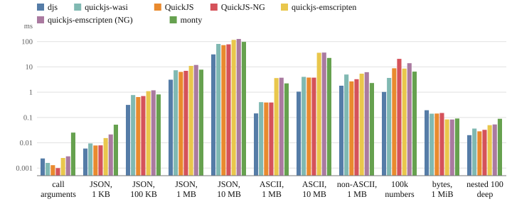
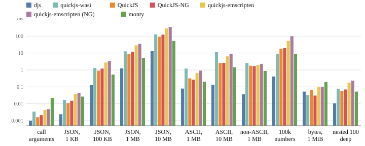
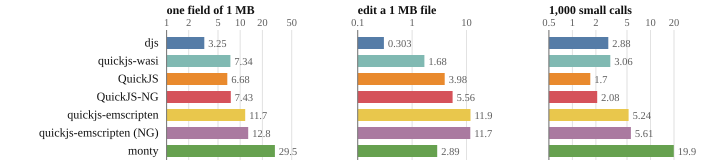

# Benchmarks

How fast does djs start, run and dump the scripts an agent writes, and what does it cost
in download and memory, next to the QuickJS builds a host would otherwise embed? This
page compares them on workloads modeled on real agent codemode sessions, all in
WebAssembly, the way a host runs them, and says how to re-run every number.

> **In short.** Seven engines (djs, four QuickJS builds of both QuickJS lines, and monty,
> a Python subset) run nine codemode workloads in wasm in one node process, each run in a
> fresh VM, and must all return the same result. djs starts a VM fastest and has the
> lowest run time over the set; it is ahead where scripts move JSON, strings and tool
> results, and behind on the smallest bodies and on some single string builtins. Passing
> data through the host bridge, each engine its best way, djs takes values in about twice
> as fast and reads them out about ten times as fast; it is behind on bytes coming in and
> on many tiny calls. Its
> module is the largest of the JavaScript engines and it takes more memory than the
> QuickJS releases built here, and its dumps of a paused run are kilobytes, written or
> loaded in under a millisecond for most workloads. `scripts/bench-engines.sh` fetches,
> builds and runs everything; the tables and charts are generated from the recorded
> results.

## What is measured, and why this way

An agent's codemode body is short and makes a few tool calls: it reads files, runs
commands, reshapes their output and prints a summary. The engine's own work is small, so
what a host pays is mostly starting a VM, passing tool results in and out, parsing the
body and assembling strings. The comparison measures exactly that, as an embedder sees it:

- **Everything in wasm, in one host.** Every engine is a wasm module run by node: the
  build a host would ship, not a native binary. Each module is compiled once per process,
  as a host keeps a compiled module.
- **A fresh VM per run.** Every run gets a new instance and VM, isolated from the others,
  as a host gives each tool call its own sandbox. *New VM* is the time to get one ready;
  *run* is the time from handing it the script to having the result string.
- **A warm process.** The times are medians of 25 runs after 3 warm-up runs, so node has
  optimized each engine's code, as in a host that has been running for a while.
- **The same tool bridge.** Tool answers are recorded once and handed to every engine as
  one JSON string; inside the engine, each tool call turns its arguments into JSON to find
  its answer and parses the answer's JSON text. That is the work a host bridge does, and it
  is the same code in every engine, so the comparison measures the engines and not their
  host interfaces. [Passing data through the bridge](#passing-data-through-the-bridge)
  compares the host interfaces.
- **The same answer.** Every engine's result must be the string node computes for the same
  script, or the run fails.
- **Memory** is the instance's linear memory after the run. Wasm memory never shrinks, so
  that is the run's high-water mark, allocator overhead included.

Times depend on the machine and its load; the tables say when and at what load they were
taken. Instruction counts would not compare across engines with different hosts, so the
page gives wall-clock medians.

## The engines

| engine | what it is | how it is built here |
| --- | --- | --- |
| djs | this engine, the shipped module | [`scripts/build-wasm.sh`](../../scripts/build-wasm.sh) |
| quickjs-wasi | QuickJS-NG for WASI with snapshot support, version 3.6.2 | the npm package's `quickjs.wasm` |
| QuickJS | Bellard's QuickJS 2026-06-04, the latest release | wasi-sdk 34, `-O2`, a minimal embedding |
| QuickJS-NG | QuickJS-NG 0.18.0, the latest release | the same: wasi-sdk 34, `-O2`, the same embedding |
| quickjs-emscripten | the popular emscripten build, version 0.32.0, of Bellard's QuickJS 2025-09-13 | the npm variant `@jitl/quickjs-wasmfile-release-sync` |
| quickjs-emscripten (NG) | the same package with QuickJS-NG 0.12.1 | the npm variant `@jitl/quickjs-ng-wasmfile-release-sync` |
| monty | pydantic's Python subset for code written by models, version 1.3.0 | the npm package's wasm component |

The two latest QuickJS releases are built by the script with one compiler, the same flags
and the same small embedding ([`js/bench/engines/driver.c`](../../js/bench/engines/driver.c)):
a runtime, a context, an evaluation that runs the job queue dry, and a result string.
monty runs the workloads translated to Python by hand; its component is instantiated on
the calling thread with no filesystem, environment or network, as its own worker does.

## The workloads

The workload set ([`tests/bench/codemode/`](../../tests/bench/codemode/)) was derived from
about three thousand codemode bodies of agent sessions: they were grouped into clusters by
what they do, and each cluster got one synthetic body of its typical size and operation
mix. The data the tools return is invented: source-like files, command output, search
results, query rows, an image.

| workload | share of bodies | what it does |
| --- | ---: | --- |
| `sequential` | 30% | a read, an edit batch with large literal arguments, two commands |
| `fanout` | 22% | twelve reads and three checks with `Promise.all`, joined and cut to an output budget |
| `media` | 13% | render a view, read the image, hand a 200 KB data URL to the host |
| `inspect` | 9% | no tools: group and search the tool catalog |
| `loop` | 8% | eight searches one after another, each result formatted with a regular expression |
| `text` | 8% | parse grep-like output, group by file, scan files for markers and definitions |
| `json` | 7% | group 600 query rows, rewrite a package manifest |
| `ts` | 2% | the `json` shape in TypeScript (djs runs it as is; the other engines get it with the types stripped by the host) |
| `heavy` | the largest 1% | 97 calls: 96 file reads in batches with per-file regular expression work |

A typical body is about 500 characters and makes three tool calls; the workloads sit at or
a little above their cluster's median, so that the engines' work shows.

## Download size

What a host ships: the wasm module, and the JavaScript some builds need around it.

<!-- gen:status engines-size -->


| engine | wasm | gzip | brotli | JS glue, gzip |
| --- | ---: | ---: | ---: | ---: |
| djs | 980 KB | 427 KB | 360 KB | none |
| quickjs-wasi | 637 KB | 287 KB | 247 KB | 28 KB |
| QuickJS | 966 KB | 332 KB | 262 KB | none |
| QuickJS-NG | 1,087 KB | 371 KB | 295 KB | none |
| quickjs-emscripten | 503 KB | 231 KB | 199 KB | 8 KB |
| quickjs-emscripten (NG) | 529 KB | 247 KB | 212 KB | 8 KB |
| monty | 24,593 KB | 7,628 KB | 4,804 KB | 55 KB |

Module bytes as shipped; gzip -9, brotli quality 11; measured at 1268c57eeb, 2026-11-06,
load 2.3.
<!-- /gen -->

djs's module is the largest of the JavaScript engines: it carries the TypeScript front
end and the base image of an initialized realm (every builtin object, coded to
<!--n wasm/base-coded kb-->46 KB<!--/n-->), which spares each new VM from building them.
quickjs-wasi and the emscripten builds are optimized for size; the two releases built
here use `-O2`, as djs's module is optimized for speed. monty's module is a different
order of size altogether: a Python interpreter with its standard library subset and a
type checker.

## Starting a VM

A host that gives every call a fresh VM pays this on every call.

<!-- gen:status engines-startup -->


| engine | compile, ms | new VM, ms | idle VM memory, MiB |
| --- | ---: | ---: | ---: |
| djs | 1.03 | 0.12 | 0.6 |
| quickjs-wasi | 2.94 | 0.26 | 1.3 |
| QuickJS | 3.27 | 0.20 | 0.3 |
| QuickJS-NG | 1.93 | 0.26 | 0.4 |
| quickjs-emscripten | 1.28 | 0.24 | 16.0 |
| quickjs-emscripten (NG) | 6.70 | 0.28 | 16.0 |
| monty | 30.5 | 0.54 | 3.9 |

Compile: the module, once per process. New VM: a new instance and VM, ready to evaluate
(median). Memory: linear memory; measured at 1268c57eeb, 2026-11-06, load 2.3.
<!-- /gen -->

A new djs VM is ready in <!--n engines/djs/startup-ms .2-->0.12<!--/n--> ms, against
<!--n engines/quickjs/startup-ms .2-->0.20<!--/n--> ms for QuickJS and
<!--n engines/quickjs-ng/startup-ms .2-->0.26<!--/n--> ms for QuickJS-NG: the realm
comes from the base image in the module, so creating a VM copies an image instead of
running the code that builds every builtin (the [snapshots page](snapshots.md) says
how). Its idle memory is above the QuickJS releases': the base image is larger than the
heap a fresh QuickJS context allocates, and djs reserves a larger native stack, which
sets how deeply its parser may nest. The emscripten builds start at 16 MiB, emscripten's
initial heap, whatever runs in them.

## Run time

The time from handing a fresh VM the script and its tool answers to having the result:
parsing and compiling the body, the tool calls through the bridge, and the script's work.

<!-- gen:status engines-run -->


| workload | djs | quickjs-wasi | QuickJS | QuickJS-NG | quickjs-emscripten | quickjs-emscripten (NG) | monty |
| --- | ---: | ---: | ---: | ---: | ---: | ---: | ---: |
| sequential | 0.44 | 0.36 | 0.36 | 0.36 | 0.41 | 0.38 | 0.62 |
| fanout | 1.03 | 1.63 | 1.24 | 1.15 | 1.79 | 1.68 | 1.43 |
| media | 0.29 | 0.49 | 0.91 | 0.45 | 1.49 | 0.98 | 0.82 |
| inspect | 0.26 | 0.23 | 0.20 | 0.20 | 0.28 | 0.31 | 0.63 |
| loop | 0.76 | 2.65 | 0.84 | 2.11 | 1.10 | 4.41 | 1.67 |
| text | 1.44 | 1.68 | 1.50 | 1.46 | 1.91 | 2.39 | 2.91 |
| json | 1.67 | 2.13 | 1.81 | 1.89 | 2.65 | 2.75 | 3.55 |
| ts | 2.04 | 2.34 | 1.99 | 2.12 | 2.94 | 3.00 | 2.70 |
| heavy | 11.6 | 15.7 | 15.3 | 16.0 | 18.8 | 29.4 | 11.8 |
| relative to djs | 1.00× | 1.36× | 1.17× | 1.20× | 1.59× | 1.91× | 1.77× |

Milliseconds per run (median), in a warm process; the last row is the geometric mean of
each engine's time over djs's; measured at 1268c57eeb, 2026-11-06, load 2.3.
<!-- /gen -->

djs has the lowest time over the set, and the largest leads where a body moves data:
`fanout`, `json` and `media` pass large tool results through `JSON.parse` and strings
(djs parses and writes JSON in about a third of QuickJS's time, see the operations
below), and `heavy` spends most of its time splitting, matching and scanning file texts.
`loop` is a regular expression replace over prose in a loop, where Bellard's QuickJS is
close and QuickJS-NG and quickjs-wasi are far behind. djs is behind on the shortest
bodies, `sequential` and `inspect`, by a few hundredths of a millisecond: compiling the
body costs about the same in both, and what is left is a handful of small builtin calls
(`Object.entries`, `toFixed`), each dearer in djs (below). On `ts` djs compiles the
TypeScript itself, while the other engines get JavaScript whose types the host stripped
beforehand, outside the timing. monty is fast on `heavy`, whose string splitting and
regular expressions are native in its Rust implementation, and slower on the rest; its
times include the same JSON bridge in Python.

## Memory

The instance's linear memory after the run: what the run cost, since wasm memory does not
shrink.

<!-- gen:status engines-memory -->


| workload | djs | quickjs-wasi | QuickJS | QuickJS-NG | quickjs-emscripten | quickjs-emscripten (NG) | monty |
| --- | ---: | ---: | ---: | ---: | ---: | ---: | ---: |
| sequential | 0.7 | 1.4 | 0.4 | 0.4 | 16.0 | 16.0 | 5.1 |
| fanout | 1.8 | 2.5 | 1.6 | 1.6 | 16.0 | 16.0 | 5.6 |
| media | 1.0 | 2.1 | 1.1 | 1.1 | 16.0 | 16.0 | 5.5 |
| inspect | 0.6 | 1.3 | 0.4 | 0.4 | 16.0 | 16.0 | 5.1 |
| loop | 0.9 | 1.5 | 0.5 | 0.6 | 16.0 | 16.0 | 5.1 |
| text | 1.2 | 1.6 | 0.6 | 0.7 | 16.0 | 16.0 | 7.1 |
| json | 1.4 | 2.2 | 1.1 | 1.3 | 16.0 | 16.0 | 5.9 |
| ts | 1.6 | 2.2 | 1.1 | 1.2 | 16.0 | 16.0 | 5.8 |
| heavy | 4.6 | 3.4 | 2.4 | 2.4 | 16.0 | 16.0 | 7.2 |
| relative to djs | 1.00× | 1.53× | 0.68× | 0.72× | 12.62× | 12.62× | 4.54× |

Linear memory after the run, MiB; the last row is the geometric mean of each engine's
over djs's; measured at 1268c57eeb, 2026-11-06, load 2.3.
<!-- /gen -->

djs needs more memory than the QuickJS releases built here and less than quickjs-wasi,
monty and the emscripten builds. Part of the gap is constant: the larger idle footprint
above. The rest comes from the garbage collector. djs's collector traces the live heap
when the allocation since the last collection crosses a threshold, about as large again
as what survived, so garbage stays until then; QuickJS counts references and frees most
garbage the moment it is dropped. `heavy`, which allocates a few megabytes of
short-lived lines and strings, shows it most.

## Operation by operation

Single operations on data shaped like the workloads', each in a loop, against the faster
of the two QuickJS releases. Above 1, djs is slower.

<!-- gen:status engines-ops -->


| operation | djs, ms | QuickJS, ms | djs / QuickJS |
| --- | ---: | ---: | ---: |
| `JSON.parse` of 600 query rows | 0.99 | 2.86 | 0.35 |
| `JSON.stringify` of 600 query rows | 0.93 | 3.10 | 0.30 |
| `split("\n")` of file texts | 1.17 | 2.66 | 0.44 |
| `join("\n")` of their lines | 0.46 | 0.69 | 0.67 |
| `includes` per line | 3.09 | 2.27 | 1.37 |
| template literal appends | 5.48 | 4.22 | 1.30 |
| `trim` | 11.1 | 3.50 | 3.16 |
| `slice` | 7.55 | 3.71 | 2.04 |
| `padStart` | 8.24 | 3.04 | 2.71 |
| `toLowerCase` | 18.4 | 10.3 | 1.78 |
| `charCodeAt` loop | 10.3 | 6.46 | 1.59 |
| `String(i)` | 6.07 | 3.26 | 1.86 |
| `toFixed` | 5.82 | 2.95 | 1.97 |
| `Math.max` | 0.67 | 0.38 | 1.79 |
| `Math.floor` | 5.74 | 2.64 | 2.17 |
| `match(/function \w+/g)` | 2.11 | 5.02 | 0.42 |
| `replace(/\s+/g, " ")` | 7.99 | 7.69 | 1.04 |
| `exec` of a line pattern | 9.16 | 13.6 | 0.67 |
| `matchAll` with `/gm` | 4.70 | 5.15 | 0.91 |
| `new RegExp` | 1.58 | 1.71 | 0.93 |
| `map` | 3.44 | 3.52 | 0.98 |
| `sort` with a comparator | 11.2 | 5.79 | 1.93 |
| `sort` of strings | 2.27 | 2.35 | 0.97 |
| `push` | 8.38 | 7.69 | 1.09 |
| `Map.set` with string keys | 18.5 | 10.0 | 1.84 |
| `Set.add` with string keys | 10.8 | 6.97 | 1.55 |
| object spread | 6.40 | 4.35 | 1.47 |
| `Object.entries` and `fromEntries` | 0.38 | 0.00 | - |
| `await` of a value | 5.40 | 16.9 | 0.32 |
| `Promise.all` of 20 | 4.44 | 7.89 | 0.56 |

Milliseconds per loop of the operation (js/bench/engines/ops.ts), the setup's time
subtracted; QuickJS: the faster of the two latest releases; measured at 1268c57eeb,
2026-11-06, load 2.0.
<!-- /gen -->

JSON, splitting and joining, regular expression matching, sorting strings, `await` and
`Promise.all` are faster in djs. What is still slower is a group of small string and
number builtins (`trim`, `padStart`, `slice`, `toLowerCase`, `String(i)`, `toFixed`,
`Object.entries`, `Math.floor`): djs writes most builtins in a TypeScript subset
compiled to its own bytecode, and although the common ones take a fast path, a call
still costs more instructions than a call of QuickJS's C functions, which shows when the
operation itself is tiny. `sort` with a comparator runs the comparator, a script
function, for every comparison, and calling it from the sort still costs more than in
QuickJS; `Map.set` and `Set.add` with string keys also take more instructions per call.
These matter in a loop of tens of thousands of calls; in the workloads they are a small
part of the time.

## Passing data through the bridge

Moving data between the host and the sandbox is what [cheap data
passing](goals.md#cheap-data-passing) is about: a tool result going in, a run's result or
a tool call's arguments coming out. The workloads above pass every tool answer the same
way in every engine, as JSON text, so that they compare the engines. This section instead
compares the bridges: each engine gets the best path its embedding offers
([`js/bench/engines/bridge.ts`](../../js/bench/engines/bridge.ts)).

| engine | value in | value out | a tool call |
| --- | --- | --- | --- |
| djs | the host encodes the value in the wire format, the VM decodes it into cells; a long ASCII string is copied straight into a string the VM reserved | the reader decodes the value out of the arena in place; the VM does nothing | the call's record names the arguments; the reader reads them, the result goes in as above |
| QuickJS, QuickJS-NG | `JSON.stringify` on the host, the UTF-8 written into linear memory, `JS_ParseJSON` there; strings by `JS_NewStringLen`, bytes as a copied `ArrayBuffer` | `JS_JSONStringify` in the VM and its UTF-8 read in place, then `JSON.parse`; strings as their UTF-8, bytes by pointer | a C function serializes its argument with `JS_JSONStringify` and calls the host, which answers with JSON text or a string |
| quickjs-wasi | JSON text parsed by `JSON.parse` in the VM, or its handle walk (`hostToHandle`) | `JSON.stringify` in the VM, or its handle walk (`dump`) | `newFunction` with the same conversions |
| quickjs-emscripten | JSON text parsed in the VM, or objects built through handles | `dump`, which is `JSON.stringify` in the VM and `JSON.parse` on the host | `newFunction` with the same conversions |
| monty | JSON text and `json.loads`, or its value arena, which the component model lowers into the module | `json.dumps`, or the value arena lifted out | an external function: the run stops, the host answers with a value arena |

Where an engine has two paths, each number below is the faster one's: the handle walks of
quickjs-wasi and quickjs-emscripten win on arrays of numbers, whose decimal text is slow
to parse, and lose on most other values, and monty's JSON text beats its value arena for
anything larger than call arguments. The payloads: call
arguments; a search tool's result as an object, of 1 KB, 100 KB, 1 MB and 10 MB of JSON;
source text of 1 MB and 10 MB (ASCII) and 1 MB of prose with accented letters, dashes and
CJK; 100,000 floating-point numbers; a 1 MiB `Uint8Array`; and objects nested 100 deep
(monty's `json.loads` stops at about 200). Every value must read back equal to what went
in. Each time is the median of one operation in fresh VMs; small payloads repeat within
a sample.

### In

<!-- gen:status bridge-in -->


| payload | size | djs | quickjs-wasi | QuickJS | QuickJS-NG | quickjs-emscripten | quickjs-emscripten (NG) | monty |
| --- | ---: | ---: | ---: | ---: | ---: | ---: | ---: | ---: |
| call arguments | 102 B | 0.002 | 0.002 | 0.001 | 0.001 | 0.003 | 0.003 | 0.025 |
| JSON, 1 KB | 1 KB | 0.006 | 0.009 | 0.008 | 0.008 | 0.015 | 0.021 | 0.052 |
| JSON, 100 KB | 100 KB | 0.313 | 0.77 | 0.642 | 0.705 | 1.1 | 1.18 | 0.816 |
| JSON, 1 MB | 1,000 KB | 3.13 | 7.36 | 6.35 | 7 | 11 | 11.9 | 7.79 |
| JSON, 10 MB | 10,000 KB | 31.2 | 80.9 | 72.7 | 78.2 | 117 | 128 | 97.5 |
| ASCII, 1 MB | 1,000 KB | 0.145 | 0.404 | 0.39 | 0.391 | 3.63 | 3.73 | 2.23 |
| ASCII, 10 MB | 10,000 KB | 1.05 | 4.04 | 3.78 | 3.77 | 36.3 | 36.8 | 22.6 |
| non-ASCII, 1 MB | 1,000 KB | 1.8 | 4.99 | 2.67 | 3.26 | 5.39 | 6.18 | 2.3 |
| 100k numbers | 1,076 KB | 1.02 | 3.66 | 8.79 | 20.8 | 8.59 | 14 | 6.49 |
| bytes, 1 MiB | 1,049 KB | 0.193 | 0.141 | 0.143 | 0.15 | 0.084 | 0.083 | 0.091 |
| nested 100 deep | 4 KB | 0.02 | 0.036 | 0.028 | 0.032 | 0.05 | 0.053 | 0.089 |
| relative to djs | | 1.0× | 2.0× | 1.9× | 2.1× | 3.9× | 4.4× | 4.3× |

Milliseconds per value put into a fresh VM (median), each engine's best path; the last
row is the geometric mean of each engine's time over djs's; measured at 1268c57eeb,
2026-11-06, load 2.0.
<!-- /gen -->

djs takes JSON-like values in about half the time of the fastest QuickJS path: a 1 MB
search result in <!--n engines/bridge/djs/json-1m/in-ms .1-->3.1<!--/n--> ms against
<!--n engines/bridge/quickjs/json-1m/in-ms .1-->6.4<!--/n--> ms for QuickJS. The host writes the value once in the wire
format and the VM builds every object at its final size in one pass, where the others
serialize it to JSON text on the host and parse that text again in the VM. A long ASCII
string is one copy into a string the VM reserved for it (<!--n engines/bridge/djs/text-10m/in-ms .1-->1.0<!--/n--> ms for
10 MB, against <!--n engines/bridge/quickjs/text-10m/in-ms .1-->3.8<!--/n--> ms for QuickJS, which first encodes the text into
its linear memory and then copies it into a string). Text with non-ASCII characters
gains less: it is encoded to UTF-8 and transcoded back in the VM. Numbers gain as much,
since the wire format carries them as binary values instead of decimal text to be parsed.

Bytes are where djs is behind: a `Uint8Array` is copied into the encoder's buffer, then
into the staging buffer, then into the VM's own bytes, three copies where the others
make two. The emscripten builds pay the most for strings, because their glue
encodes them to UTF-8 in JavaScript, byte by byte.

### Out

<!-- gen:status bridge-out -->


| payload | size | djs | quickjs-wasi | QuickJS | QuickJS-NG | quickjs-emscripten | quickjs-emscripten (NG) | monty |
| --- | ---: | ---: | ---: | ---: | ---: | ---: | ---: | ---: |
| call arguments | 102 B | 0.001 | 0.003 | 0.002 | 0.002 | 0.004 | 0.005 | 0.022 |
| JSON, 1 KB | 1 KB | 0.002 | 0.017 | 0.011 | 0.015 | 0.036 | 0.044 | 0.027 |
| JSON, 100 KB | 100 KB | 0.127 | 1.29 | 0.899 | 1.2 | 2.76 | 3.41 | 0.534 |
| JSON, 1 MB | 1,000 KB | 1.23 | 12.5 | 8.54 | 12 | 28.7 | 35.1 | 5.18 |
| JSON, 10 MB | 10,000 KB | 13.2 | 126 | 90 | 122 | 285 | 352 | 51.9 |
| ASCII, 1 MB | 1,000 KB | 0.079 | 1.2 | 0.316 | 0.266 | 0.654 | 0.906 | 0.2 |
| ASCII, 10 MB | 10,000 KB | 0.131 | 11.4 | 2.58 | 2.57 | 6.41 | 8.93 | 1.44 |
| non-ASCII, 1 MB | 1,000 KB | 0.036 | 2.54 | 1.78 | 1.69 | 1.97 | 2.3 | 0.871 |
| 100k numbers | 1,076 KB | 0.41 | 8.47 | 17.9 | 19.5 | 52.4 | 99.9 | 8.87 |
| bytes, 1 MiB | 1,049 KB | 0.053 | 0.033 | 0.065 | 0.03 | 0.097 | 0.097 | 0.192 |
| nested 100 deep | 4 KB | 0.011 | 0.077 | 0.059 | 0.07 | 0.18 | 0.233 | 0.053 |
| relative to djs | | 1.0× | 10.7× | 7.2× | 7.8× | 18.0× | 22.9× | 7.5× |

Milliseconds per value read out of a VM (median), each engine's best path; the last row
is the geometric mean of each engine's time over djs's; measured at 1268c57eeb,
2026-11-06, load 2.0.
<!-- /gen -->

Reading out is where the designs differ most. djs's reader decodes the value straight out
of the VM's memory, and the VM does no work at all; everyone else first has the VM write
the value as JSON text, copies the text out and parses it on the host. A 1 MB search
result comes out of djs in <!--n engines/bridge/djs/json-1m/out-ms .2-->1.23<!--/n--> ms, against
<!--n engines/bridge/quickjs/json-1m/out-ms .1-->8.5<!--/n--> ms for QuickJS and <!--n engines/bridge/monty/json-1m/out-ms .1-->5.2<!--/n--> ms for monty, whose
`json.dumps` is the fastest of the JSON paths here. A string comes out at the speed of a
memory copy, since its characters are already in the form a host string needs. A
`Uint8Array` is copied out in all of them; the reader's copy costs a few hundredths of a
millisecond more than reading the bytes in place by a pointer.

### Throughput and memory

<!-- gen:status bridge-rate -->
| engine | JSON 1 MB, in | out | JSON 10 MB, in | out | ASCII 10 MB, in | out | non-ASCII 1 MB, in | out | bytes 1 MiB, in | out |
| --- | ---: | ---: | ---: | ---: | ---: | ---: | ---: | ---: | ---: | ---: |
| djs | 320 | 811 | 321 | 756 | 9,527 | 76,220 | 555 | 27,855 | 5,427 | 19,935 |
| quickjs-wasi | 136 | 80 | 124 | 79 | 2,475 | 876 | 200 | 393 | 7,447 | 31,872 |
| QuickJS | 157 | 117 | 138 | 111 | 2,646 | 3,868 | 375 | 563 | 7,353 | 16,058 |
| QuickJS-NG | 143 | 83 | 128 | 82 | 2,655 | 3,884 | 307 | 593 | 6,967 | 34,493 |
| quickjs-emscripten | 91 | 35 | 86 | 35 | 275 | 1,560 | 186 | 506 | 12,543 | 10,777 |
| quickjs-emscripten (NG) | 84 | 29 | 78 | 28 | 271 | 1,120 | 162 | 434 | 12,603 | 10,777 |
| monty | 128 | 193 | 103 | 193 | 443 | 6,959 | 435 | 1,148 | 11,548 | 5,458 |

MB per second: the payload's size over the median time; measured at 1268c57eeb,
2026-11-06, load 2.0.
<!-- /gen -->

<!-- gen:status bridge-memory -->
| engine | idle | JSON 10 MB in | and out | ASCII 10 MB in | and out |
| --- | ---: | ---: | ---: | ---: | ---: |
| djs | 0.6 | 44.6 | 44.6 | 10.1 | 10.1 |
| quickjs-wasi | 1.3 | 42.2 | 52.0 | 20.4 | 20.4 |
| QuickJS | 0.3 | 36.7 | 56.6 | 19.4 | 19.4 |
| QuickJS-NG | 0.4 | 41.3 | 51.1 | 19.4 | 19.4 |
| quickjs-emscripten | 16.0 | 42.0 | 83.1 | 24.2 | 24.2 |
| quickjs-emscripten (NG) | 16.0 | 50.4 | 83.1 | 24.2 | 24.2 |
| monty | 5.0 | 82.6 | 108.6 | 14.5 | 32.6 |

Linear memory, MiB: of a fresh VM, after putting the value in, and after reading it back
out; measured at 1268c57eeb, 2026-11-06, load 2.0.
<!-- /gen -->

The memory after putting a 10 MB value in is mostly the value itself in each engine's
representation. djs keeps a little more than QuickJS for JSON: its staging buffer stays
as large as the largest wire encoding it was given. Reading the value out adds nothing
in djs, while the engines that go through JSON text need room for the text, which in the
emscripten builds doubles their memory. A 10 MB ASCII string takes about its own size in
djs, one copy; in QuickJS it is there twice, as the UTF-8 the host wrote and as the
string.

### End to end

Three whole runs, each in a fresh VM, with a host function `tool` that every engine calls
synchronously: a 1 MB search result of which the script returns one path, a 1 MB file
that the script edits with one `replace` and passes to a second call, and a thousand calls
with small arguments and results.

<!-- gen:status bridge-e2e -->


| case | djs | quickjs-wasi | QuickJS | QuickJS-NG | quickjs-emscripten | quickjs-emscripten (NG) | monty |
| --- | ---: | ---: | ---: | ---: | ---: | ---: | ---: |
| one field of 1 MB | 3.25 | 7.34 | 6.68 | 7.43 | 11.7 | 12.8 | 29.5 |
| edit a 1 MB file | 0.303 | 1.68 | 3.98 | 5.56 | 11.9 | 11.7 | 2.89 |
| 1,000 small calls | 2.88 | 3.06 | 1.7 | 2.08 | 5.24 | 5.61 | 19.9 |

Milliseconds per run in a fresh VM (median): compiling and running the script, its tool
calls through each engine's host function; measured at 1268c57eeb, 2026-11-06, load 2.0.
<!-- /gen -->

The case of a 1 MB result of which the script reads one field is decided by putting the
result in: every engine, djs included, builds the whole value before the script runs, so
djs's lead is that of the table above, and reading one string out costs nothing anywhere.
Editing a 1 MB file shows both directions: the file goes in as one copy, and the edited
text comes out to the second call through the reader, in
<!--n engines/bridge/djs/e2e/edit-1m-ms .2-->0.30<!--/n--> ms against <!--n engines/bridge/quickjs/e2e/edit-1m-ms .1-->4.0<!--/n--> ms for QuickJS, whose host function has to
write the megabyte as JSON text inside the VM and parse it again on the host.

A thousand small calls are where djs is behind the minimal C embedding:
<!--n engines/bridge/djs/e2e/calls-1000-ms .1-->2.9<!--/n--> ms against <!--n engines/bridge/quickjs/e2e/calls-1000-ms .1-->1.7<!--/n--> ms. With small values the conversion is
cheap everywhere, and what remains is the call itself: djs's run returns to the host at
every call, the host reads the call's record, puts the result in and runs the VM again,
while the C embedding calls the host function from inside the interpreter (the other
QuickJS builds do too, but every value crosses through their JavaScript glue, and they
are slower than djs). monty stops and resumes its run for every call, which costs it <!--n engines/bridge/monty/e2e/calls-1000-ms .0-->20<!--/n--> ms.

In short, djs's two halves pay off differently. The wire format makes the way in about
twice as fast as JSON text for structured data and a single copy for long ASCII strings.
The reader makes the way out an order of magnitude faster, because no engine work and
no text happen in between. Bytes coming in and many tiny calls are the places where the
simpler paths of the C embedding are still ahead.

## Dumps

djs can write a run that waits on tool calls as a [continuation dump](dumps.md) and
continue it later in a new sandbox. Here every workload runs through the sandbox with
asynchronous host tools and is dumped at every idle point, every time it waits on a call:

<!-- gen:status engines-dumps -->


| workload | idle points | dump, KiB (max) | gzip, KiB (max) | write, ms | load, ms |
| --- | ---: | ---: | ---: | ---: | ---: |
| sequential | 4 | 1.2 (2.3) | 0.6 (0.9) | 0.30 | 0.30 |
| fanout | 15 | 74.3 (139.1) | 17.1 (33.5) | 0.51 | 0.62 |
| media | 2 | 0.4 (0.4) | 0.3 (0.3) | 0.13 | 0.23 |
| inspect | 0 | | | | |
| loop | 8 | 8.6 (15.5) | 3.1 (5.2) | 0.46 | 0.35 |
| text | 5 | 52.2 (53.0) | 9.2 (9.4) | 0.76 | 0.89 |
| json | 3 | 121.9 (122.0) | 20.5 (20.6) | 3.91 | 2.96 |
| ts | 1 | 1.7 (1.7) | 0.8 (0.8) | 0.74 | 0.37 |
| heavy | 97 | 42.1 (114.9) | 10.3 (25.2) | 0.49 | 0.66 |

Medians over a workload's idle points; load: a new sandbox with the run loaded; measured
at 1268c57eeb, 2026-11-06, load 2.3.
<!-- /gen -->

Most dumps are a few kilobytes, and gzip takes the larger ones to between a fifth and a
third; they hold the run's live state, so a dump taken while `json` holds 600 query
rows, or while `fanout` holds the file texts it has read, is as large as that data.
Writing one and loading it into a new sandbox takes about as long as starting a VM and
running a small body; the `json` dumps take longest, as they encode and decode the most
objects. `inspect` makes no tool call, so it never waits and has nothing to dump.

## Re-running

```sh
scripts/bench-engines.sh          # fetch and build the engines, run, print the tables
scripts/bench-engines.sh --setup  # fetch and build only
scripts/status.py engines         # three runs; record the medians for this page
scripts/status.py bridge          # only the bridge benchmark
cargo run -q -p djs-docs -- regen # rewrite the tables
```

The engines go into `vendor/engines` of the primary checkout: npm packages pinned with
their integrity hashes by
[`js/bench/engines/package-lock.json`](../../js/bench/engines/package-lock.json), wasi-sdk
and the QuickJS release sources pinned by SHA-256 in
[`scripts/bench-engines.sh`](../../scripts/bench-engines.sh). Run it on a quiet machine:
the harness prints the load it started at, and recorded numbers should come from a load
below about 4.

## Where to look

- [`js/bench/engines/run.ts`](../../js/bench/engines/run.ts): the harness, what it times and how
- [`js/bench/engines/engines.ts`](../../js/bench/engines/engines.ts): each engine behind one
  interface, with its paths in and out for the bridge benchmark
- [`js/bench/engines/bridge.ts`](../../js/bench/engines/bridge.ts): the bridge benchmark, its
  payloads and end-to-end cases; [`driver.c`](../../js/bench/engines/driver.c): the C embedding
  of the two QuickJS releases
- [`js/bench/engines/prelude.js`](../../js/bench/engines/prelude.js),
  [`prelude.py`](../../js/bench/engines/prelude.py): the stub tools inside the engines
- [`tests/bench/codemode/`](../../tests/bench/codemode/): the workloads, their Python
  translations and [`tools.ts`](../../tests/bench/codemode/tools.ts), the invented tool data
- [`scripts/bench-engines.sh`](../../scripts/bench-engines.sh): fetching and building the engines
