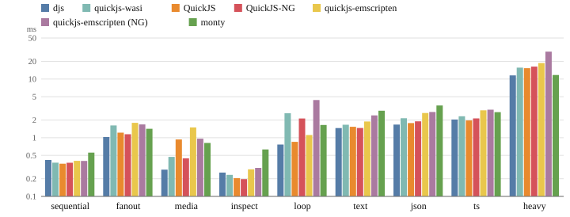
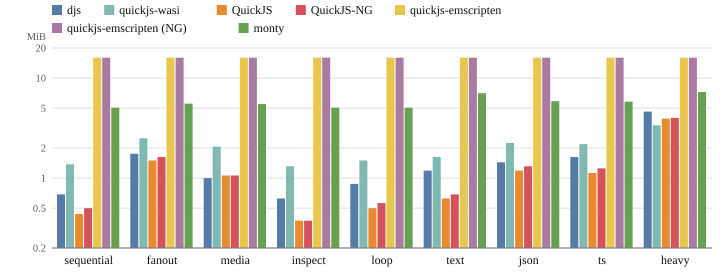
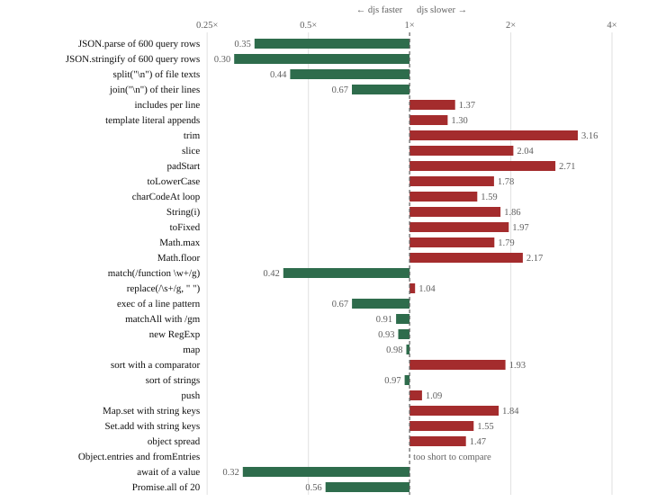
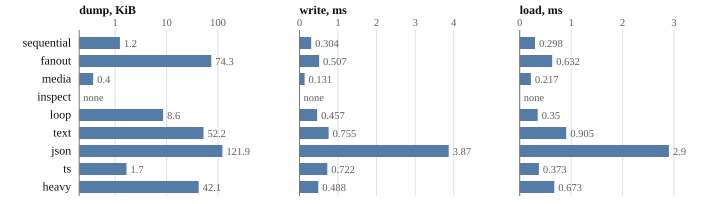

# Benchmarks

How fast does djs start, run and dump the scripts an agent writes, and what does it cost
in download and memory, next to the QuickJS builds a host would otherwise embed? This
page compares them on workloads modeled on real agent codemode sessions, all in
WebAssembly, the way a host runs them, and says how to re-run every number.

> **In short.** Seven engines (djs, four QuickJS builds of both QuickJS lines, and monty,
> a Python subset) run nine codemode workloads in wasm in one node process, each run in a
> fresh VM, and must all return the same result. djs starts a VM fastest and has the
> lowest run time over the set; it is ahead where scripts move JSON, strings and tool
> results, and behind on the smallest bodies and on some single string builtins. Its
> module is the largest of the JavaScript engines and it takes more memory than the
> QuickJS releases built here, and its dumps of a paused run are kilobytes, written or
> loaded in under a millisecond for most workloads. `scripts/bench-engines.sh` fetches,
> builds and runs everything; the tables are generated from the recorded results.

## What is measured, and why this way

An agent's codemode body is short and makes a few tool calls: it reads files, runs
commands, reshapes their output and prints a summary. The engine's own work is small, so
what a host pays is mostly starting a VM, passing tool results in and out, parsing the
body and assembling strings. The comparison measures exactly that, as an embedder sees it:

- **Everything in wasm, in one host.** Every engine is a wasm module run by node: the
  build a host would ship, not a native binary. Each module is compiled once per process,
  as a host keeps a compiled module.
- **A fresh VM per run.** Every run gets a new instance and VM, isolated from the others,
  as a host gives each tool call its own sandbox. *New VM* is the time to get one ready;
  *run* is the time from handing it the script to having the result string.
- **A warm process.** The times are medians of 25 runs after 3 warm-up runs, so node has
  optimized each engine's code, as in a host that has been running for a while.
- **The same tool bridge.** Tool answers are recorded once and handed to every engine as
  one JSON string; inside the engine, each tool call turns its arguments into JSON to find
  its answer and parses the answer's JSON text. That is the work a host bridge does, and it
  is the same code in every engine, so the comparison measures the engines and not their
  host interfaces.
- **The same answer.** Every engine's result must be the string node computes for the same
  script, or the run fails.
- **Memory** is the instance's linear memory after the run. Wasm memory never shrinks, so
  that is the run's high-water mark, allocator overhead included.

Times depend on the machine and its load; the tables say when and at what load they were
taken. Instruction counts would not compare across engines with different hosts, so the
page gives wall-clock medians.

## The engines

| engine | what it is | how it is built here |
| --- | --- | --- |
| djs | this engine, the shipped module | [`scripts/build-wasm.sh`](../../scripts/build-wasm.sh) |
| quickjs-wasi | QuickJS-NG for WASI with snapshot support, version 3.6.2 | the npm package's `quickjs.wasm` |
| QuickJS | Bellard's QuickJS 2026-06-04, the latest release | wasi-sdk 34, `-O2`, a minimal embedding |
| QuickJS-NG | QuickJS-NG 0.18.0, the latest release | the same: wasi-sdk 34, `-O2`, the same embedding |
| quickjs-emscripten | the popular emscripten build, version 0.32.0, of Bellard's QuickJS 2025-09-13 | the npm variant `@jitl/quickjs-wasmfile-release-sync` |
| quickjs-emscripten (NG) | the same package with QuickJS-NG 0.12.1 | the npm variant `@jitl/quickjs-ng-wasmfile-release-sync` |
| monty | pydantic's Python subset for code written by models, version 1.3.0 | the npm package's wasm component |

The two latest QuickJS releases are built by the script with one compiler, the same flags
and the same small embedding ([`js/bench/engines/driver.c`](../../js/bench/engines/driver.c)):
a runtime, a context, an evaluation that runs the job queue dry, and a result string.
monty runs the workloads translated to Python by hand; its component is instantiated on
the calling thread with no filesystem, environment or network, as its own worker does.

## The workloads

The workload set ([`tests/bench/codemode/`](../../tests/bench/codemode/)) was derived from
about three thousand codemode bodies of agent sessions: they were grouped into clusters by
what they do, and each cluster got one synthetic body of its typical size and operation
mix. The data the tools return is invented: source-like files, command output, search
results, query rows, an image.

| workload | share of bodies | what it does |
| --- | ---: | --- |
| `sequential` | 30% | a read, an edit batch with large literal arguments, two commands |
| `fanout` | 22% | twelve reads and three checks with `Promise.all`, joined and cut to an output budget |
| `media` | 13% | render a view, read the image, hand a 200 KB data URL to the host |
| `inspect` | 9% | no tools: group and search the tool catalog |
| `loop` | 8% | eight searches one after another, each result formatted with a regular expression |
| `text` | 8% | parse grep-like output, group by file, scan files for markers and definitions |
| `json` | 7% | group 600 query rows, rewrite a package manifest |
| `ts` | 2% | the `json` shape in TypeScript (djs runs it as is; the other engines get it with the types stripped by the host) |
| `heavy` | the largest 1% | 97 calls: 96 file reads in batches with per-file regular expression work |

A typical body is about 500 characters and makes three tool calls; the workloads sit at or
a little above their cluster's median, so that the engines' work shows.

## Download size

What a host ships: the wasm module, and the JavaScript some builds need around it.

<!-- gen:status engines-size -->


| engine | wasm | gzip | brotli | JS glue, gzip |
| --- | ---: | ---: | ---: | ---: |
| djs | 980 KB | 427 KB | 360 KB | none |
| quickjs-wasi | 637 KB | 287 KB | 247 KB | 28 KB |
| QuickJS | 964 KB | 331 KB | 262 KB | none |
| QuickJS-NG | 1,085 KB | 371 KB | 295 KB | none |
| quickjs-emscripten | 503 KB | 231 KB | 199 KB | 8 KB |
| quickjs-emscripten (NG) | 529 KB | 247 KB | 212 KB | 8 KB |
| monty | 24,593 KB | 7,628 KB | 4,804 KB | 55 KB |

Module bytes as shipped; gzip -9, brotli quality 11; measured at 8175610deb, 2026-11-06,
load 3.3.
<!-- /gen -->

djs's module is the largest of the JavaScript engines: it carries the TypeScript front
end and the base image of an initialized realm (every builtin object, coded to
<!--n wasm/base-coded kb-->46 KB<!--/n-->), which spares each new VM from building them.
quickjs-wasi and the emscripten builds are optimized for size; the two releases built
here use `-O2`, as djs's module is optimized for speed. monty's module is a different
order of size altogether: a Python interpreter with its standard library subset and a
type checker.

## Starting a VM

A host that gives every call a fresh VM pays this on every call.

<!-- gen:status engines-startup -->


| engine | compile, ms | new VM, ms | idle VM memory, MiB |
| --- | ---: | ---: | ---: |
| djs | 1.09 | 0.12 | 0.6 |
| quickjs-wasi | 3.25 | 0.24 | 1.3 |
| QuickJS | 3.37 | 0.20 | 0.3 |
| QuickJS-NG | 2.50 | 0.26 | 0.4 |
| quickjs-emscripten | 1.10 | 0.23 | 16.0 |
| quickjs-emscripten (NG) | 4.89 | 0.29 | 16.0 |
| monty | 31.1 | 0.53 | 3.9 |

Compile: the module, once per process. New VM: a new instance and VM, ready to evaluate
(median). Memory: linear memory; measured at 8175610deb, 2026-11-06, load 3.3.
<!-- /gen -->

A new djs VM is ready in <!--n engines/djs/startup-ms .2-->0.12<!--/n--> ms, against
<!--n engines/quickjs/startup-ms .2-->0.20<!--/n--> ms for QuickJS and
<!--n engines/quickjs-ng/startup-ms .2-->0.26<!--/n--> ms for QuickJS-NG: the realm
comes from the base image in the module, so creating a VM copies an image instead of
running the code that builds every builtin (the [snapshots page](snapshots.md) says
how). Its idle memory is above the QuickJS releases': the base image is larger than the
heap a fresh QuickJS context allocates, and djs reserves a larger native stack, which
sets how deeply its parser may nest. The emscripten builds start at 16 MiB, emscripten's
initial heap, whatever runs in them.

## Run time

The time from handing a fresh VM the script and its tool answers to having the result:
parsing and compiling the body, the tool calls through the bridge, and the script's work.

<!-- gen:status engines-run -->


| workload | djs | quickjs-wasi | QuickJS | QuickJS-NG | quickjs-emscripten | quickjs-emscripten (NG) | monty |
| --- | ---: | ---: | ---: | ---: | ---: | ---: | ---: |
| sequential | 0.42 | 0.38 | 0.36 | 0.37 | 0.40 | 0.40 | 0.56 |
| fanout | 1.03 | 1.62 | 1.22 | 1.15 | 1.79 | 1.69 | 1.42 |
| media | 0.29 | 0.47 | 0.93 | 0.45 | 1.50 | 0.96 | 0.81 |
| inspect | 0.26 | 0.23 | 0.20 | 0.20 | 0.29 | 0.31 | 0.63 |
| loop | 0.77 | 2.61 | 0.85 | 2.13 | 1.11 | 4.39 | 1.65 |
| text | 1.46 | 1.67 | 1.54 | 1.46 | 1.89 | 2.40 | 2.89 |
| json | 1.68 | 2.15 | 1.78 | 1.90 | 2.63 | 2.74 | 3.54 |
| ts | 2.04 | 2.32 | 1.97 | 2.13 | 2.93 | 3.01 | 2.73 |
| heavy | 11.5 | 15.6 | 15.3 | 16.3 | 18.7 | 29.3 | 11.7 |
| relative to djs | 1.00× | 1.36× | 1.17× | 1.21× | 1.60× | 1.93× | 1.76× |

Milliseconds per run (median), in a warm process; the last row is the geometric mean of
each engine's time over djs's; measured at 8175610deb, 2026-11-06, load 3.3.
<!-- /gen -->

djs has the lowest time over the set, and the largest leads where a body moves data:
`fanout`, `json` and `media` pass large tool results through `JSON.parse` and strings
(djs parses and writes JSON in about a third of QuickJS's time, see the operations
below), and `heavy` spends most of its time splitting, matching and scanning file texts.
`loop` is a regular expression replace over prose in a loop, where Bellard's QuickJS is
close and QuickJS-NG and quickjs-wasi are far behind. djs is behind on the shortest
bodies, `sequential` and `inspect`, by a few hundredths of a millisecond: compiling the
body costs about the same in both, and what is left is a handful of small builtin calls
(`Object.entries`, `toFixed`), each dearer in djs (below). On `ts` djs compiles the
TypeScript itself, while the other engines get JavaScript whose types the host stripped
beforehand, outside the timing. monty is fast on `heavy`, whose string splitting and
regular expressions are native in its Rust implementation, and slower on the rest; its
times include the same JSON bridge in Python.

## Memory

The instance's linear memory after the run: what the run cost, since wasm memory does not
shrink.

<!-- gen:status engines-memory -->


| workload | djs | quickjs-wasi | QuickJS | QuickJS-NG | quickjs-emscripten | quickjs-emscripten (NG) | monty |
| --- | ---: | ---: | ---: | ---: | ---: | ---: | ---: |
| sequential | 0.7 | 1.4 | 0.4 | 0.4 | 16.0 | 16.0 | 5.1 |
| fanout | 1.8 | 2.5 | 1.6 | 1.6 | 16.0 | 16.0 | 5.6 |
| media | 1.0 | 2.1 | 1.1 | 1.1 | 16.0 | 16.0 | 5.5 |
| inspect | 0.6 | 1.3 | 0.4 | 0.4 | 16.0 | 16.0 | 5.1 |
| loop | 0.9 | 1.5 | 0.5 | 0.6 | 16.0 | 16.0 | 5.1 |
| text | 1.2 | 1.6 | 0.6 | 0.7 | 16.0 | 16.0 | 7.1 |
| json | 1.4 | 2.2 | 1.1 | 1.3 | 16.0 | 16.0 | 5.9 |
| ts | 1.6 | 2.2 | 1.1 | 1.2 | 16.0 | 16.0 | 5.8 |
| heavy | 4.6 | 3.4 | 2.4 | 2.4 | 16.0 | 16.0 | 7.2 |
| relative to djs | 1.00× | 1.53× | 0.68× | 0.72× | 12.62× | 12.62× | 4.54× |

Linear memory after the run, MiB; the last row is the geometric mean of each engine's
over djs's; measured at 8175610deb, 2026-11-06, load 3.3.
<!-- /gen -->

djs needs more memory than the QuickJS releases built here and less than quickjs-wasi,
monty and the emscripten builds. Part of the gap is constant: the larger idle footprint
above. The rest comes from the garbage collector. djs's collector traces the live heap
when the allocation since the last collection crosses a threshold, about as large again
as what survived, so garbage stays until then; QuickJS counts references and frees most
garbage the moment it is dropped. `heavy`, which allocates a few megabytes of
short-lived lines and strings, shows it most.

## Operation by operation

Single operations on data shaped like the workloads', each in a loop, against the faster
of the two QuickJS releases. Above 1, djs is slower.

<!-- gen:status engines-ops -->


| operation | djs, ms | QuickJS, ms | djs / QuickJS |
| --- | ---: | ---: | ---: |
| `JSON.parse` of 600 query rows | 0.95 | 2.90 | 0.33 |
| `JSON.stringify` of 600 query rows | 0.92 | 3.19 | 0.29 |
| `split("\n")` of file texts | 1.22 | 2.89 | 0.42 |
| `join("\n")` of their lines | 0.48 | 0.94 | 0.51 |
| `includes` per line | 2.98 | 2.77 | 1.07 |
| template literal appends | 5.55 | 4.51 | 1.23 |
| `trim` | 11.0 | 3.93 | 2.80 |
| `slice` | 7.76 | 4.02 | 1.93 |
| `padStart` | 8.22 | 3.29 | 2.50 |
| `toLowerCase` | 18.5 | 10.8 | 1.71 |
| `charCodeAt` loop | 9.94 | 6.40 | 1.55 |
| `String(i)` | 6.00 | 3.51 | 1.71 |
| `toFixed` | 5.92 | 3.27 | 1.81 |
| `Math.max` | 0.56 | 0.52 | 1.08 |
| `Math.floor` | 5.77 | 2.65 | 2.18 |
| `match(/function \w+/g)` | 2.04 | 5.13 | 0.40 |
| `replace(/\s+/g, " ")` | 8.09 | 7.90 | 1.02 |
| `exec` of a line pattern | 9.31 | 13.3 | 0.70 |
| `matchAll` with `/gm` | 4.76 | 5.45 | 0.87 |
| `new RegExp` | 1.44 | 1.87 | 0.77 |
| `map` | 3.28 | 3.46 | 0.95 |
| `sort` with a comparator | 11.2 | 6.00 | 1.87 |
| `sort` of strings | 2.15 | 2.49 | 0.87 |
| `push` | 8.21 | 7.90 | 1.04 |
| `Map.set` with string keys | 18.2 | 10.2 | 1.78 |
| `Set.add` with string keys | 10.8 | 7.33 | 1.48 |
| object spread | 6.26 | 4.63 | 1.35 |
| `Object.entries` and `fromEntries` | 0.27 | 0.12 | 2.32 |
| `await` of a value | 5.33 | 16.8 | 0.32 |
| `Promise.all` of 20 | 4.25 | 7.99 | 0.53 |

Milliseconds per loop of the operation (js/bench/engines/ops.ts), the setup's time
subtracted; QuickJS: the faster of the two latest releases; measured at 8175610deb,
2026-11-06, load 2.8.
<!-- /gen -->

JSON, splitting and joining, regular expression matching, sorting strings, `await` and
`Promise.all` are faster in djs. What is still slower is a group of small string and
number builtins (`trim`, `padStart`, `slice`, `toLowerCase`, `String(i)`, `toFixed`,
`Object.entries`, `Math.floor`): djs writes most builtins in a TypeScript subset
compiled to its own bytecode, and although the common ones take a fast path, a call
still costs more instructions than a call of QuickJS's C functions, which shows when the
operation itself is tiny. `sort` with a comparator runs the comparator, a script
function, for every comparison, and calling it from the sort still costs more than in
QuickJS; `Map.set` and `Set.add` with string keys also take more instructions per call.
These matter in a loop of tens of thousands of calls; in the workloads they are a small
part of the time.

## Dumps

djs can write a run that waits on tool calls as a [continuation dump](dumps.md) and
continue it later in a new sandbox. Here every workload runs through the sandbox with
asynchronous host tools and is dumped at every idle point, every time it waits on a call:

<!-- gen:status engines-dumps -->


| workload | idle points | dump, KiB (max) | gzip, KiB (max) | write, ms | load, ms |
| --- | ---: | ---: | ---: | ---: | ---: |
| sequential | 4 | 1.2 (2.3) | 0.6 (0.9) | 0.30 | 0.30 |
| fanout | 15 | 74.3 (139.1) | 17.1 (33.5) | 0.51 | 0.63 |
| media | 2 | 0.4 (0.4) | 0.3 (0.3) | 0.13 | 0.22 |
| inspect | 0 | | | | |
| loop | 8 | 8.6 (15.5) | 3.1 (5.2) | 0.46 | 0.35 |
| text | 5 | 52.2 (53.0) | 9.2 (9.4) | 0.76 | 0.91 |
| json | 3 | 121.9 (122.0) | 20.5 (20.6) | 3.87 | 2.90 |
| ts | 1 | 1.7 (1.7) | 0.8 (0.8) | 0.72 | 0.37 |
| heavy | 97 | 42.1 (114.9) | 10.3 (25.2) | 0.49 | 0.67 |

Medians over a workload's idle points; load: a new sandbox with the run loaded; measured
at 8175610deb, 2026-11-06, load 3.3.
<!-- /gen -->

Most dumps are a few kilobytes, and gzip takes the larger ones to between a fifth and a
third; they hold the run's live state, so a dump taken while `json` holds 600 query
rows, or while `fanout` holds the file texts it has read, is as large as that data.
Writing one and loading it into a new sandbox takes about as long as starting a VM and
running a small body; the `json` dumps take longest, as they encode and decode the most
objects. `inspect` makes no tool call, so it never waits and has nothing to dump.

## Re-running

```sh
scripts/bench-engines.sh          # fetch and build the engines, run, print the tables
scripts/bench-engines.sh --setup  # fetch and build only
scripts/status.py engines         # three runs; record the medians for this page
cargo run -q -p djs-docs -- regen # rewrite the tables
```

The engines go into `vendor/engines` of the primary checkout: npm packages pinned with
their integrity hashes by
[`js/bench/engines/package-lock.json`](../../js/bench/engines/package-lock.json), wasi-sdk
and the QuickJS release sources pinned by SHA-256 in
[`scripts/bench-engines.sh`](../../scripts/bench-engines.sh). Run it on a quiet machine:
the harness prints the load it started at, and recorded numbers should come from a load
below about 4.

## Where to look

- [`js/bench/engines/run.ts`](../../js/bench/engines/run.ts): the harness, what it times and how
- [`js/bench/engines/engines.ts`](../../js/bench/engines/engines.ts): each engine behind one interface
- [`js/bench/engines/prelude.js`](../../js/bench/engines/prelude.js),
  [`prelude.py`](../../js/bench/engines/prelude.py): the stub tools inside the engines
- [`tests/bench/codemode/`](../../tests/bench/codemode/): the workloads, their Python
  translations and [`tools.ts`](../../tests/bench/codemode/tools.ts), the invented tool data
- [`scripts/bench-engines.sh`](../../scripts/bench-engines.sh): fetching and building the engines
