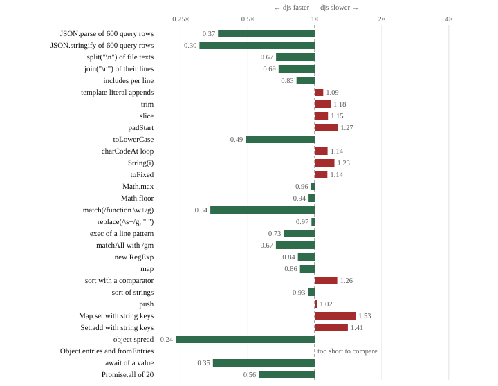
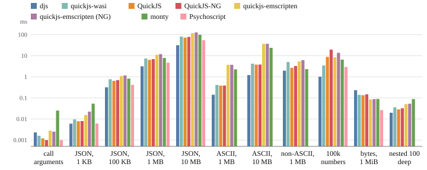
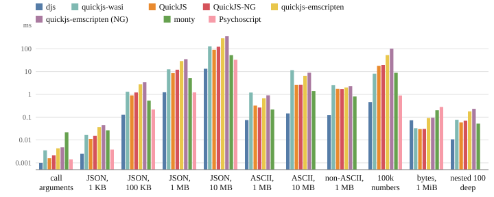

# Benchmarks

How fast does djs start and run the scripts an agent writes, and what does it cost
in download and memory, next to the engines a host would otherwise embed? This page
compares them on workloads modeled on real agent codemode sessions, in WebAssembly the
way a host runs them (and one engine written in JavaScript), shows how each copes with
scripts that never end or exhaust memory, and says how to re-run every number.

> **In short.** Eight engines run nine codemode workloads in one node process, each run
> in a fresh VM, and must all return the same result: djs, four QuickJS builds of both
> QuickJS lines and monty, a Python subset, all in wasm, and Psychoscript, an interpreter
> written in JavaScript that runs in the host's own engine. djs starts a VM fastest of
> the wasm engines and has the lowest run time over the set; it is ahead where scripts
> move JSON, strings and tool results, and behind on the smallest bodies and on some
> single string and number builtins. Passing data through the host bridge, each engine
> its best way, djs takes values in about twice as fast as the QuickJS builds and reads
> them out six to nine times as fast; it is behind on bytes coming in and on many tiny
> calls, and Psychoscript, which shares the host's strings, passes strings without a copy.
> Its module is the largest of the JavaScript engines in wasm, and it takes about a tenth
> more memory than the QuickJS releases built here over the set. Under a one-second
> budget and a 64 MiB heap cap, djs and the other wasm engines end every runaway script
> they were given and go on with a fresh VM (two builds overshoot the heap cap);
> Psychoscript, which has no memory limit and cannot interrupt a regular expression
> match, lets a growing array take <!--n traps/psychoscript/grow/rss mib.0-->1,430 MiB<!--/n-->
> of the host's memory and blocks its host on a backtracking pattern until it is killed.
> `scripts/bench-engines.sh` fetches, builds and runs everything; the tables and charts
> are generated from the recorded results.

## What is measured, and why this way

An agent's codemode body is short and makes a few tool calls: it reads files, runs
commands, reshapes their output and prints a summary. The engine's own work is small, so
what a host pays is mostly starting a VM, passing tool results in and out, parsing the
body and assembling strings. The comparison measures exactly that, as an embedder sees it:

- **Everything in wasm, in one host.** Every engine but one is a wasm module run by node:
  the build a host would ship, not a native binary. Each module is compiled once per
  process, as a host keeps a compiled module. Psychoscript is the exception: it is
  JavaScript, so node's own engine compiles and runs it, with its JIT and its garbage
  collector, and it has no module and no linear memory of its own. The columns about the
  module and its memory say what they mean for it.
- **A fresh VM per run.** Every run gets a new instance and VM, isolated from the others,
  as a host gives each tool call its own sandbox. *New VM* is the time to get one ready;
  *run* is the time from handing it the script to having the result string.
- **A warm process.** The times are medians of 25 runs after 3 warm-up runs, so node has
  optimized each engine's code, as in a host that has been running for a while.
- **The same tool bridge.** Tool answers are recorded once and handed to every engine as
  one JSON string; inside the engine, each tool call turns its arguments into JSON to find
  its answer and parses the answer's JSON text. That is the work a host bridge does, and it
  is the same code in every engine, so the comparison measures the engines and not their
  host interfaces. [Passing data through the bridge](#passing-data-through-the-bridge)
  compares the host interfaces.
- **The same answer.** Every engine's result must be the string node computes for the same
  script, or the run fails.
- **Memory** is the instance's linear memory after the run. Wasm memory never shrinks, so
  that is the run's high-water mark, allocator overhead included. Psychoscript's values
  live in the host's heap among the host's own, where no measure would compare, so it has
  no memory numbers (except where a runaway script makes the host's memory grow).

Times depend on the machine and its load; the tables say when and at what load they were
taken. Instruction counts would not compare across engines with different hosts, so the
page gives wall-clock medians.

## The engines

| engine | what it is | how it is built here |
| --- | --- | --- |
| djs | this engine, the shipped module | [`scripts/build-wasm.sh`](../../scripts/build-wasm.sh) |
| quickjs-wasi | QuickJS-NG for WASI, which can save and restore its memory, version 3.6.2 | the npm package's `quickjs.wasm` |
| QuickJS | Bellard's QuickJS 2026-06-04, the latest release | wasi-sdk 34, `-O2`, a minimal embedding |
| QuickJS-NG | QuickJS-NG 0.18.0, the latest release | the same: wasi-sdk 34, `-O2`, the same embedding |
| quickjs-emscripten | the popular emscripten build, version 0.32.0, of Bellard's QuickJS 2025-09-13 | the npm variant `@jitl/quickjs-wasmfile-release-sync` |
| quickjs-emscripten (NG) | the same package with QuickJS-NG 0.12.1 | the npm variant `@jitl/quickjs-ng-wasmfile-release-sync` |
| monty | pydantic's Python subset for code written by models, version 1.3.0 | the npm package's wasm component |
| Psychoscript | anomaly's "confined, resumable JavaScript interpreter", version 0.4.0: a strict-mode subset of JavaScript compiled to bytecode and run by a VM written in JavaScript | the npm package as published, no wasm, run by node's engine |

The two latest QuickJS releases are built by the script with one compiler, the same flags
and the same small embedding ([`js/bench/engines/driver.c`](../../js/bench/engines/driver.c)):
a runtime, a context, an evaluation that runs the job queue dry, and a result string.
monty runs the workloads translated to Python by hand; its component is instantiated on
the calling thread with no filesystem, environment or network, as its own worker does.
Psychoscript runs the codemode bodies as given, top-level `await` and `return` included,
with a fresh `Runtime` for every run: the tool answers go in as a binding, the result
string comes back as the run's value. Everything the workloads use is in its subset;
TypeScript it gets with the types stripped by the host, as the QuickJS builds do. Its
isolation is of another kind than the others': a program reaches only the host functions
it is given, but it runs on the host's thread and in the host's heap, where the wasm
engines keep everything inside their instance's memory.

## The workloads

The workload set ([`tests/bench/codemode/`](../../tests/bench/codemode/)) was derived from
about three thousand codemode bodies of agent sessions: they were grouped into clusters by
what they do, and each cluster got one synthetic body of its typical size and operation
mix. The data the tools return is invented: source-like files, command output, search
results, query rows, an image.

| workload | share of bodies | what it does |
| --- | ---: | --- |
| `sequential` | 30% | a read, an edit batch with large literal arguments, two commands |
| `fanout` | 22% | twelve reads and three checks with `Promise.all`, joined and cut to an output budget |
| `media` | 13% | render a view, read the image, hand a 200 KB data URL to the host |
| `inspect` | 9% | no tools: group and search the tool catalog |
| `loop` | 8% | eight searches one after another, each result formatted with a regular expression |
| `text` | 8% | parse grep-like output, group by file, scan files for markers and definitions |
| `json` | 7% | group 600 query rows, rewrite a package manifest |
| `ts` | 2% | the `json` shape in TypeScript (djs runs it as is; the other engines get it with the types stripped by the host) |
| `heavy` | the largest 1% | 97 calls: 96 file reads in batches with per-file regular expression work |

A typical body is about 500 characters and makes three tool calls; the workloads sit at or
a little above their cluster's median, so that the engines' work shows.

## Download size

What a host ships: the wasm module, and the JavaScript some builds need around it.

<!-- gen:status engines-size -->


| engine | wasm | gzip | brotli | JS glue, gzip |
| --- | ---: | ---: | ---: | ---: |
| djs | 995 KB | 431 KB | 364 KB | none |
| quickjs-wasi | 637 KB | 287 KB | 247 KB | 28 KB |
| QuickJS | 966 KB | 332 KB | 262 KB | none |
| QuickJS-NG | 1,087 KB | 371 KB | 295 KB | none |
| quickjs-emscripten | 503 KB | 231 KB | 199 KB | 8 KB |
| quickjs-emscripten (NG) | 529 KB | 247 KB | 212 KB | 8 KB |
| monty | 24,593 KB | 7,628 KB | 4,804 KB | 55 KB |
| Psychoscript | none | | | 303 KB |

Module bytes as shipped; gzip -9, brotli quality 11. Psychoscript has no wasm: its
column of JS is all of its code, its package's modules and acorn's as published (1,199
KB raw, 254 KB with brotli); measured at c81310b606, 2026-11-21; d0bc2eef16, 2026-11-21;
e78e71dd08, 2026-11-28, load 3.1 (Psychoscript: 3.5).
<!-- /gen -->

djs's module is the largest of the JavaScript engines: it carries the TypeScript front
end and the base image of an initialized realm (every builtin object, coded to
<!--n wasm/base-coded kb-->45 KB<!--/n-->), which spares each new VM from building them.
quickjs-wasi and the emscripten builds are optimized for size; the two releases built
here use `-O2`, as djs's module is optimized for speed. monty's module is a different
order of size altogether: a Python interpreter with its standard library subset and a
type checker. Psychoscript ships no wasm: what a host downloads is its JavaScript, the
package's modules with its prelude's bytecode and the acorn parser, unminified as
published; a bundler's minifier would make it smaller.

## Starting a VM

A host that gives every call a fresh VM pays this on every call.

<!-- gen:status engines-startup -->


| engine | compile, ms | new VM, ms | idle VM memory, MiB |
| --- | ---: | ---: | ---: |
| djs | 1.14 | 0.07 | 0.4 |
| quickjs-wasi | 5.27 | 0.24 | 1.3 |
| QuickJS | 5.16 | 0.20 | 0.3 |
| QuickJS-NG | 1.99 | 0.26 | 0.4 |
| quickjs-emscripten | 1.15 | 0.24 | 16.0 |
| quickjs-emscripten (NG) | 6.82 | 0.28 | 16.0 |
| monty | 31.7 | 0.56 | 3.9 |
| Psychoscript | 18.0 | 0.00 | n/a |

Compile: the module, once per process (Psychoscript: importing its JavaScript). New VM:
a new instance and VM, ready to evaluate (median; Psychoscript: a `Runtime`, which
builds the realm in each run). Memory: linear memory (Psychoscript has none: it lives in
the host's heap); measured at d0bc2eef16, 2026-11-21; e78e71dd08, 2026-11-28, load 3.1
(Psychoscript: 3.5).
<!-- /gen -->

A new djs VM is ready in <!--n engines/djs/startup-ms .2-->0.07<!--/n--> ms, against
<!--n engines/quickjs/startup-ms .2-->0.20<!--/n--> ms for QuickJS and
<!--n engines/quickjs-ng/startup-ms .2-->0.26<!--/n--> ms for QuickJS-NG: the realm
comes from the base image in the module, so creating a VM copies an image instead of
running the code that builds every builtin (the [images page](images.md) says
how). Its idle memory equals QuickJS-NG's and is one 64 KiB page above QuickJS's: the
base image is larger than the heap a fresh QuickJS context allocates. The emscripten
builds start at 16 MiB, emscripten's initial heap, whatever runs in them.

Psychoscript's two numbers mean something else. Its *compile* is importing its
JavaScript, which node parses and compiles as it goes. Its *new VM* is creating a
`Runtime`, an object that holds the options: the realm of a run is built when the run
starts, so that cost is part of its run times below, and it has no memory of its own to
show.

## Run time

The time from handing a fresh VM the script and its tool answers to having the result:
parsing and compiling the body, the tool calls through the bridge, and the script's work.

<!-- gen:status engines-run -->


| workload | djs | quickjs-wasi | QuickJS | QuickJS-NG | quickjs-emscripten | quickjs-emscripten (NG) | monty | Psychoscript |
| --- | ---: | ---: | ---: | ---: | ---: | ---: | ---: | ---: |
| sequential | 0.38 | 0.37 | 0.37 | 0.38 | 0.41 | 0.37 | 0.61 | 0.63 |
| fanout | 0.84 | 1.57 | 1.22 | 1.13 | 1.78 | 1.65 | 1.43 | 0.98 |
| media | 0.20 | 0.47 | 0.91 | 0.43 | 1.49 | 0.98 | 0.81 | 0.45 |
| inspect | 0.24 | 0.23 | 0.20 | 0.19 | 0.29 | 0.31 | 0.65 | 0.45 |
| loop | 0.70 | 2.60 | 0.83 | 2.10 | 1.11 | 4.38 | 1.66 | 0.74 |
| text | 1.24 | 1.65 | 1.49 | 1.44 | 1.90 | 2.39 | 2.90 | 1.71 |
| json | 1.39 | 2.12 | 1.79 | 1.88 | 2.65 | 2.74 | 3.54 | 2.32 |
| ts | 1.75 | 2.31 | 1.97 | 2.10 | 2.94 | 2.99 | 2.74 | 3.17 |
| heavy | 8.87 | 15.6 | 15.0 | 16.3 | 19.0 | 29.4 | 11.9 | 20.1 |
| relative to djs | 1.00× | 1.60× | 1.38× | 1.42× | 1.90× | 2.27× | 2.12× | 1.62× |

Milliseconds per run (median), in a warm process; the last row is the geometric mean of
each engine's time over djs's; measured at d0bc2eef16, 2026-11-21; e78e71dd08,
2026-11-28, load 3.1 (Psychoscript: 3.5).
<!-- /gen -->

djs has the lowest time over the set, and the largest leads where a body moves data:
`fanout`, `json` and `media` pass large tool results through `JSON.parse` and strings
(djs parses and writes JSON in about a third of QuickJS's time, see the operations
below), and `heavy` spends most of its time splitting, matching and scanning file texts.
`loop` is a regular expression replace over prose in a loop, where Bellard's QuickJS is
close and QuickJS-NG and quickjs-wasi are far behind. djs is behind on the shortest
bodies, `sequential` and `inspect`, by a few hundredths of a millisecond: compiling the
body costs about the same in both, and what is left is a handful of small builtin calls
(`Object.entries`, `toFixed`), each dearer in djs (below). On `ts` djs compiles the
TypeScript itself, while the other engines get JavaScript whose types the host stripped
beforehand, outside the timing. monty is fast on `heavy`, whose string splitting and
regular expressions are native in its Rust implementation, and slower on the rest; its
times include the same JSON bridge in Python.

Psychoscript comes out at about the speed of quickjs-wasi over the set, with a different
profile. It is second to djs on `fanout`, `media` and `loop`: it is JavaScript that node's
JIT has compiled after the warm-up runs, and its regular expressions run on the host
engine's own matcher. It is behind the QuickJS releases on the bodies that do the most
work in the interpreter itself, `json`, `ts` and `heavy`, and on the shortest ones,
where building the realm of every run shows.

## Memory

The instance's linear memory after the run: what the run cost, since wasm memory does not
shrink.

<!-- gen:status engines-memory -->


| workload | djs | quickjs-wasi | QuickJS | QuickJS-NG | quickjs-emscripten | quickjs-emscripten (NG) | monty | Psychoscript |
| --- | ---: | ---: | ---: | ---: | ---: | ---: | ---: | ---: |
| sequential | 0.5 | 1.4 | 0.4 | 0.4 | 16.0 | 16.0 | 5.1 | n/a |
| fanout | 1.4 | 2.5 | 1.6 | 1.6 | 16.0 | 16.0 | 5.6 | n/a |
| media | 0.8 | 2.1 | 1.1 | 1.1 | 16.0 | 16.0 | 5.5 | n/a |
| inspect | 0.4 | 1.3 | 0.4 | 0.4 | 16.0 | 16.0 | 5.1 | n/a |
| loop | 0.6 | 1.5 | 0.5 | 0.6 | 16.0 | 16.0 | 5.1 | n/a |
| text | 0.9 | 1.6 | 0.6 | 0.7 | 16.0 | 16.0 | 7.1 | n/a |
| json | 1.2 | 2.2 | 1.1 | 1.3 | 16.0 | 16.0 | 5.9 | n/a |
| ts | 1.3 | 2.2 | 1.1 | 1.2 | 16.0 | 16.0 | 5.8 | n/a |
| heavy | 3.9 | 3.4 | 2.4 | 2.4 | 16.0 | 16.0 | 7.2 | n/a |
| relative to djs | 1.00× | 1.99× | 0.89× | 0.94× | 16.45× | 16.45× | 5.92× | n/a |

Linear memory after the run, MiB; the last row is the geometric mean of each engine's
over djs's; Psychoscript has no linear memory; measured at d0bc2eef16, 2026-11-21, load
3.1 (Psychoscript: 3.5).
<!-- /gen -->

Over the set djs needs about a tenth more memory than the QuickJS releases built here,
and half of quickjs-wasi's or less, a fraction of monty's and the emscripten builds'. Where
a body holds large tool results (`fanout`, `media`) djs needs less than the QuickJS
releases; on the small bodies it is level or a page above, the idle footprint. The gap
on `text` and `heavy` comes from the garbage collector. djs's collector traces the live
heap when the allocation since the last collection crosses a threshold, about as large
again as what survived, so garbage stays until then; QuickJS counts references and frees
most garbage the moment it is dropped. `heavy`, which allocates a few megabytes of
short-lived lines and strings, shows it most.

Psychoscript has no column of numbers here: its objects are the host's JavaScript
objects in the host's heap, collected by the host's collector, and the only measure,
the growth of the whole process's heap, would mix them with the host's own allocation
and depend on when node's collector ran.

## Operation by operation

Single operations on data shaped like the workloads', each in a loop, against the faster
of the two QuickJS releases. Above 1, djs is slower.

<!-- gen:status engines-ops -->


| operation | djs, ms | QuickJS, ms | djs / QuickJS |
| --- | ---: | ---: | ---: |
| `JSON.parse` of 600 query rows | 1.10 | 3.00 | 0.37 |
| `JSON.stringify` of 600 query rows | 0.94 | 3.11 | 0.30 |
| `split("\n")` of file texts | 1.90 | 2.84 | 0.67 |
| `join("\n")` of their lines | 0.61 | 0.88 | 0.69 |
| `includes` per line | 2.15 | 2.60 | 0.83 |
| template literal appends | 4.85 | 4.45 | 1.09 |
| `trim` | 4.45 | 3.78 | 1.18 |
| `slice` | 4.56 | 3.98 | 1.15 |
| `padStart` | 3.95 | 3.12 | 1.27 |
| `toLowerCase` | 5.18 | 10.6 | 0.49 |
| `charCodeAt` loop | 7.39 | 6.48 | 1.14 |
| `String(i)` | 4.23 | 3.45 | 1.23 |
| `toFixed` | 3.62 | 3.18 | 1.14 |
| `Math.max` | 0.54 | 0.56 | 0.96 |
| `Math.floor` | 2.65 | 2.82 | 0.94 |
| `match(/function \w+/g)` | 1.78 | 5.25 | 0.34 |
| `replace(/\s+/g, " ")` | 7.91 | 8.19 | 0.97 |
| `exec` of a line pattern | 9.90 | 13.7 | 0.73 |
| `matchAll` with `/gm` | 3.67 | 5.49 | 0.67 |
| `new RegExp` | 1.60 | 1.90 | 0.84 |
| `map` | 3.07 | 3.58 | 0.86 |
| `sort` with a comparator | 7.61 | 6.03 | 1.26 |
| `sort` of strings | 2.27 | 2.43 | 0.93 |
| `push` | 8.05 | 7.87 | 1.02 |
| `Map.set` with string keys | 15.6 | 10.2 | 1.53 |
| `Set.add` with string keys | 9.74 | 6.92 | 1.41 |
| object spread | 1.07 | 4.50 | 0.24 |
| `Object.entries` and `fromEntries` | 0.00 | 0.11 | - |
| `await` of a value | 5.95 | 17.1 | 0.35 |
| `Promise.all` of 20 | 4.49 | 8.01 | 0.56 |

Milliseconds per loop of the operation (js/bench/engines/ops.ts), the setup's time
subtracted; QuickJS: the faster of the two latest releases; measured at d0bc2eef16,
2026-11-21, load 2.9.
<!-- /gen -->

JSON, splitting and joining, `toLowerCase`, regular expression matching, `includes`,
`map`, `new RegExp`, object spread, `await` and `Promise.all` are faster in djs;
`replace`, sorting strings, `push`, `Math.max` and `Math.floor` are at about parity. The
hot string and number builtins run as Rust that is generated from their TypeScript
source, so what is left of the gap in `trim`, `slice` and the `charCodeAt` loop is
mostly the call itself:
finding the function and leaving the interpreter's loop to run it cost more than a call
of QuickJS's C functions, which shows when the operation is tiny. `String(i)`,
`toFixed` and template literals come within about a quarter of QuickJS: integers are
written without the floating-point formatter and `toFixed` of an ordinary number
without big-integer arithmetic, and what remains is mostly allocating the short result
string. `padStart` here pads `String(i)`, so it pays for that, a second call and a
second string. `sort` with a comparator
runs the comparator, a script function, for every comparison, and calling it from the
sort still costs more than in QuickJS; `Map.set` and `Set.add` with string keys also
take more instructions per call. `Object.entries` and `fromEntries` are a fraction of a
millisecond in both. These matter in a loop of tens of thousands of calls; in the
workloads they are a small part of the time.

## Passing data through the bridge

Moving data between the host and the sandbox is what [cheap data
passing](goals.md#cheap-data-passing) is about: a tool result going in, a run's result or
a tool call's arguments coming out. The workloads above pass every tool answer the same
way in every engine, as JSON text, so that they compare the engines. This section instead
compares the bridges: each engine gets the best path its embedding offers
([`js/bench/engines/bridge.ts`](../../js/bench/engines/bridge.ts)).

| engine | value in | value out | a tool call |
| --- | --- | --- | --- |
| djs | the host encodes the value in the wire format, the VM decodes it into cells; a long ASCII string is copied straight into a string the VM reserved | the reader decodes the value out of the arena in place; the VM does nothing | the call's record names the arguments; the reader reads them, the result goes in as above |
| QuickJS, QuickJS-NG | `JSON.stringify` on the host, the UTF-8 written into linear memory, `JS_ParseJSON` there; strings by `JS_NewStringLen`, bytes as a copied `ArrayBuffer` | `JS_JSONStringify` in the VM and its UTF-8 read in place, then `JSON.parse`; strings as their UTF-8, bytes by pointer | a C function serializes its argument with `JS_JSONStringify` and calls the host, which answers with JSON text or a string |
| quickjs-wasi | JSON text parsed by `JSON.parse` in the VM, or its handle walk (`hostToHandle`) | `JSON.stringify` in the VM, or its handle walk (`dump`) | `newFunction` with the same conversions |
| quickjs-emscripten | JSON text parsed in the VM, or objects built through handles | `dump`, which is `JSON.stringify` in the VM and `JSON.parse` on the host | `newFunction` with the same conversions |
| monty | JSON text and `json.loads`, or its value arena, which the component model lowers into the module | `json.dumps`, or the value arena lifted out | an external function: the run stops, the host answers with a value arena |
| Psychoscript | a host function's result (`Host.fn`), copied into the interpreter's values; strings are the host's own strings and are not copied | a run's result, copied out; bytes cannot cross out, so they come out as base64 text the host decodes | a sync `Host.fn`: the argument copied out, the result copied in |

Where an engine has two paths, each number below is the faster one's: the handle walks of
quickjs-wasi and quickjs-emscripten win on arrays of numbers, whose decimal text is slow
to parse, and lose on most other values, and monty's JSON text beats its value arena for
anything larger than call arguments. The payloads: call
arguments; a search tool's result as an object, of 1 KB, 100 KB, 1 MB and 10 MB of JSON;
source text of 1 MB and 10 MB (ASCII) and 1 MB of prose with accented letters, dashes and
CJK; 100,000 floating-point numbers; a 1 MiB `Uint8Array`; and objects nested 100 deep
(monty's `json.loads` stops at about 200, and Psychoscript copies values at most 32
levels deep). Every value must read back equal to what went in. Each time is the median
of one operation in fresh VMs; small payloads repeat within a sample.

Psychoscript keeps no VM between runs: a value crosses only as a host function's result
or a run's result, so each of its operations is a whole run. Its *in* is a run that takes
the value from a host function less the same run with nothing to take, its *out* a run
that returns the value less the run that only takes it in, each timed alone and
alternating, the medians subtracted. Its strings show as *no copy*: they cross as the
host's own strings, and what is left of their time is the noise of two runs. Its times
are differences rather than operations, so the geometric means leave it out.

### In

<!-- gen:status bridge-in -->


| payload | size | djs | quickjs-wasi | QuickJS | QuickJS-NG | quickjs-emscripten | quickjs-emscripten (NG) | monty | Psychoscript |
| --- | ---: | ---: | ---: | ---: | ---: | ---: | ---: | ---: | ---: |
| call arguments | 102 B | 0.002 | 0.002 | 0.001 | 0.001 | 0.003 | 0.003 | 0.025 | 0.001 |
| JSON, 1 KB | 1 KB | 0.006 | 0.009 | 0.008 | 0.008 | 0.015 | 0.022 | 0.053 | 0.006 |
| JSON, 100 KB | 100 KB | 0.317 | 0.763 | 0.645 | 0.699 | 1.09 | 1.17 | 0.828 | 0.413 |
| JSON, 1 MB | 1,000 KB | 3.14 | 7.35 | 6.4 | 6.95 | 11 | 11.9 | 7.86 | 4.69 |
| JSON, 10 MB | 10,000 KB | 31.5 | 81.6 | 72.6 | 78.4 | 118 | 128 | 98.4 | 54.9 |
| ASCII, 1 MB | 1,000 KB | 0.141 | 0.413 | 0.382 | 0.387 | 3.7 | 3.71 | 2.26 | no copy |
| ASCII, 10 MB | 10,000 KB | 1.21 | 4.19 | 3.79 | 3.84 | 36.6 | 37 | 23.8 | no copy |
| non-ASCII, 1 MB | 1,000 KB | 1.96 | 5.04 | 2.67 | 3.27 | 5.41 | 6.16 | 2.31 | no copy |
| 100k numbers | 1,076 KB | 1.01 | 3.45 | 8.82 | 19.5 | 8.43 | 13.8 | 6.54 | 2.92 |
| bytes, 1 MiB | 1,049 KB | 0.232 | 0.14 | 0.134 | 0.148 | 0.084 | 0.088 | 0.089 | 0.026 |
| nested 100 deep | 4 KB | 0.02 | 0.036 | 0.029 | 0.032 | 0.051 | 0.053 | 0.088 | fails |
| relative to djs | | 1.0× | 2.0× | 1.8× | 2.0× | 3.8× | 4.2× | 4.2× | n/a |

Milliseconds per value put into a fresh VM (median), each engine's best path
(Psychoscript: a run that takes the value from a host function, less the same run
without it); the last row is the geometric mean of each engine's time over djs's;
measured at d0bc2eef16, 2026-11-21; e78e71dd08, 2026-11-28, load 3.3 (Psychoscript:
4.2).
<!-- /gen -->

djs takes JSON-like values in about half the time of the fastest QuickJS path: a 1 MB
search result in <!--n engines/bridge/djs/json-1m/in-ms .1-->3.1<!--/n--> ms against
<!--n engines/bridge/quickjs/json-1m/in-ms .1-->6.4<!--/n--> ms for QuickJS. The host writes the value once in the wire
format and the VM builds every object at its final size in one pass, where the others
serialize it to JSON text on the host and parse that text again in the VM. A long ASCII
string is one copy into a string the VM reserved for it (<!--n engines/bridge/djs/text-10m/in-ms .1-->1.2<!--/n--> ms for
10 MB, against <!--n engines/bridge/quickjs/text-10m/in-ms .1-->3.8<!--/n--> ms for QuickJS, which first encodes the text into
its linear memory and then copies it into a string). Text with non-ASCII characters
gains less: it is encoded to UTF-8 and transcoded back in the VM. Numbers gain as much,
since the wire format carries them as binary values instead of decimal text to be parsed.

Bytes are where djs is behind: a `Uint8Array` is copied into the encoder's buffer, then
into the staging buffer, then into the VM's own bytes, three copies where the others
make two. The emscripten builds pay the most for strings, because their glue
encodes them to UTF-8 in JavaScript, byte by byte.

Psychoscript copies a 1 MB search result in in
<!--n engines/bridge/psychoscript/json-1m/in-ms .1-->4.7<!--/n--> ms, between djs and the
QuickJS builds: the copy is a walk over the host's objects that builds the interpreter's,
with no text in between. Strings cost it nothing, as they are the host's own, and bytes
are one copy within the host's heap.

### Out

<!-- gen:status bridge-out -->


| payload | size | djs | quickjs-wasi | QuickJS | QuickJS-NG | quickjs-emscripten | quickjs-emscripten (NG) | monty | Psychoscript |
| --- | ---: | ---: | ---: | ---: | ---: | ---: | ---: | ---: | ---: |
| call arguments | 102 B | 0.001 | 0.004 | 0.002 | 0.002 | 0.004 | 0.005 | 0.022 | 0.001 |
| JSON, 1 KB | 1 KB | 0.003 | 0.017 | 0.011 | 0.015 | 0.036 | 0.044 | 0.027 | 0.004 |
| JSON, 100 KB | 100 KB | 0.128 | 1.31 | 0.901 | 1.21 | 2.76 | 3.4 | 0.531 | 0.217 |
| JSON, 1 MB | 1,000 KB | 1.24 | 12.6 | 8.58 | 12.1 | 28.8 | 35 | 5.21 | 1.22 |
| JSON, 10 MB | 10,000 KB | 13.3 | 128 | 90.4 | 123 | 287 | 354 | 52.5 | 32.9 |
| ASCII, 1 MB | 1,000 KB | 0.075 | 1.2 | 0.322 | 0.265 | 0.675 | 0.909 | 0.216 | no copy |
| ASCII, 10 MB | 10,000 KB | 0.146 | 11.5 | 2.64 | 2.65 | 6.47 | 8.94 | 1.4 | no copy |
| non-ASCII, 1 MB | 1,000 KB | 0.124 | 2.58 | 1.76 | 1.72 | 2.01 | 2.27 | 0.814 | no copy |
| 100k numbers | 1,076 KB | 0.459 | 8.07 | 17.9 | 19.5 | 52.8 | 101 | 8.83 | 0.893 |
| bytes, 1 MiB | 1,049 KB | 0.073 | 0.033 | 0.03 | 0.03 | 0.092 | 0.095 | 0.201 | 0.282 |
| nested 100 deep | 4 KB | 0.011 | 0.077 | 0.059 | 0.07 | 0.18 | 0.233 | 0.053 | fails |
| relative to djs | | 1.0× | 9.1× | 5.8× | 6.6× | 15.3× | 19.4× | 6.4× | n/a |

Milliseconds per value read out of a VM (median), each engine's best path (Psychoscript:
a run that returns the value, less the run that only takes it in); the last row is the
geometric mean of each engine's time over djs's; measured at d0bc2eef16, 2026-11-21;
e78e71dd08, 2026-11-28, load 3.3 (Psychoscript: 4.2).
<!-- /gen -->

Reading out is where the designs differ most. djs's reader decodes the value straight out
of the VM's memory, and the VM does no work at all; everyone else first has the VM write
the value as JSON text, copies the text out and parses it on the host. A 1 MB search
result comes out of djs in <!--n engines/bridge/djs/json-1m/out-ms .2-->1.24<!--/n--> ms, against
<!--n engines/bridge/quickjs/json-1m/out-ms .1-->8.6<!--/n--> ms for QuickJS and <!--n engines/bridge/monty/json-1m/out-ms .1-->5.2<!--/n--> ms for monty, whose
`json.dumps` is the fastest of the JSON paths here. A string comes out at the speed of a
memory copy, since its characters are already in the form a host string needs. A
`Uint8Array` is copied out in all of them; the reader's copy costs a few hundredths of a
millisecond more than reading the bytes in place by a pointer.

Psychoscript's copy out is level with djs's reader for a 1 MB result
(<!--n engines/bridge/psychoscript/json-1m/out-ms .2-->1.22<!--/n--> ms) and falls behind
for 10 MB (<!--n engines/bridge/psychoscript/json-10m/out-ms .0-->33<!--/n--> ms against
<!--n engines/bridge/djs/json-10m/out-ms .0-->13<!--/n--> ms), where the copy's garbage
is the host's to collect. Its bytes come out slowest of all, as base64 text.

### Throughput and memory

<!-- gen:status bridge-rate -->
| engine | JSON 1 MB, in | out | JSON 10 MB, in | out | ASCII 10 MB, in | out | non-ASCII 1 MB, in | out | bytes 1 MiB, in | out |
| --- | ---: | ---: | ---: | ---: | ---: | ---: | ---: | ---: | ---: | ---: |
| djs | 319 | 807 | 317 | 753 | 8,256 | 68,587 | 510 | 8,045 | 4,522 | 14,404 |
| quickjs-wasi | 136 | 80 | 123 | 78 | 2,388 | 869 | 199 | 388 | 7,495 | 31,969 |
| QuickJS | 156 | 117 | 138 | 111 | 2,641 | 3,789 | 375 | 569 | 7,837 | 34,953 |
| QuickJS-NG | 144 | 83 | 127 | 81 | 2,601 | 3,767 | 306 | 582 | 7,104 | 34,493 |
| quickjs-emscripten | 91 | 35 | 85 | 35 | 273 | 1,546 | 185 | 498 | 12,424 | 11,361 |
| quickjs-emscripten (NG) | 84 | 29 | 78 | 28 | 270 | 1,118 | 162 | 441 | 11,970 | 11,049 |
| monty | 127 | 192 | 102 | 190 | 420 | 7,127 | 432 | 1,229 | 11,782 | 5,230 |
| Psychoscript | 213 | 819 | 182 | 304 | no copy | no copy | no copy | no copy | 39,719 | 3,722 |

MB per second: the payload's size over the median time; measured at d0bc2eef16,
2026-11-21; e78e71dd08, 2026-11-28, load 3.3 (Psychoscript: 4.2).
<!-- /gen -->

<!-- gen:status bridge-memory -->
| engine | idle | JSON 10 MB in | and out | ASCII 10 MB in | and out |
| --- | ---: | ---: | ---: | ---: | ---: |
| djs | 0.4 | 42.2 | 42.2 | 14.6 | 14.6 |
| quickjs-wasi | 1.3 | 42.2 | 52.0 | 20.4 | 20.4 |
| QuickJS | 0.3 | 36.7 | 56.6 | 19.4 | 19.4 |
| QuickJS-NG | 0.4 | 41.3 | 51.1 | 19.4 | 19.4 |
| quickjs-emscripten | 16.0 | 42.0 | 83.1 | 24.2 | 24.2 |
| quickjs-emscripten (NG) | 16.0 | 50.4 | 83.1 | 24.2 | 24.2 |
| monty | 5.0 | 82.6 | 108.6 | 14.5 | 32.6 |
| Psychoscript | n/a | n/a | n/a | n/a | n/a |

Linear memory, MiB: of a fresh VM, after putting the value in, and after reading it back
out (Psychoscript has none); measured at d0bc2eef16, 2026-11-21, load 3.3 (Psychoscript:
4.2).
<!-- /gen -->

The memory after putting a 10 MB value in is mostly the value itself in each engine's
representation. djs keeps a little more than QuickJS for JSON: its staging buffer stays
as large as the largest wire encoding it was given. Reading the value out adds nothing
in djs, while the engines that go through JSON text need room for the text, which in the
emscripten builds doubles their memory. A 10 MB ASCII string takes about its own size in
djs, one copy; in QuickJS it is there twice, as the UTF-8 the host wrote and as the
string.

### End to end

Three whole runs, each in a fresh VM, with a host function `tool` that every engine calls
synchronously: a 1 MB search result of which the script returns one path, a 1 MB file
that the script edits with one `replace` and passes to a second call, and a thousand calls
with small arguments and results.

<!-- gen:status bridge-e2e -->


| case | djs | quickjs-wasi | QuickJS | QuickJS-NG | quickjs-emscripten | quickjs-emscripten (NG) | monty | Psychoscript |
| --- | ---: | ---: | ---: | ---: | ---: | ---: | ---: | ---: |
| one field of 1 MB | 3.26 | 7.36 | 6.69 | 7.45 | 11.8 | 12.8 | 29.8 | 5.6 |
| edit a 1 MB file | 0.37 | 1.7 | 4.04 | 5.56 | 11.8 | 11.8 | 2.89 | 0.172 |
| 1,000 small calls | 3.22 | 3.05 | 1.69 | 2.05 | 5.28 | 5.6 | 20.1 | 1.68 |

Milliseconds per run in a fresh VM (median): compiling and running the script, its tool
calls through each engine's host function; measured at d0bc2eef16, 2026-11-21;
e78e71dd08, 2026-11-28, load 3.3 (Psychoscript: 4.2).
<!-- /gen -->

The case of a 1 MB result of which the script reads one field is decided by putting the
result in: every engine, djs included, builds the whole value before the script runs, so
djs's lead is that of the table above, and reading one string out costs nothing anywhere.
Editing a 1 MB file shows both directions: the file goes in as one copy, and the edited
text comes out to the second call through the reader, in
<!--n engines/bridge/djs/e2e/edit-1m-ms .2-->0.37<!--/n--> ms against <!--n engines/bridge/quickjs/e2e/edit-1m-ms .1-->4.0<!--/n--> ms for QuickJS, whose host function has to
write the megabyte as JSON text inside the VM and parse it again on the host.

A thousand small calls are where djs is behind the minimal C embedding:
<!--n engines/bridge/djs/e2e/calls-1000-ms .1-->3.2<!--/n--> ms against <!--n engines/bridge/quickjs/e2e/calls-1000-ms .1-->1.7<!--/n--> ms. With small values the conversion is
cheap everywhere, and what remains is the call itself: djs's run returns to the host at
every call, the host reads the call's record, puts the result in and runs the VM again,
while the C embedding calls the host function from inside the interpreter (the other
QuickJS builds do too, but every value crosses through their JavaScript glue, and they
are slower than djs). monty stops and resumes its run for every call, which costs it <!--n engines/bridge/monty/e2e/calls-1000-ms .0-->20<!--/n--> ms.

Psychoscript is fastest on two of the three cases: a thousand calls take it
<!--n engines/bridge/psychoscript/e2e/calls-1000-ms .1-->1.7<!--/n--> ms, as a host
function is called in the host's own engine, and the edited file is the host's string
both ways, <!--n engines/bridge/psychoscript/e2e/edit-1m-ms .2-->0.17<!--/n--> ms. The
field of a 1 MB result costs it what copying the result in does.

In short, djs's two halves pay off differently. The wire format makes the way in about
twice as fast as JSON text for structured data and a single copy for long ASCII strings.
The reader makes the way out six to nine times as fast for structured data and more for
strings, because no engine work and no text happen in between. Bytes coming in and many tiny calls are the places where the
simpler paths of the C embedding are still ahead.

## Runaway scripts

A host runs scripts it did not write, and some of them never end, or allocate until
memory runs out, by mistake or on purpose. What matters then is whether the engine stops
them, how soon, whether the script can catch what stopped it, and whether the host can go
on. [`js/bench/engines/traps.ts`](../../js/bench/engines/traps.ts) runs nine such scripts
on every engine, each in a child process of its own with a hard kill after 10 s and a
memory guard of 4 GiB resident, so that a crash or a hang cannot take the harness down.
Every engine gets the same budget through its own documented limits: one second of run
time and a 64 MiB heap. Each script runs inside a `try` that returns what it caught, and
afterwards the same process creates a fresh VM and runs a small script in it. How djs's
limits work is on the [limits page](limits.md).

| engine | time | memory | stack |
| --- | --- | --- | --- |
| djs | an `AbortSignal` that times out, which the run checks between fuel slices | `memoryLimit` | its frames live in the heap: a fixed depth limit |
| quickjs-wasi | `interruptHandler` with a deadline | `memoryLimit` | `maxStackSize`, 48 KiB |
| QuickJS, QuickJS-NG | an interrupt handler with a deadline (`JS_SetInterruptHandler`) | `JS_SetMemoryLimit` | `JS_SetMaxStackSize`, 48 KiB |
| quickjs-emscripten | `setInterruptHandler(shouldInterruptAfterDeadline(...))` | `setMemoryLimit` | `setMaxStackSize`, 48 KiB |
| monty | `maxFeedDurationSecs` | `maxMemory` | its default recursion limit |
| Psychoscript | `timeoutMs` | none: it has no memory limit | its own, and fixed caps: strings of 2^24 characters, arrays of ten million elements, values 32 levels deep across the boundary |

The stack limit is the same 48 KiB in every QuickJS build, because the releases built
here have a 64 KiB stack. With the npm packages' default of 1 MiB, a deep recursion or
a deeply nested `JSON.parse` exhausts the host's own native stack first, which every wasm
call frame also uses, and the run ends in a wasm trap: node's `RangeError` thrown out of
the module instead of an error inside the script.

| case | what the script does |
| --- | --- |
| endless loop | `for (;;) {}` |
| endless promise jobs | a promise job that queues itself again, while the run awaits a promise that never settles |
| growing an array | pushes small objects until memory runs out |
| a 1 GiB string | `"x".repeat(2 ** 30)` |
| a doubling string | `s += s` until it fails |
| unbounded recursion | a function that calls itself |
| `JSON.parse`, 10⁶ deep | arrays nested a million deep |
| `JSON.stringify`, 10⁵ deep | objects nested a hundred thousand deep |
| `/(a+)+$/` backtracking | the pattern on forty `a`s and a `!`: exponential for a backtracking matcher |

monty runs the same scripts in Python.

<!-- gen:status traps -->
| case | djs | quickjs-wasi | QuickJS | QuickJS-NG | quickjs-emscripten | quickjs-emscripten (NG) | monty | Psychoscript |
| --- | --- | --- | --- | --- | --- | --- | --- | --- |
| endless loop | stopped (time), 1.0 s | stopped (time), 1.0 s | stopped (time), 1.0 s | stopped (time), 1.0 s | stopped (time), 1.0 s | stopped (time), 1.0 s | stopped (time), 1.0 s | stopped (time), 1.0 s |
| endless promise jobs | stopped (time), 1.0 s | stopped (time), 1.0 s | no result, 1.0 s | stopped (time), 1.0 s | no result, 1.0 s | stopped (time), 1.0 s | stopped (time), 1.0 s | stopped (time), 1.0 s |
| growing an array | caught InternalError (memory), 0.2 s | caught InternalError (memory), 0.2 s | caught (memory), 0.1 s | caught `null`, 0.1 s | caught InternalError (memory), 0.6 s | caught InternalError (memory), 0.7 s | stopped (memory), 0.2 s | stopped (time), 1.0 s |
| a 1 GiB string | caught RangeError (length), 0.01 s | caught RangeError (length), 0.00 s | caught RangeError (length), 0.00 s | caught RangeError (length), 0.01 s | caught RangeError (length), 0.00 s | caught RangeError (length), 0.00 s | stopped (memory), 0.01 s | caught RangeError (length), 0.02 s |
| a doubling string | caught RangeError (length), 0.01 s | caught InternalError (length), 0.00 s | caught InternalError (length), 0.00 s | stopped (length), 0.00 s | caught InternalError (length), 0.00 s | caught InternalError (length), 0.00 s | stopped (memory), 0.02 s | caught RangeError (length), 0.02 s |
| unbounded recursion | caught RangeError (stack), 0.01 s | caught RangeError (stack), 0.00 s | caught InternalError (stack), 0.00 s | caught RangeError (stack), 0.01 s | caught InternalError (stack), 0.00 s | caught RangeError (stack), 0.00 s | caught RecursionError (stack), 0.02 s | caught RangeError (stack), 0.03 s |
| `JSON.parse`, 10⁶ deep | caught SyntaxError (stack), 0.01 s | caught RangeError (stack), 0.01 s | caught SyntaxError (stack), 0.01 s | caught RangeError (stack), 0.01 s | caught SyntaxError (stack), 0.01 s | caught RangeError (stack), 0.01 s | caught JSONDecodeError (stack), 0.02 s | caught RangeError (stack), 0.07 s |
| `JSON.stringify`, 10⁵ deep | caught RangeError (stack), 0.02 s | caught RangeError (stack), 0.03 s | caught InternalError (stack), 0.03 s | caught RangeError (stack), 0.03 s | caught InternalError (stack), 0.04 s | caught RangeError (stack), 0.05 s | caught RecursionError (stack), 0.06 s | caught RangeError (depth), 0.04 s |
| `/(a+)+$/` backtracking | stopped (time), 1.0 s | stopped (time), 1.0 s | stopped (time), 1.0 s | stopped (time), 1.0 s | stopped (time), 1.0 s | stopped (time), 1.0 s | completed, 0.02 s | hangs, killed at 10.1 s |

What ended each run and when, under a 1 s time budget and a 64 MiB heap cap, by each
engine's own mechanisms; caught: the script caught the error; stopped: the engine ended
the run, the script could not catch it; measured at 08a272dbba, 2026-11-28, load 4.0.
<!-- /gen -->

<!-- gen:status traps-memory -->
| case | djs | quickjs-wasi | QuickJS | QuickJS-NG | quickjs-emscripten | quickjs-emscripten (NG) | monty | Psychoscript, host RSS |
| --- | --- | --- | --- | --- | --- | --- | --- | --- |
| endless loop | 0.5 | 1.3 | 0.3 | 0.4 | 16.0 | 16.0 | 5.0 | 8.6 |
| endless promise jobs | 0.8 | 1.3 | 0.3 | 0.4 | 16.0 | 16.0 | 5.0 | 69.8 |
| growing an array | 62.1 | 65.2 | 64.2 | 64.8 | 357.5 | 357.5 | 72.3 | 1430.3 |
| a 1 GiB string | 0.5 | 1.3 | 0.3 | 0.4 | 16.0 | 16.0 | 5.0 | 10.7 |
| a doubling string | 0.5 | 1.3 | 0.3 | 0.4 | 16.0 | 16.0 | 68.5 | 11.3 |
| unbounded recursion | 15.2 | 1.3 | 0.4 | 0.4 | 16.0 | 16.0 | 5.0 | 9.4 |
| `JSON.parse`, 10⁶ deep | 3.2 | 5.3 | 4.1 | 4.4 | 16.0 | 16.0 | 9.8 | 164.4 |
| `JSON.stringify`, 10⁵ deep | 8.2 | 8.6 | 7.6 | 7.7 | 16.0 | 16.0 | 32.7 | 59.3 |
| `/(a+)+$/` backtracking | 0.5 | 1.3 | 0.3 | 0.4 | 16.0 | 16.0 | 5.0 | - |

MiB: linear memory after the run (Psychoscript: the growth of the host process's peak
resident size during it); - where the process was killed; measured at 08a272dbba,
2026-11-28, load 4.0.
<!-- /gen -->

Every engine stops the endless loop and the endless promise jobs at the budget, and all
but two stop the backtracking expression there too; none of these stops can be caught by
the script. Bellard's QuickJS, in both builds, ends an interrupted run by rejecting its
promise; an interrupted promise job is dropped, and the run ends without a result.
monty's regular expression matcher finishes the backtracking case at once. Psychoscript's
cannot be stopped, as its documentation says: a match runs on the host engine's own
matcher, outside its interpreter's time checks, so the host's thread stays blocked until
the outer kill, and nothing else in that process runs meanwhile.

Out of memory differs most. djs reaches its cap with a catchable
`InternalError: out of memory`, and the reserve it holds back lets the handler run.
quickjs-wasi does the same; QuickJS-NG and Bellard's QuickJS throw `null`, and in
Bellard's QuickJS the handler itself has no room left, so that only a handler that
allocates nothing gets to report it. The emscripten builds overshoot their limit: they
reach out of memory at <!--n traps/quickjs-emscripten/grow/memory mib.0-->358 MiB<!--/n-->
of linear memory under the 64 MiB limit. monty ends the run, uncatchably, when its limit
is passed. Psychoscript has no memory limit: the growing array takes
<!--n traps/psychoscript/grow/rss mib.0-->1,430 MiB<!--/n--> of the host's memory before
the time budget ends the run, and with a longer budget it would take what the host has.

The single huge allocations are refused before they happen, as a catchable error, except
in monty, whose memory limit ends the run, and in QuickJS-NG, where the doubling string's
`string too long` ends the run without the script seeing it. Recursion and deep nesting are
a catchable error everywhere: a stack overflow, or in Psychoscript the 32 levels to which it
copies values (its `JSON.stringify` keeps to them too). Every engine that ended its run
created and ran a fresh VM in the same process afterwards; only a host blocked by a match
it cannot interrupt could not.

## Re-running

```sh
scripts/bench-engines.sh          # fetch and build the engines, run, print the tables
scripts/bench-engines.sh --setup  # fetch and build only
scripts/status.py engines         # three runs; record the medians for this page
scripts/status.py bridge          # only the bridge benchmark
scripts/status.py engines --engines psychoscript  # one engine's numbers, the rest kept
scripts/status.py traps           # the runaway scripts (node js/bench/engines/traps.ts)
cargo run -q -p djs-docs -- regen # rewrite the tables
```

The engines go into `vendor/engines` of the primary checkout: npm packages pinned with
their integrity hashes by
[`js/bench/engines/package-lock.json`](../../js/bench/engines/package-lock.json), wasi-sdk
and the QuickJS release sources pinned by SHA-256 in
[`scripts/bench-engines.sh`](../../scripts/bench-engines.sh). Run it on a quiet machine:
the harness prints the load it started at, and recorded numbers should come from a load
below about 4.

## Where to look

- [`js/bench/engines/run.ts`](../../js/bench/engines/run.ts): the harness, what it times and how
- [`js/bench/engines/engines.ts`](../../js/bench/engines/engines.ts): each engine behind one
  interface, with its paths in and out for the bridge benchmark
- [`js/bench/engines/bridge.ts`](../../js/bench/engines/bridge.ts): the bridge benchmark, its
  payloads and end-to-end cases; [`driver.c`](../../js/bench/engines/driver.c): the C embedding
  of the two QuickJS releases
- [`js/bench/engines/traps.ts`](../../js/bench/engines/traps.ts): the runaway scripts, each
  engine's limits (`limited` in engines.ts) and the child processes that contain them
- [`js/bench/engines/prelude.js`](../../js/bench/engines/prelude.js),
  [`prelude.py`](../../js/bench/engines/prelude.py): the stub tools inside the engines
- [`tests/bench/codemode/`](../../tests/bench/codemode/): the workloads, their Python
  translations and [`tools.ts`](../../tests/bench/codemode/tools.ts), the invented tool data
- [`scripts/bench-engines.sh`](../../scripts/bench-engines.sh): fetching and building the engines
