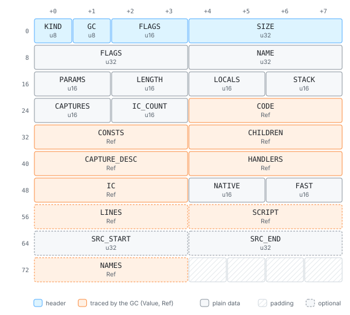
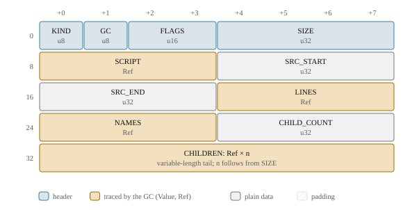

# The compiler: tokens to bytecode, no AST

A codemode script is compiled once, run once, and thrown away, so whatever the compiler
does before the first instruction runs is latency the user waits for. djs therefore
compiles the way QuickJS does, which is the goal of [no syntax
tree](goals.md#no-syntax-tree): a recursive-descent parser that writes bytecode *while*
it parses, with no tree in between. This page explains how that works for a grammar full
of constructs that only make sense once you have read past them, how functions that
never run are kept cheap, and what the missing tree costs.

> **In short.** The parser reads tokens and writes stack-machine bytecode directly;
> every ambiguity (arrow heads, destructuring, TypeScript generics) is settled by
> scanning ahead or rewinding the lexer, never by undoing emitted code. Names are
> emitted as placeholders and resolved in one pass after the whole unit is parsed, when
> every declaration is known, and the result is one function template cell per function
> in the heap. With lazy functions, a function's body is parsed at load but turned into
> its final bytecode only at its first call.

## The pipeline

```text
source text
  │  lexer: tokens with spans, rescanned on the parser's request
  ▼
parser + emitter: recursive descent, one function state per function
  │  phase-1 bytecode: name placeholders, symbolic labels, scope markers
  ▼  (the whole compilation unit parsed)
resolution, per function, children before parents
  │  local / argument / box / capture / global storage, TDZ checks, hoisting,
  │  peepholes, one linear re-emit, jump fixups, stack depths, line table
  ▼
function template cells in the heap
```

The work happens in two phases. The first, parsing, reads every token once and emits
**phase-1 code**: instructions in which a variable is still only a name and a jump
target only a label. The second, **resolution**, runs when the whole unit has been read,
so it knows every declaration, decides where each variable lives, and writes the final
code. Only that last step touches the arena. Parsing interns atoms and string constants
as it meets them; everything else (code under construction, scope trees, fixup lists)
is Rust state that is dropped when `compile` returns.

Each function becomes a **function template**: its bytecode, constants, capture
descriptors, handler table and inline cache slots, in a heap cell. Compiled code is
therefore part of the heap and of every image, like any other value.

<!-- gen:cell FuncTemplate FuncInfo -->




<!-- /gen -->

The layout is shaped by the builtins, which are most of the templates in every heap.
The bytecode, the capture descriptors and the handler table sit inline at the end of the
template cell, so a call finds its code at a fixed offset and no separate code cell pays
a header and padding. What a builtin never has, child templates and debug information
(the script, the source span for `toString`, the line table, local names), lives in the
separate `FuncInfo` cell, which a builtin's template does not point to: a builtin costs
48 bytes plus its code.

The functions of one compilation unit share one constant pool. A string or number that
many functions use, an error message or a property name passed as a string, is stored
once, and the unit pays one cell header instead of one per function. The top level gets
a pool of its own, since it runs once and its constants need not live as long as the
functions it creates. Indexes are handed out in emit order, so the short `push_const8`
form covers the first 256 constants. When the base image is built, the entries that only
the builtins' set-up code used are dropped, keeping the order, so every index only gets
smaller and the code is patched in place.

## Emitting while parsing

Expressions are parsed by precedence climbing, and each operator is emitted after its
operands, which is exactly the order a stack machine wants:

```js
const price = 12, qty = 3, discount = 5;
return price * qty - discount;
```

<!-- gen:disasm -->
```text
function 0 <anonymous>: params=0 locals=4 stack=2 captures=0
  handler [3, 19) -> 19 depth 0
    0  async_start loc0 (<state>)
    3  push_i8 12
    5  put_loc1 (price)
    6  push3
    7  put_loc2 (qty)
    8  push_i8 5
   10  put_loc3 (discount)
   11  get_loc1 (price)  ; 2:8
   12  get_loc2 (qty)  ; 2:16
   13  mul  ; 2:14
   14  get_loc3 (discount)  ; 2:22
   15  sub  ; 2:20
   16  async_return loc0 (<state>)
   19  async_reject loc0 (<state>)
```
<!-- /gen -->

The example is a codemode body, an async function, which is why it starts with
`async_start` and ends with `async_return`; the `handler` line is the region that turns
an exception into a rejected promise. In between, every operand is pushed and every
operator pops its inputs and pushes its result. The [opcode reference](ref-opcodes.md)
lists every instruction; this page uses a handful:

<!-- gen:ops get_loc put_loc mul sub new_box get_box put_box get_cap_chk fclosure -->
| opcode | byte | immediates | size | pop → push | cost | description |
| --- | ---: | --- | ---: | --- | --- | --- |
| `get_loc` | 39 | Loc | 3 | 0 → 1 | Basic | `-> v` |
| `put_loc` | 40 | Loc | 3 | 1 → 0 | Basic | `v ->` |
| `mul` | 123 | – | 1 | 2 → 1 | Basic | `a b -> a * b` |
| `sub` | 122 | – | 1 | 2 → 1 | Basic | `a b -> a - b` |
| `new_box` | 57 | Loc | 3 | 0 → 0 | Alloc | `loc = new Box(uninitialized)` |
| `get_box` | 51 | Loc | 3 | 0 → 1 | Basic | `-> v`: the value of the Box in local `loc`. |
| `put_box` | 52 | Loc | 3 | 1 → 0 | Basic | `v ->` |
| `get_cap_chk` | 63 | Cap | 3 | 0 → 1 | Basic | `-> v` with a TDZ check. |
| `fclosure` | 13 | Child | 5 | 0 → 1 | Alloc | `-> function`: create a closure of child template `child`. |
<!-- /gen -->

## Ambiguity without backtracking

JavaScript's grammar does not always say what a token starts until much later. Is
`(a, b)` a parenthesized expression or the parameters of an arrow function? Is `[a, b]`
an array literal or the target of a destructuring assignment `[a, b] = pair`? A parser
that builds a tree can parse a "cover" form and reinterpret it afterwards. A parser that
emits code as it goes has already committed to bytecode.

djs follows one rule: **speculation never emits bytecode.** Every ambiguity is decided
before anything is emitted for it:

- **Token scans.** For `(`, a scan on a copy of the lexer skips the balanced parentheses
  and checks for `=>`. It bails out at the first token that cannot be in a parameter
  list, so `(a + b) * c` costs a token or two. For `[` and `{`, a scan checks whether
  the matching closer is followed by `=`, and remembers the answer for every nested
  bracket it passed, so a large data literal is scanned once, not once per nesting
  level.
- **Rewinding the lexer.** A checkpoint is the lexer state plus the current token, a
  small struct that is copied. TypeScript's `f<T>(x)` versus `f < T > (x)` is decided by
  skipping a type argument list speculatively and looking at what follows; if it was not
  one, the lexer is put back. Nothing else needs to be restored, because nothing else
  changed.
- **Deferred patterns.** In `let [a, b] = pair`, the pattern comes before its value, but
  its code must run after. The parser skips the pattern with a bracket scan, parses and
  emits the value, rewinds the lexer to the pattern and emits it, then jumps forward
  past the value again.

The one place where emitted code is rewritten is assignment: `a.b.c = v` has already
emitted `get_field c` when the parser sees `=`, so it turns that last instruction into
the matching store. That is a rewrite of one instruction, at the end of the buffer.

> **Trade-off.** Lexer-only speculation over checkpoints that truncate emitted code.
> Rolling back the bytecode, the constants and the scope state to a saved point would
> let the parser guess and retry, but every piece of compiler state (child functions,
> captures, handler entries, line entries) would have to be part of that checkpoint,
> and forgetting one is a bug that shows only on unusual input. With lexer-only
> checkpoints there is nothing to forget. The cost: some constructs are scanned twice,
> once to decide and once to parse.

## Names are resolved after parsing

When the parser meets an identifier, it often cannot know what it refers to. `x` in an
inner function may be a `var` its parent declares further down, a `let` that is still in
its temporal dead zone, or a global. So the parser emits a placeholder and records the
name and scope in a side table. After the whole compilation unit is parsed, the
resolution pass walks the functions in reverse creation order, which visits children
before parents without recursion. For each name it decides the storage:

| binding | storage |
| --- | --- |
| captured by an inner function | a local slot holding a heap **box** (`get_box`/`put_box`) |
| a parameter, not captured | its argument slot (`get_arg`) |
| any other local | a local slot (`get_loc`) |
| not found in any enclosing function | a global lookup (`get_global`) |

Then it re-emits the function's code in one linear pass: it replaces placeholders, drops
scope markers, inserts TDZ checks where a read might come before the declaration has run
(and only there), patches jumps and computes the maximum stack depth.

A captured variable lives in a box from the moment its scope is entered, so a closure
holds the box, never a pointer into its parent's frame:

```js
let count = 0;
const bump = () => { count++; };
bump(); bump();
return count;
```

<!-- gen:disasm -->
```text
function 0 <anonymous>: params=0 locals=3 stack=2 captures=0
  handler [3, 29) -> 29 depth 0
    0  async_start loc0 (<state>)
    3  new_box loc1 (count)
    6  push0
    7  put_box loc1 (count)
   10  fclosure child0
   15  set_loc2 (bump)  ; 3:1
   16  undefined
   17  call0  ; 3:5
   18  drop
   19  get_loc2 (bump)  ; 3:9
   20  undefined
   21  call0  ; 3:13
   22  drop
   23  get_box loc1 (count)  ; 4:8
   26  async_return loc0 (<state>)
   29  async_reject loc0 (<state>)
function 0.0 bump: params=0 locals=0 stack=1 captures=1
    0  get_cap_chk cap0 (count)  ; 2:22
    3  inc  ; 2:27
    4  put_cap_chk cap0 (count)  ; 2:22
    7  return_undef
```
<!-- /gen -->

`count` is captured by the arrow function, so the body keeps it in a box (`new_box`,
then `put_box` and `get_box`), and `fclosure` copies the box reference into the new
closure, where `bump` reaches it as capture 0 (`get_cap_chk`). Through a capture the TDZ
check stays, because a closure can run before the declaration it captures has; in the
body, where the read comes textually after the declaration, resolution dropped it.
`bump` itself is not captured, so it stays a plain local, and its store followed by a
load became one `set_loc`.

> **Trade-off.** Boxes for every captured binding over closing over the stack. QuickJS's
> closures point into the frame's variables until the frame returns, then copy them out.
> djs pays an allocation per captured binding per scope entry instead. In return no frame
> ever holds something a closure points into, so a frame can be suspended, copied into a
> generator object or written into an image as plain values ([the
> interpreter](interpreter.md)), and per-iteration `let` bindings in loops come for free:
> each iteration gets a new box.

## TypeScript in the same pass

TypeScript is a compile flag, not a separate front end. With it on, the parser calls a
**type skipper** wherever a type may appear, and the skipper consumes the type without
emitting anything; the constructs with run-time meaning (enums, namespaces, parameter
properties) compile straight to bytecode. The checkpoints above are what decide a
generic call from two comparisons. [TypeScript](typescript.md) says what is erased, what
runs, and how `djs strip-types` shows the erasure.

## The bytecode

The bytecode is stack-based, with variable-length instructions: a `u8` opcode followed
by little-endian immediates (local slots, atom ids, constant indexes, relative jump
offsets). The instruction set is declared once, in the `ops!` table in
`bytecode/ops.rs`, with each instruction's immediates, stack effect, fuel cost and flags.
The emitter, the decoder, the disassembler, the stack-depth checker, the opcode hash
that images are checked against and the [opcode reference](ref-opcodes.md) are all
generated from that table.

There are no general superinstructions. The compiler makes a few layout changes and
peepholes over the phase-1 code instead:

- loops are **rotated**: the condition is tested at the bottom, so an iteration costs
  one conditional jump;
- `i++` as a statement on a plain local becomes `inc_loc`;
- jumps to jumps are threaded, `not` before a conditional jump flips the jump, and a
  store followed by a load of the same local becomes `set_loc`.

The final code is then made **short**. Most operands are small: locals, arguments and
constant indexes below 256, calls with up to three arguments, jumps of a few dozen
bytes. So the most frequent instructions have short forms that the emitter picks when
the operand fits. `get_loc2` has the operand in its opcode, `get_loc8 12` has a
one-byte operand, `call_intrinsic8` takes its argument count from the intrinsic's
declared arity, and `get_builtin_callee8` is `get_builtin; undefined` in two bytes.
Jumps are emitted with 4-byte offsets, and the last step shortens every jump whose
offset fits a byte, repeating until no shortened jump pushes another out of range. Code
after a `return`, `throw` or `jump` up to the next label is dropped. Each short form runs
exactly like its wide form, big functions simply keep the wide ones, and the builtins'
bytecode is about half the size it would be with wide forms only.

```js
let sum = 0;
for (let i = 0; i < 10; i++) sum += i;
console.log(sum);
```

<!-- gen:disasm -->
```text
function 0 <anonymous>: params=0 locals=3 stack=3 captures=0
  handler [3, 43) -> 43 depth 0
    0  async_start loc0 (<state>)
    3  push0
    4  put_loc1 (sum)
    5  push0
    6  put_loc2 (i)
    7  jump8 -> 16
    9  get_loc1 (sum)  ; 2:30
   10  get_loc2 (i)  ; 2:37
   11  add  ; 2:34
   12  put_loc1 (sum)  ; 2:30
   13  inc_loc loc2 (i)  ; 2:26
   16  get_loc2 (i)  ; 2:17
   17  push_i8 10
   19  lt  ; 2:19
   20  jump_if_true8 -> 9  ; 2:30
   22  get_global "console" ic0  ; 3:1
   29  get_method "log" ic1  ; 3:8
   36  get_loc1 (sum)  ; 3:13
   37  call1  ; 3:12
   38  drop
   39  undefined
   40  async_return loc0 (<state>)
   43  async_reject loc0 (<state>)
```
<!-- /gen -->

The loop is entered with one jump to the condition at the bottom; every iteration after
that is the body, `inc_loc`, the comparison and one backward conditional jump. Two more
details show up here: `console` is a global the host defines, read through an inline
cache like a property (`get_global "console" ic0`), and `get_method "log" ic1` carries
the number of its own inline cache slot, which [the
interpreter](interpreter.md#making-it-fast) fills.

> **Trade-off.** A stack machine over registers. A register VM executes fewer
> instructions, but allocating registers well needs either a syntax tree or a much
> smarter single-pass allocator. A stack machine is the natural target for code emitted
> in parse order. The cost is instruction count, which the peepholes, the interpreter's
> fast paths and inline caches win back where it matters.

## Lazy functions

Most of a compile is the second phase: resolving names, the re-emit with its peepholes,
short forms and stack check, and writing the template. A function that never runs does
not need any of it. A library, a [continuation dump](dumps.md) or the code that loads
one defines many functions of which few are called, so djs can defer that phase to a
function's first call.

**What stays at load.** The whole unit is still parsed, with phase-1 code for every
function. So every early error is reported when the script loads, never later, and
resolution still sees every function: it knows which bindings inner functions capture,
which therefore live in boxes, and the enclosing code is the same as in an eager
compile. Only the second phase of a lazy function is skipped. Its template is a **lazy
template**: the real flags, name, `length`, parameter count and capture descriptors,
and as its code the single instruction `lazy`. Creating closures of it, and their
`name`, `length` and `toString`, work as on any template.

**What stays eager.** A function that is likely to run soon would only be parsed twice,
so it is compiled with its unit: the top level, a function called where it is defined,
a function or arrow passed straight to a call (`items.map(x => x.id)`), a parenthesized
one (`(function () { ... })`, the usual hint for "runs soon"), async functions and
generators, class constructors, a function that uses a name resolved through
TypeScript declarations (a `const enum` member, a namespace member), and every builtin.

**The first call.** The call enters a frame for the lazy template as usual and runs
`lazy`. It parses the function's own source text again, as a unit of its own, with a
stand-in for the enclosing function that binds one variable per capture, runs the second
phase, switches the closure to the compiled template and continues in the same frame.
Only the function's text is read, so the cost is proportional to the function, not to
the script; the instruction charges fuel for it, one unit per 32 bytes of source. The
compiled template is kept on the lazy one, so later closures of the same function pay a
check, not a compile. Since the load already reported every error, nothing can fail at
that point except memory.

A function's code is the same whether it is compiled with its unit or at its first
call. That matters for [continuation dumps](dumps.md): to name a suspended frame's
slots, the dumper compiles the same source again and relies on getting identical code.
So in a build with lazy functions, every function that may compile lazily has a
constant pool of its own in every compile, and the rule for what is lazy looks only at
the function and its parent's text, which a compile of the function alone sees too.

**Where it is on.** Lazy compilation is a build feature and a per-VM option, off by
default. Native builds have the feature, so an embedder can turn it on per VM; the wasm
module with the dumper has it and turns it on for every VM; the shipped codemode modules
leave it out. An image that a
host seals as a prelude, to start many runs from, compiles all its lazy functions first,
so no run pays for them.

> **Trade-off.** Parse twice over keeping a tree. Keeping the first parse's state for
> later would need a second code format in the heap, which images would then have to
> carry. Parsing again needs nothing stored: the source is kept anyway, for `toString`
> and stack traces. The cost: a function that runs is parsed twice, so its compile costs
> about one and a half times an eager one, while a function that never runs costs about
> 40% of one. Lazy compilation wins where most functions never run (dumps, libraries:
> TypeScript's own compiler, a single 9 MB file, compiles in about half the time) and loses on codemode
> scripts, whose callbacks nearly all run, which is why the codemode modules leave it
> out.

## What the missing tree costs

Without a tree there are no optimization passes over whole functions: no constant
folding across statements, no escape analysis, no inlining. Every ambiguity has to be
answered before anything is emitted, which makes arrow functions, destructuring and
TypeScript's generics harder to compile than in a parser that can reinterpret a tree.

> **Trade-off.** No AST over an optimizing front end. For code that runs once, the time
> to build and walk a tree is time the script waits, and its memory is memory a sandbox
> holds. Compiling straight to bytecode keeps the compile to one read of the source plus
> one pass per function, and TypeScript costs no extra pass at all. The cost is
> cleverness the bytecode cannot have, and a parser that must settle every question
> before it writes code.

The compiler, unlike the interpreter, recurses on the Rust stack: compilation is
bounded by the size of its input and never needs to suspend. A nesting limit turns
pathological input (ten thousand nested parentheses) into a SyntaxError instead of a
stack overflow ([limits](limits.md#nesting-in-source)). Codemode scripts are always
strict, and there is no `with`, no direct `eval` and no ES modules: `import()` compiles
and returns a rejected promise ([the language](language.md#what-is-left-out-and-why)). A
Script goal, with global `var` bindings and completion values, exists for indirect
`eval`, the REPL and conformance tests.

## Where to look

- [`crates/djs-core/src/lexer/`](../../crates/djs-core/src/lexer/): tokens, numbers,
  strings and regular expression literals.
- [`crates/djs-core/src/compiler/parser.rs`](../../crates/djs-core/src/compiler/parser.rs):
  the parser's state, checkpoints and the nesting limit;
  [`compiler/expr.rs`](../../crates/djs-core/src/compiler/expr.rs) and
  [`compiler/stmt.rs`](../../crates/djs-core/src/compiler/stmt.rs): expressions and
  statements.
- [`crates/djs-core/src/compiler/scan.rs`](../../crates/djs-core/src/compiler/scan.rs):
  the token scans that decide arrows and destructuring.
- [`crates/djs-core/src/compiler/resolve.rs`](../../crates/djs-core/src/compiler/resolve.rs):
  resolution, storage, the re-emit, constant pools and which functions are lazy;
  [`compiler/peephole.rs`](../../crates/djs-core/src/compiler/peephole.rs): the
  peepholes.
- [`crates/djs-core/src/compiler/lazy.rs`](../../crates/djs-core/src/compiler/lazy.rs):
  compiling a lazy function at its first call;
  [`interp/run/lazy.rs`](../../crates/djs-core/src/interp/run/lazy.rs): the `lazy`
  instruction.
- [`crates/djs-core/src/compiler/ts.rs`](../../crates/djs-core/src/compiler/ts.rs): the
  type skipper.
- [`crates/djs-core/src/bytecode/ops.rs`](../../crates/djs-core/src/bytecode/ops.rs):
  the instruction table;
  [`bytecode/template.rs`](../../crates/djs-core/src/bytecode/template.rs): writing
  templates.
- `djs disasm file.js` prints the bytecode of any script, as the listings on this page
  show it ([the command line](cli.md#djs-disasm-and-djs-strip-types)).
