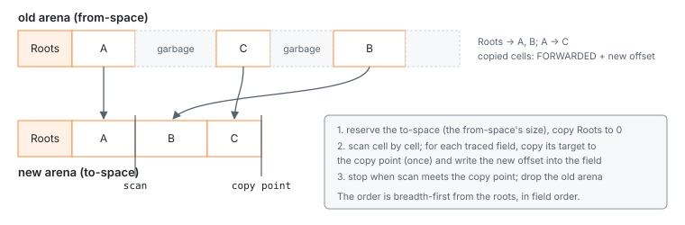

# The garbage collector

Everything a djs VM keeps is in the arena, and the arena only grows by bumping.
Something has to give the memory of dead objects back, and in djs that same thing
decides what a snapshot contains and whether two runs of a program leave identical
images. This chapter explains the collector, when it runs, what happens when memory runs
out, and what it costs.

> **In short.** djs has two collectors over one trace. A VM's own collections are
> **in place** (mark-compact): they mark everything reachable from the roots, then slide
> the survivors down over the garbage, keeping their order. No second arena is needed,
> so a collection costs no more memory than the heap itself. Most of them are **minor**:
> the heap's prefix that holds the realm and the prelude, the **old region**, is taken as
> live and left where it is, and only what the program allocated since is traced and
> moved. A **copying** (Cheney)
> collector lays a heap out breadth-first from the roots, a function of the object graph
> alone; it makes the canonical hash and the base image. Collections happen only at
> safepoints, when allocation has crossed a threshold that is itself part of the heap, so
> collection points depend on the program and never on how it was sliced. Running into
> the memory cap is a catchable error, with a collect-and-retry before it.

## What is traced

What counts as a traced field comes from the layout table alone: a field declared as
`Value` or `Ref` in `cells!` is traced, nothing else is (D1052). There is no per-kind
tracing code to forget when a cell kind is added, and both collectors use the same
description. A few kinds get extra treatment:

- a reference to a **flattened rope** is redirected to its flat string, so the rope
  dies;
- **Map and Set** tables, whose object keys hash by offset, are rehashed in place after
  the cells have moved (D1381);
- **ephemeron tables** (WeakMap, WeakSet, WeakRef, FinalizationRegistry) are not traced
  like other cells. Once everything else reachable is found, every pair whose key is
  reachable gets its value traced too, and this repeats until nothing changes; pairs
  with dead keys are then cleared (D1382, D1513);
- inline cache slots that hold arena offsets are emptied (D1621).

## Sliding in place

A VM's collection runs in four passes over the arena (D2040):

1. **Mark.** Starting at the `Roots` cell, every reachable cell gets a mark bit in its
   header, and its words are set in a **live bitmap**, one bit per 8 bytes. The marker
   keeps a stack of cells still to scan, which grows on demand; if it cannot grow, a
   cell stays marked but unscanned, and a walk over the marked cells finds it later.
   Only the *set* of marked cells reaches the result, so the order of marking cannot
   change it.
2. **Count.** A table with one entry per 512 bytes of arena records how many live bytes
   lie before that block. The new address of a live cell is that entry plus the live
   words before it in its block, which one population count of a bitmap word gives.
   Nothing is written into the cells.
3. **Update.** Every traced field of every marked cell is rewritten with its target's
   new address. Nothing below the first dead word moves, so fields pointing there stay
   as they are.
4. **Slide.** The marked cells move down in address order, a run of adjacent live cells
   at a time, and the freed tail is zeroed. Map and Set tables are rehashed last.

The bitmap, the table and the stack take about 2.3% of the arena. They are allocated
before anything is touched, so a host that cannot provide them gets an error with the
heap unchanged.

Because cells keep their order, the heap after a collection is the live cells in the
order they were allocated. Collecting along the way and collecting once at the end leave
the same bytes for the same allocations. That is what the [determinism
checks](determinism.md) build on, together with collection points that don't depend on
slicing. Collecting a collected heap changes nothing.

> **Trade-off.** In-place over copying for a VM's own collections (D018). A copying
> collector needs the old and the new arena at once, about twice the live data, plus
> what the host allocator fragments when the arena moves. In wasm, memory never shrinks,
> so that peak is what every run costs. Sliding in place has no second arena: peak
> memory dropped by 3–52% on allocation-heavy workloads, and by 1 MiB for a pi session
> with tool calls. The price is two traversals instead of one, plus the bitmap work:
> collections take 1.1–1.6 times as long, programs 0–5.5% more instructions, and the
> second collector adds 6 KB of code.

## The old region

Most of a fresh VM's heap is the base image: the realm, the compiled builtins and the
prelude, about 400 KB, nearly all of it live for the VM's whole life. A program that
allocates a lot of short-lived data collects every few hundred kilobytes, and a full
collection traces that whole base every time again. On a property-heavy benchmark that
was most of the collector's work.

So the arena has an **old region**: a prefix `[0, B)`, with B stored in the `Roots` cell
(D2041). A **minor** collection treats every old cell as live. It does not mark them and
does not move them; it marks and slides only the **young** cells above B. What it needs to
know is which young cells the old ones keep alive, and the old cells are mutable:
scripts add globals, patch prototypes, fill caches and grow the realm's tables. Rather
than track every write, a minor collection reads the whole old region once:

1. **Walk.** It visits the old cells in address order, and every traced field that points
   at or above B is a root for the young cells. The marker treats it like the `Roots`
   cell's fields. The field's address goes on a short list.
2. **Mark, count, update, slide** as before, but only over the young cells: the bitmap and
   the table start at B, and survivors slide down to B. Of the old cells, only the fields
   on the list are rewritten (if the list fills up, the update walks the old region
   again).

A few old cells need more than their fields read:
- an old **WeakMap**'s pairs with young keys join the ephemeron rounds, and are cleared if
  the key dies;
- an old Map or Set with young object keys is rehashed, since those keys move;
- old function templates get their offset caches emptied, like young ones.

Reading a field is about four times cheaper than tracing it: on a heap holding just the
base, a minor collection takes 0.08 ms where a full one takes 0.18 ms. The walk does not
go through the general cell walker. For each cell kind, a small table worked out at
compile time from the layout lists where its `Value` and `Ref` fields are. The walk loads
each of them and compares it against B, and only a young target leads to a call (D2055).
That made the walk about four times cheaper again: a property-heavy benchmark and a
pi-like one each run 3.3% fewer instructions.

**Where B comes from.** A VM created from the base image starts with B at the image's
end: the base is made by the copying collector, which seals what it leaves. An embedder
can seal a heap itself with `Vm::seal` (`vm_seal` in wasm): a full collection, after which
everything live is old. pi does that after running its own prelude, so its lockdown and
helpers become old too. Nothing else moves B up.

**Full collections** still trace everything. They run every 16th time, when a minor
collection left more than half the memory cap in use, whenever the embedder asks
(`Vm::collect`), and with no old region at all (B = 0). The first collection of a VM
made from the base image is full too (D2045). The VM's setup kills some base cells
right away; the atom table's entries, for one, are replaced as soon as a script adds an
atom. If those dead cells stayed for sixteen collections, they would shift every later
threshold. A full collection keeps the old
region's live cells and drops its dead ones: B shrinks to the live bytes below it, but it
never grows.

**What it retains.** Between full collections, an old cell that died still holds its
fields, so the young cells only it reaches survive too: say, an old object's property
table after the object grew. In practice that is a few kilobytes, and the next full
collection frees it. Few kilobytes could still move peak memory by megabytes, through
where the growing arena landed (see below).

**Determinism.** B and the count of minor collections since the last full one are in the
`Roots` cell, like the threshold. Whether a collection is minor or full is decided from
the heap alone, so a restored VM collects the same way as the original. A full collection
slides everything into allocation order, so its result is the same whether minor
collections ran before it or not.

> **Trade-off.** A walk over the old region over a write barrier. A barrier that records
> stores into old cells (a card table) would let a minor collection read only the cells
> written since the last one. But it costs a compare on every traced store in the
> interpreter's hottest paths, and it has to be complete, raw stack writes included: a
> forgotten store frees a live cell. The walk has nothing to forget. Since the per-kind
> slot tables it costs about 1% of the workloads that collect most often, so the barrier
> is not built (D2044).

> **Trade-off.** No promotion. A generational collector moves long-lived young cells into
> the old region, so later collections stop tracing them. djs tried this twice.
> - Making every full collection's survivors old (D2042). Data that died after its
>   promotion stayed until the next full collection, and thresholds were computed over
>   it: peak memory rose by up to 76%.
> - Promoting the cells that survived two collections, tracked by region: the survivors
>   of one collection sit in a known range just above the old region (D2046).
>   Collections got 7–20% faster, about 1% of the run, but peak memory still rose by up
>   to 2 MiB on a pi-like workload and far more on one that grows a long string. Cells
>   that live through two collections still die soon: per-task data, or a string's
>   buffer that is replaced as it grows.
>
> The old region is the state of a setup phase, sealed on purpose. A program with a large
> long-lived young heap gains little: its minor collections still trace that data.

### Peak memory and the host allocator

In wasm the arena is one block of the module's memory, and memory never shrinks. A
general-purpose allocator grows such a block by copying it when it cannot extend it in
place. The old and the new block then exist at the same time, and a run's peak was most
often exactly such a moment. Whether a growth could stay in place depended on the exact
sizes involved: a few kilobytes more or less in the live heap could move a run's peak by
3–6 MiB, up or down. Policies such as reserving the capacity right after a collection,
or growing by smaller steps, moved some workloads one way and others the other (D2047).

So the wasm module has its own allocator for big blocks
([`crates/djs-wasm/src/allocator.rs`](../../crates/djs-wasm/src/allocator.rs), D2053). It
manages the memory in 64 KiB pages. A block of 256 KiB or more, the arena among them,
is a run of pages of its own, and it grows in place whenever the pages after it are free
or it ends where memory ends: memory then grows by just the difference. Smaller
allocations stay with the general allocator, which takes its pages from the same pool.
Peaks of allocation-heavy runs halved, to about the arena's size plus the rest of the
heap.

A run's peak still depends a little on placement, so a memory claim about the collector
compares distributions over many slightly perturbed runs, never one run per build
(D2048).

## Copying, for canonical layouts

The copying collector reserves a new arena as large as the old one's used part, copies
the `Roots` cell to offset 0, and then scans the new arena from the start, cell by cell
(D1090):



For every traced field of a scanned cell, the target is copied to the end of the new
arena unless it already was, and the field is rewritten with the new offset. A copied
cell gets the `FORWARDED` bit in its old header and its new offset in its old first
payload word, which is why every cell kind has at least one. When the scan catches up
with the copy point, everything reachable has been copied, and the old arena is dropped.

The order is breadth-first from the roots, in field order, so the layout depends only
on the object graph, not on the order in which cells were allocated. djs uses it where
that matters:
- the **canonical hash** collects a copy of the heap this way and hashes the result, so
  two VMs with the same graph have the same hash whatever their history;
- the **base image** is made this way, so it doesn't depend on how the prelude
  allocated.

## When it runs

Allocation never collects (see [the arena](arena.md)). It sets `gc_pending` once the
arena crosses the **GC threshold**, and the collection runs at the next safepoint: a
call, a return, a backward jump, a state transition of a native builtin
([suspension](suspension.md)). After a collection the next threshold is set from the
live size:

```rust
pub fn next_threshold(live: u32, limit: u32) -> u32 {
    let headroom = limit.saturating_sub(live);
    let growth = live.max(MIN_GROWTH);
    if growth > headroom / 2 {
        return live + headroom / 2;
    }
    // Whole 64 KiB wasm pages when that stays within the headroom rule (D1870).
    let t = (live as u64 + growth as u64).next_multiple_of(PAGE);
    if t <= live as u64 + headroom as u64 / 2 {
        t as u32
    } else {
        live + growth
    }
}
```

That is: let the heap grow to twice its live size (at least 256 KiB more), rounded up to
whole wasm pages, but never by more than half of what is left below the cap, so that
collections come more often as memory gets tight. The arena's backing store stops
growing at the threshold, since wasm memory never shrinks and the peak is what a run
costs (D1870).

> **Trade-off.** Twice the live size, not more. Since minor collections skip the old
> region, a collection's cost is mostly the young data that survives it, and letting the
> heap grow by the young survivors once more (capped at 256 KiB) means fewer
> collections. It saved 2–4% of the instructions of pi-like and JSON-heavy runs, but
> raised their peak memory by 0.3–0.9 MiB, up to 17%. djs keeps the plain rule (D2056).

Which collections are minor and which are full is a function of the program in the same
way (see [the old region](#the-old-region)). Three rules make the collection points a
function of the program alone:

- the threshold is stored in the `Roots` cell, so a VM restored from an image collects
  where the original would have (D1601);
- the threshold is computed from the live size and the cap only, never from what the
  host allocator happened to reserve;
- `run` does not collect when it starts, and nothing a stop does allocates in a way that
  counts (D1710).

So a program run in one go, in slices of 97 fuel, or with a snapshot and restore at
every slice collects at the same instructions and leaves the same bytes. The gate checks
exactly that (D1720).

```js live
let kept = [];
for (let round = 0; round < 50; round++) {
  const batch = [];
  for (let i = 0; i < 200; i++) batch.push({ round, i, label: "item " + i });
  kept.push(batch[0]);            // keep one object per round, drop the rest
}
console.log(kept.length, kept[49].label, kept[49].round);
```
<!-- gen:run -->
```text
50 item 0 49
```
<!-- /gen -->

On the docs site, the *Heap* tab shows the cells this example allocated, by kind, apart
from the base realm every VM starts with,
and its *Collect now* button runs a collection in the page: most of the ten thousand
objects disappear, and the fifty kept ones are packed in with the rest of the live heap.

## Out of memory

The embedder gives each VM a memory cap. Running into it must be a JavaScript error the
script can catch, as in QuickJS, and it must happen at the same point in every run.
Since allocation never collects, the heap at the moment of failure may be mostly
garbage, so djs does three things (D1600, D1700):

1. **Collect and retry.** Before an out-of-memory error reaches JavaScript, the failing
   step collects and runs once more. For bytecode, the step is the instruction:
   instructions that allocate before they change anything (`put_field`, `add`, `object`,
   a few intrinsic calls) have their operands put back on the stack, the heap collects,
   and the instruction runs again (D1700). Native builtins do the same at the points
   where their generated code holds no heap value outside the frame (D1900), and `@fast`
   entries decline, so the builtin's own path retries (D1910).
2. **A preallocated error.** If the retry fails too, the realm's one
   `InternalError: out of memory` object is thrown. It is never allocated at the throw.
3. **A reserve.** The arena's limit is the cap minus `min(cap / 32, 1 MiB)`. Throwing
   the error opens the reserve and collects when the handler is reached, so a handler
   that formats the error and reports it has room to run.

A refusal by the *host* allocator below the cap (the backing store cannot grow, the
collector's side tables cannot be allocated) is different: it is not a function of the program, so it is
not catchable. The run stops with `HostOutOfMemory` and the VM stays usable (D1690).

> **Trade-off.** Retry at instruction granularity over collecting inside allocation.
> Collecting on an allocation failure would rescue every allocation site, but every Rust
> function that holds a heap value across an allocation would then need to root it, in
> hundreds of places. Retrying the whole instruction needs a list of the instructions
> that may retry and nothing else, at the price of an instruction that runs twice when
> memory is tight.

> **Trade-off.** Strong shapes and atoms that never die. Two kinds of heap data are
> never collected: shapes, because weak transitions would make the shape tree depend on
> collection points (D1831), and atoms, because atom collection is not built yet
> (D1054). Both are bounded in practice; a script that makes millions of distinct keys
> keeps their atoms until the VM is dropped.

## Where to look

- [`crates/djs-core/src/heap/compactor.rs`](../../crates/djs-core/src/heap/compactor.rs):
  the in-place collector, full and minor;
  [`crates/djs-core/src/heap/gc.rs`](../../crates/djs-core/src/heap/gc.rs): the copying
  collector, the collection schedule (`collect_auto`), `seal` and `next_threshold`;
  [`gc_tests.rs`](../../crates/djs-core/src/heap/gc_tests.rs): its tests, including
  "collecting twice gives identical bytes".
- [`crates/djs-core/src/heap/walk.rs`](../../crates/djs-core/src/heap/walk.rs): tracing
  from the layout table, and the verifier.
- [`crates/djs-core/src/interp/run.rs`](../../crates/djs-core/src/interp/run.rs):
  safepoints and the retry of D1700.

Decisions on this page:

<!-- gen:decisions D2040 D2041 D2042 D2044 D2055 D2056 D2045 D2046 D2047 D2048 D2053 D018 D1090 D1052 D1381 D1382 D1513 D1621 D1990 D1870 D1601 D1710 D1720 D1600 D1700 D1900 D1910 D1690 D1831 D1054 -->
- D2040: In-place mark-compact for in-VM collections; Cheney for canonical layouts
- D2041: An old region that minor collections neither trace nor move
- D2042: Full collections do not promote; only seal points make cells old
- D2044: No card table and write barrier (old-generation phase 2) for now
- D2055: The old-region walk uses per-kind slot plans
- D2056: The collection threshold stays at twice the live size
- D2045: The first collection after a canonical image is full
- D2046: No aging promotion
- D2047: Arena growth policies that did not help
- D2048: Peak memory is compared as a distribution over perturbed runs
- D2053: A page allocator under dlmalloc in djs-wasm: huge blocks grow in place
- D018: Adopt mark-compact for in-VM collections
- D1090: Copying collector
- D1052: Layout description macro
- D1381: Map and Set are ordered hash tables rehashed by the collector
- D1382: WeakMap and WeakSet are ephemerons in the Cheney collector
- D1513: WeakRef and FinalizationRegistry on ephemeron tables; cleanup jobs after a collection
- D1621: Prototype property caches: a receiver-prototype offset, an epoch, and GC clearing
- D1990: A restored arena reserves its GC threshold plus a slack
- D1870: Arena growth stops at the GC threshold; thresholds in 64 KiB pages; no to-space reuse
- D1601: The GC threshold is part of the heap image
- D1710: GC points and raw images do not depend on the fuel slice
- D1720: Determinism checks in the gate: heap images across schedules and builds
- D1600: Out-of-memory recovery: a collection at the handler and a reserve below the cap
- D1700: A failing allocation collects and retries its instruction once
- D1900: Native builtins collect and retry at the heap cap
- D1910: Dense-array loops, fromCharCode and the URI functions as `@fast`; entries decline at the heap cap
- D1690: Running out of host memory is not a JS out-of-memory error
- D1831: Shapes with strong transitions and a per-heap shape budget
- D1054: Atom representation; symbols are atoms
<!-- /gen -->
