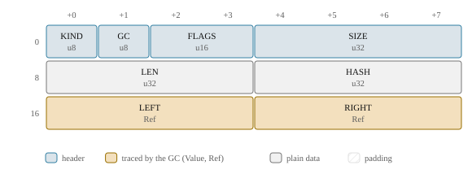
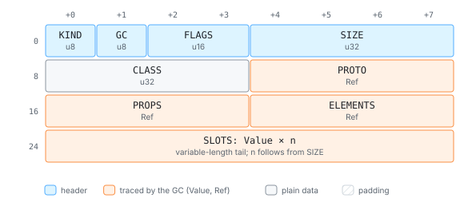
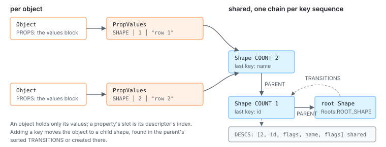
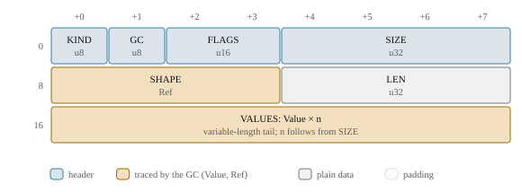
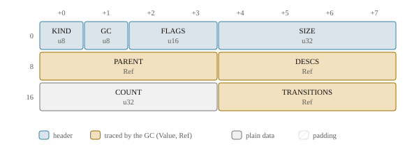
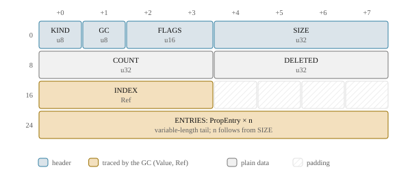

# Cells, strings and objects

The arena is a row of cells; this chapter is about what the cells are. JavaScript's data
types are not stored the way the spec describes them: a string may be a tree of pieces,
an object's keys may live in a structure shared by thousands of objects, and an array's
elements sit apart from its named properties. Each of these representations is there for
a measured reason, mostly memory, and each has a rule that keeps it out of sight of the
script.

> **In short.** Strings are one-byte or two-byte flat cells, plus ropes for
> concatenation and append buffers for `s += x` loops. Property keys are **atoms**,
> small integers that stay valid across collections. Objects keep their named properties
> either in a values block described by a shared **shape**, or in a private
> **dictionary** table, and keep array elements in a separate dense store. Map and Set
> are ordered hash tables; the weak collections are ephemeron tables the collector
> understands.

## One declaration for every kind

Every cell kind is declared once, with explicit byte offsets, in the `cells!` macro of
`heap/cells.rs` (D1052). The declaration generates the typed field accessors that Rust
code uses (`arena.get(cell, Str8::LEN)`), compile-time checks of the layout, and the
`LAYOUTS` table. Everything else that needs to know a layout reads that table:

- the garbage collector and the image verifier: a field declared as `Value` or `Ref` is
  traced, and that is the whole trace description, so a new cell kind is collected
  correctly the moment it is declared;
- the layout hash, which is part of every image's build hash, so changing a layout
  invalidates old images instead of misreading them;
- the host's reader, generated as `js/src/layout.generated.ts` (D1210);
- the diagrams in this guide and in the [cell layouts reference](ref-cells.md).

There are 24 kinds. JavaScript objects of every class (arrays, functions, promises,
maps, errors, typed arrays: 34 classes) are all one kind, `Object`; their class is a
field and their class-specific state lives in the object's tail of slots. The other
kinds are strings, symbols, BigInts, and the internal structures objects are built from:
property tables, shapes, value arrays, bytecode.

## Strings

JavaScript strings are sequences of UTF-16 code units, lone surrogates allowed. djs
stores them the way V8 does, in one of three cell kinds (D1053):

- **`Str8`**: one byte per code unit, for strings whose units all fit in Latin-1. Most
  strings in practice: JSON keys, identifiers, ASCII text.
- **`Str16`**: two bytes per unit (UTF-16LE). Constructors narrow, so a `Str16` always
  holds a unit above 0xFF. Equal strings therefore have the same width, and equal flat
  strings have equal bytes, so comparing them is a `memcmp`.
- **`Rope`**: the concatenation of two strings, made when the result has at least 32
  units. Shorter results are copied into a flat cell right away (without any Rust
  allocation, D1871). A rope is flattened when something needs its units: the flat copy
  is written once and the rope is redirected to it.

<!-- gen:cell Rope -->


<!-- /gen -->

Codemode scripts build their output with `+=` in a loop, and a plain rope makes that a
chain of one node per append: millions of cells for the collector to copy and a
million-deep tree to flatten. Once a string is a few hundred units long, an append chain
switches to an **append rope** instead (D1610): a rope that means "the first `LEN` units
of this buffer", over a flat cell with spare capacity. `s += piece` writes the piece
into the buffer in place and makes a new 24-byte append rope with the longer length. The
old string value is still the shorter rope over the same buffer, and still reads the
same units, because the units past its length are never part of it. Only the rope at the
end of the buffer may write into it; any other append copies first. Measured on 10
million single-character appends in a function: 574 MB of resident memory before, 150 MB
after (D1610 has the numbers).

```js live
const ascii = "codemode";
const wide = "naïve → done";   // '→' is above 0xFF: a two-byte string
let out = "";
for (let i = 0; i < 2000; i++) out += `line ${i}\n`;   // one append buffer
console.log(ascii.length, wide.length, out.length, out.slice(-10).trim());
```
<!-- gen:run -->
```text
8 12 18890 line 1999
```
<!-- /gen -->

> **Trade-off.** Two widths and ropes over one UTF-16 representation. A single
> representation would make every string operation simpler. But Latin-1 halves the
> memory of almost every string a codemode script sees, and the host reads a `Str8` with
> a cheap byte-to-char decode. Ropes make `+=` O(1). The cost is code: every string
> operation handles three kinds (and the append flags), and the hash is computed over
> code units so that it does not depend on the representation.

## Atoms: property keys as integers

A property key is an **atom**, a `u32` (D1054):

- with bit 31 set, it is an array index (0 to 2³¹−1) stored in the atom itself, never
  interned;
- otherwise it indexes the heap's atom table, with bit 30 telling symbols from strings.

Every symbol gets an atom too, so every property key is an atom and comparing keys is a
`u32` compare. Atoms are table *indexes*, not offsets, so they stay valid when the
collector moves the strings they stand for, and they can be written straight into
bytecode as immediates. Well-known names (`length`, `prototype`, `Symbol.iterator`) have
fixed ids generated from a list in `heap/atom.rs`, so the interpreter and the builtins
refer to them as constants.

> **Trade-off.** Atoms are never freed. A script that creates millions of distinct keys
> (`obj["k" + i]`) grows the atom table for the life of the VM. Codemode VMs live for
> one script, so atom collection is a follow-up, not a feature.

## Objects

An `Object` cell has a class, a prototype, a reference to its named properties, a
reference to its dense elements, and a tail of class-specific slots:

<!-- gen:cell Object -->


<!-- /gen -->

### Shapes

Codemode scripts make many objects with the same keys: the rows of a tool result, the
records a `map` callback returns, instances of one class. Storing the keys in every
object wastes most of its memory. So an ordinary object starts in **shape mode**
(D1831): it holds only a `PropValues` block, and the block points to a **shape** that
lists the keys and attributes in insertion order. A property's slot is its index in the
shape. Objects with the same key sequence share the shape:



<!-- gen:cell PropValues Shape -->




<!-- /gen -->

Shapes form a tree rooted in `Roots::ROOT_SHAPE`. Adding a key moves an object from its
shape to the child for that key and its attributes, found by binary search in the
parent's sorted `TRANSITIONS`, or created there. A chain's descriptors are one shared
array that each extending child appends to, so a chain of n shapes costs O(n) bytes.
`JSON.parse`, the wire decoder and object literals with a known key count walk the
transitions once per key and allocate the values block at its exact size, so every
record of a JSON array shares one chain.

The measured effect: a `{a, b, c, d}` literal went from 122.5 to 82.5 bytes per object,
a five-key `JSON.parse` record from 178.5 to 130.5, and loops that create objects with
literals or constructors got two thirds faster, because property additions now hit
inline caches.

### Dictionary mode

Shapes pay off only while they are shared. An object switches to **dictionary mode**,
one way, when sharing is unlikely or the shape tree would grow without bound:

- it gets more than 32 named properties;
- an existing property changes its attributes (`defineProperty` on it, `Object.freeze`);
- it gets an array-index key in its table;
- a key is deleted, unless the object can go back to its parent shape or reach the
  remaining key sequence with at most one new shape;
- it is a builtin prototype or namespace (`Array.prototype`, `Math`), or the global
  object: one-off objects, for which a private table is smaller than a chain of unshared
  shapes;
- the heap's **shape budget** of 4096 shapes is spent and its key set has no shape yet.

A dictionary is a `PropTable` of 16-byte entries (key, flags, value) in insertion order,
searched linearly up to 8 entries and through a hash index above that. An accessor's
entry points to an `AccessorPair` cell holding the getter and setter, which is what
keeps data entries at 16 bytes (D1830).

<!-- gen:cell PropTable -->


<!-- /gen -->

> **Trade-off.** Strong transitions and a budget over a collectable shape tree. V8 lets
> unused shapes die. In djs a parent keeps its children alive, so shapes never die, and
> the tree is capped at 4096 shapes per heap instead (about 160 KB typically, 2.3 MB at
> worst). Weak transitions would make the tree, and so the heap image, depend on when
> collections ran, and [deterministic runs](determinism.md) need images to be a function
> of the program alone. The cost: a script that creates thousands of distinct key
> sequences gets dictionaries after the budget. Measured: real scripts create 0 to 16
> shapes, the difftest corpus at most 59 per case.

> **Trade-off.** The prototype stays in the object, not in the shape. Changing a
> prototype then touches no shape, and objects with the same keys share a shape whatever
> their prototype. The inline caches check the prototype separately (D1621), which costs
> one compare on a prototype hit.

### Elements

Array elements are not named properties. An object's `ELEMENTS` is a `ValueArray`
holding the dense part of its index keys, with a hole marker for missing ones (D1055). A
dense slot always means a plain writable, enumerable, configurable data property, so the
interpreter's element fast paths can read and write it directly. Anything else lives in
the property table:

- an index key with other attributes, or an accessor, goes to the table and sets the
  object's `OBJ_INDEXED_PROPS` flag;
- a write more than 64 slots past the end of the dense part goes to the table instead of
  creating 64 holes.

The fast paths check the flag once and can then trust the dense store. An array's
`length` is slot 0 of its tail, a Number, and read-only lengths are a header flag. Typed
arrays and ArrayBuffers keep their bytes in an untraced `Bytes` cell (D1390).

## Map, Set and the weak collections

Map and Set are ordered hash tables in the heap (D1381): an entries array in insertion
order, a linear-probing index of entry numbers, and a live count. Keys follow
SameValueZero: numbers are normalized (−0 to +0, one NaN, the int32 form where it fits)
and strings hash by content. Objects and symbols hash by their offset, which the
collector changes, so after every collection it rehashes each table it copied, in place.

WeakMap and WeakSet keep their pairs in an `EphemeronArray`, a cell the collector does
not trace normally (D1382). A pair survives a collection only if its key is reachable
some other way, including through the values of other weak tables. WeakRef and
FinalizationRegistry are built from the same tables (D1513). Weak references make
collection timing observable, so the host can make them strong or absent (D1680).

```js live
const m = new Map([["b", 1], ["a", 2]]);
m.set(-0, "zero");
console.log([...m.keys()].join(","), m.get(0), m.size);
const s = new Set("hello");
console.log([...s].join(""));
```
<!-- gen:run -->
```text
b,a,0 zero 3
helo
```
<!-- /gen -->

> **Trade-off.** Rehash after a collection over hashing by a stable id. Giving every
> object a hash field would cost 4 to 8 bytes in every object for the sake of the few
> used as Map keys; a lazy rehash on a GC epoch would make a second collection change
> the image. The cost: every collection is O(entries of all live tables), and under the
> GC stress mode that is every safepoint.

## Where to look

- [`crates/djs-core/src/heap/cells.rs`](../../crates/djs-core/src/heap/cells.rs): every
  cell kind and header flag ([all layouts](ref-cells.md)).
- [`crates/djs-core/src/heap/string.rs`](../../crates/djs-core/src/heap/string.rs):
  strings, ropes and append buffers;
  [`atom.rs`](../../crates/djs-core/src/heap/atom.rs): atoms and the well-known names.
- [`crates/djs-core/src/heap/object.rs`](../../crates/djs-core/src/heap/object.rs) and
  [`shape.rs`](../../crates/djs-core/src/heap/shape.rs): properties, shapes,
  dictionaries, elements.
- [`crates/djs-core/src/heap/collection.rs`](../../crates/djs-core/src/heap/collection.rs)
  and [`weakref.rs`](../../crates/djs-core/src/heap/weakref.rs): Map, Set and the weak
  collections.

Decisions on this page:

<!-- gen:decisions D1052 D1053 D1610 D1871 D1054 D1055 D1830 D1831 D1621 D1390 D1381 D1382 D1513 -->
- D1052: Layout description macro
- D1053: String representation
- D1610: Append ropes: `s += x` writes into a growable buffer
- D1871: No Rust allocations in short concatenation and fromCharCode
- D1054: Atom representation; symbols are atoms
- D1055: Object storage
- D1830: Property entries are 16 bytes; accessors live in an AccessorPair cell
- D1831: Shapes with strong transitions and a per-heap shape budget
- D1621: Prototype property caches: a receiver-prototype offset, an epoch, and GC clearing
- D1390: ArrayBuffers and typed arrays in the heap
- D1381: Map and Set are ordered hash tables rehashed by the collector
- D1382: WeakMap and WeakSet are ephemerons in the Cheney collector
- D1513: WeakRef and FinalizationRegistry on ephemeron tables; cleanup jobs after a collection
<!-- /gen -->
