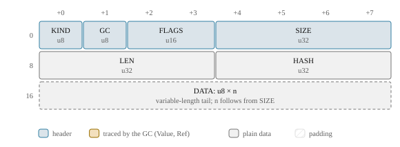
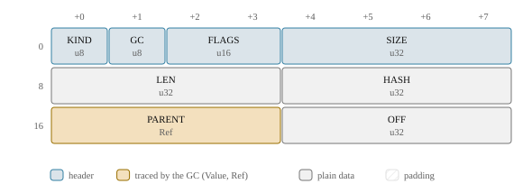

# Cells, strings and objects

The [arena](arena.md) is a row of cells, and [values](values.md) point at them; this
chapter is about what the cells are. JavaScript's data types are not stored the way the
spec describes them: a string may be a tree of pieces or a window into another string,
an object's keys may live in a structure shared by thousands of objects, and an array's
elements sit apart from its named properties. Each representation saves memory or time
on what codemode scripts do most, and each has a rule that keeps it out of the script's
sight.

> **In short.** Strings are one-byte or two-byte flat cells, plus ropes for
> concatenation, append buffers for `s += x` loops and slices for substrings. Property
> keys are **atoms**, small integers that stay valid across collections. Objects keep
> their named properties either in a values block described by a shared **shape** or in
> a private **dictionary** table, and their array elements in a separate dense store;
> Map and Set are ordered hash tables, and the weak collections are tables the collector
> understands.

## One declaration for every kind

Every cell kind is declared once, with explicit byte offsets, in the `cells!` macro of
[`heap/cells.rs`](../../crates/djs-core/src/heap/cells.rs). The declaration generates the
typed field accessors that Rust code uses (`arena.get(cell, Str8::LEN)`), compile-time
checks of the layout, and the `LAYOUTS` table. Everything else that needs to know a
layout reads that table:

- the garbage collector and the image verifier: a field declared as `Value` or `Ref` is
  traced, and that is the whole trace description, so a new cell kind is collected
  correctly the moment it is declared;
- the layout hash, part of every image's dependency descriptor, so that changing a
  layout makes old images refuse to load instead of being misread;
- the host's reader, through the generated `js/src/layout.generated.ts`;
- the diagrams in this guide and in the [cell layouts reference](ref-cells.md).

There are a couple of dozen kinds. JavaScript objects of every class (arrays, functions,
promises, maps, errors, typed arrays and the rest) are all one kind, `Object`; their
class is a field, and their class-specific state lives in the object's tail of slots.
The other kinds are strings, symbols and BigInts, and the internal structures objects
and code are built from: property tables, shapes, value arrays, function templates,
bytecode.

## Strings

JavaScript strings are sequences of UTF-16 code units, lone surrogates allowed. djs
stores them the way V8 does, in one of two flat kinds:

- **`Str8`**: one byte per code unit, for strings whose units all fit in Latin-1. Most
  strings in practice: JSON keys, identifiers, ASCII text.
- **`Str16`**: two bytes per unit (UTF-16LE). Constructors narrow, so a `Str16` always
  holds a unit above 0xFF. Equal strings therefore have the same width, and equal flat
  strings have equal bytes, so comparing them is a `memcmp`.

<!-- gen:cell Str8 -->


<!-- /gen -->

`HASH` caches the string's hash once it is computed (zero until then).

### Ropes and append buffers

A **`Rope`** is the concatenation of two strings, made when the result has at least 32
units. Shorter results are copied into a flat cell right away. A rope is flattened when
something needs its units in one piece: the flat copy is written once and the rope is
redirected to it.

<!-- gen:cell Rope -->


<!-- /gen -->

Codemode scripts build their output with `+=` in a loop, and a plain rope would make
that a chain of one node per append: millions of cells for the collector to move and a
million-deep tree to flatten. So once a string built by appending is a few hundred units
long, the chain switches to an **append rope**: a rope that means "the first `LEN` units
of this buffer", over a flat cell with spare capacity. `s += piece` writes the piece
into the buffer in place and makes a new 24-byte append rope with the longer length. The
old string is still the shorter rope over the same buffer, and still reads the same
units, because the units past its length are not part of it. Only the rope at the end of
the buffer may write into it; any other append copies first. Ten million
single-character appends in a function leave a sandbox with <!--n heap/append-10m-memory mb-->40.5 MB<!--/n--> of wasm memory
this way; a rope node per append would add 24 bytes for each, 240 MB.

```js live
const ascii = "codemode";
const wide = "naïve → done";   // '→' is above 0xFF: a two-byte string
let out = "";
for (let i = 0; i < 2000; i++) out += `line ${i}\n`;   // one append buffer
console.log(ascii.length, wide.length, out.length, out.slice(-10).trim());
```
<!-- gen:run -->
```text
8 12 18890 line 1999
```
<!-- /gen -->

### Slices

A codemode script typically reads a log or a file and cuts it up:
`text.split("\n")`, `line.slice(a, b)`, `JSON.parse(text)`. If every piece were a copy, a
5 MB log split into lines would hold 10 MB. A **`Slice`** is instead the units
`[OFF, OFF + LEN)` of a flat one-byte string, in a 24-byte cell:

<!-- gen:cell Slice -->


<!-- /gen -->

- Substrings, `split`'s pieces, regular expression matches and `JSON.parse`'s string
  values become slices when they have at least 32 units and the string they come from
  has at least 256. Shorter ones are copied, which is cheap and keeps nothing alive. A
  slice of a slice reads the same parent.
- Every reader that only needs the units reads them in place, as it does an append
  rope's, so a slice costs nothing to use. Flattening it, which an atom (a property key)
  or a Map key needs, copies the units once and turns the cell into a flattened rope in
  place.
- Only one-byte parents are sliced: a slice of a two-byte string could hold only narrow
  units, and equal strings must have equal widths.

On the log-splitting case the heap is 7.2 MiB with slices against 12.0 MiB with copies,
and a snapshot of it 6.9 MiB against 11.7. A slice keeps its whole parent alive, so a
short piece could pin a huge text; [the collector](gc.md#slices-and-the-strings-they-keep)
copies such slices out.

> **Trade-off.** Two widths, ropes and slices over one UTF-16 representation. A single
> representation would make every string operation simpler. But Latin-1 halves the
> memory of almost every string a codemode script sees, and the host reads a `Str8` with
> a cheap byte-to-char decode. Ropes make `+=` cheap, and slices make cutting a text up
> free. The cost is code: every string operation handles four kinds (and the append
> flags), and the hash is computed over code units so that it does not depend on the
> representation.

### Symbols and BigInts

A `Symbol` cell holds its description and its atom (below); private names (`#x`) are
symbols too, flagged so that no reflection sees them. A `BigInt` cell holds a sign flag
and the magnitude as 32-bit limbs.

## Atoms: property keys as integers

A property key is an **atom**, a `u32`:

- with bit 31 set, it is an array index (0 to 2³¹−1) stored in the atom itself, never
  interned, so element access never touches the atom table;
- otherwise it indexes the heap's atom table, with bit 30 telling symbols from strings.

Every symbol gets an atom too, so every property key is an atom and comparing keys is a
`u32` compare. Atoms are table indexes, not offsets, so they stay valid when the
collector moves the strings they stand for, and bytecode and property tables can hold
them without being rewritten. Well-known names (`length`, `prototype`,
`Symbol.iterator`) have fixed ids generated from a list in
[`heap/atom.rs`](../../crates/djs-core/src/heap/atom.rs), so the interpreter and the
builtins refer to them as constants. In a VM made from the base image the table has two
levels: the base's atoms with their hash index in the builtin prefix, never written, and
the VM's own after them, in a small list and index of its own.

Both levels hash strings with the same function, SipHash-1-3 over code units, under
different keys. The base's index uses a fixed key, the same in every VM of the build,
since the prefix must be. The VM's own index, and Map and Set, use a key derived from
the VM's random seed and kept in the image: the seed a host takes from its entropy or,
in [deterministic mode](determinism.md), from the run's seed. A
multiplicative hash with no key would be cheaper, but anyone can build thousands of
strings that collide under it, and a script that reads such keys from a web page would
spend quadratic time on them; under a secret key that does not work. A string caches
the hash of its level: the base's strings the fixed one, the rest the keyed one.
Reseeding a VM rehashes its own atoms and tables.

> **Trade-off.** Atoms are never freed. A script that creates millions of distinct keys
> (`obj["k" + i]`) grows the atom table for the life of the VM. A codemode VM usually
> lives for one script, so the table's growth is bounded by what that script does, and
> djs saves itself the bookkeeping of finding which atoms bytecode and tables still use.

## Objects

An `Object` cell has a class, a prototype, a reference to its named properties, a
reference to its dense elements, and a tail of class-specific slots:

<!-- gen:cell Object -->


<!-- /gen -->

### Shapes

Codemode scripts make many objects with the same keys: the rows of a tool result, the
records a `map` callback returns, instances of one class. Storing the keys in every
object would spend most of its memory on them. So an ordinary object starts in **shape
mode**: it holds only a `PropValues` block, and the block points to a **shape** that
lists the keys and their attributes in insertion order. A property's slot is its index
in the shape. Objects with the same key sequence share the shape:


<!-- gen:cell PropValues Shape -->


<!-- /gen -->

Shapes form a tree rooted in the `Roots` cell's `ROOT_SHAPE`. Adding a key moves an
object from its shape to the child for that key and its attributes, found by binary
search in the parent's sorted `TRANSITIONS`, or created there. A chain's descriptors are
one shared array that each extending child appends to, so a chain of n shapes costs O(n)
bytes. `JSON.parse`, the host's value decoder and object literals with a known key count
walk the transitions once per key and allocate the values block at its exact size, so
every record of a JSON array shares one chain.

In numbers: a `{a, b, c, d}` literal costs <!--n heap/literal4/shape .0-->72<!--/n--> bytes of heap per object with a shape
against <!--n heap/literal4/dictionary .0-->112<!--/n--> with a private table, and a five-key `JSON.parse` record <!--n heap/json5/shape .0-->104<!--/n--> against
<!--n heap/json5/dictionary .0-->152<!--/n-->. And
since a shape is something an [inline cache](interpreter.md) can compare,
property reads and additions on such objects hit the caches.

### Dictionary mode

Shapes pay off only while they are shared. An object switches to **dictionary mode**,
one way, when sharing is unlikely or the shape tree would grow without bound:

- it gets more than 32 named properties;
- an existing property changes its attributes (`defineProperty` on it, `Object.freeze`);
- it gets an array-index key in its table;
- a key is deleted, unless the object can go back to its parent shape or reach the
  remaining key sequence with at most one new shape;
- it is a builtin prototype or namespace (`Array.prototype`, `Math`) or the global
  object: one-off objects, for which a private table is smaller than a chain of unshared
  shapes;
- the heap's **shape budget** of 4096 shapes is spent and its key sequence has no shape
  yet.

A dictionary is a `PropTable` of 16-byte entries (key, flags, value) in insertion order,
searched linearly up to 8 entries and through a hash index above that. An accessor's
entry points to an `AccessorPair` cell holding the getter and the setter, which keeps
data entries at 16 bytes. A growing table's index has room for twice its capacity, so
lookups probe little; the builtin prototypes and namespaces in the base are full and
almost never grow, so theirs are sized for a load of three quarters, which halves most
of them at no measurable cost.

<!-- gen:cell PropTable -->


<!-- /gen -->

> **Trade-off.** Strong transitions and a budget over a collectable shape tree. V8 lets
> unused shapes die. In djs a parent keeps its children alive, so shapes never die, and
> the tree is capped at 4096 shapes per heap instead (about 160 KB typically, 2.3 MB at
> worst). Weak transitions would make the tree, and so the heap image, depend on when
> collections ran, and [deterministic runs](determinism.md) need images to be a function
> of the program alone. The cost: a script that creates thousands of distinct key
> sequences gets dictionaries once the budget is spent. Real scripts create 0 to 16
> shapes; the most any case of the differential test corpus creates is 59.

> **Trade-off.** The prototype stays in the object, not in the shape. Changing a
> prototype then touches no shape, and objects with the same keys share a shape whatever
> their prototype. The cost: the inline caches check the prototype separately, one
> compare more on a prototype hit.

### Elements

Array elements are not named properties. An object's `ELEMENTS` is a `ValueArray`
holding the dense part of its index keys, with a hole marker for missing ones. A dense
slot always means a plain writable, enumerable, configurable data property, so the
interpreter's element fast paths can read and write it directly. Anything else lives in
the property table:

- an index key with other attributes, or an accessor, goes to the table and sets the
  object's `OBJ_INDEXED_PROPS` flag;
- a write more than 64 slots past the end of the dense part goes to the table instead of
  creating 64 holes.

The fast paths check the flag once and can then trust the dense store. An array's
`length` is slot 0 of its tail, a Number, and a read-only length is a header flag. Typed
arrays and ArrayBuffers keep their bytes in an untraced `Bytes` cell.

### Functions

A closure's `length` and `name` are not stored either. Every function has both,
read-only and non-enumerable, and almost none ever changes them, so two header flags say
"this function still has the `length` and `name` its template records", and property
lookup, key listing and deletion answer from the template. Creating a closure then
defines no properties, so an arrow function passed to `map` inside a loop costs one
allocation and no shape search, and the builtins in every VM carry no storage for the
two. Deleting one clears its flag; any other change first stores both as ordinary
properties in front of the others, which keeps the key order the spec requires. Inline
caches cannot see the two keys in a shape, so for functions they look `length` and
`name` up instead of trusting a shape compare.

Only arrays ever get dense elements, so a closure keeps its function template in the
`ELEMENTS` field instead of a slot, and its slots are just its captured variables. That
makes every closure, and every builtin in every VM, 8 bytes smaller. The element paths
stay free of class checks: a template's first word, where an elements array keeps its
length, is always zero, so a closure read as an array has no elements.

## Map, Set and the weak collections

Map and Set are ordered hash tables in the heap: an entries array in insertion order, a
linear-probing index of entry numbers, and a live count. Keys follow SameValueZero:
numbers are normalized (−0 to +0, one NaN, the `INT` form where it fits) and strings
hash by content, through the VM's keyed hash described with the atoms above, so tool
data built to collide cannot make a table's lookups quadratic. Objects and symbols hash
by their offset, which the collector changes, so after every collection it rehashes, in
place, every table it moved or whose object keys it moved.

WeakMap and WeakSet keep their pairs in an `EphemeronArray`, a cell the collector does
not trace normally: a pair survives a collection only if its key is reachable some other
way, including through the values of other weak tables. WeakRef and
FinalizationRegistry are built from the same tables. Weak references make collection
timing observable, so a host can make them strong (nothing dies) or
absent ([determinism](determinism.md)).

```js live
const m = new Map([["b", 1], ["a", 2]]);
m.set(-0, "zero");
console.log([...m.keys()].join(","), m.get(0), m.size);
const s = new Set("hello");
console.log([...s].join(""));
```
<!-- gen:run -->
```text
b,a,0 zero 3
helo
```
<!-- /gen -->

> **Trade-off.** Rehashing after a collection over hashing by a stable id. A hash field
> in every object would cost 4 to 8 bytes in every object for the sake of the few used
> as Map keys, and rehashing lazily on a collection counter would let a later collection
> change the image. The cost: every collection is linear in the entries of the tables
> whose keys moved.

## Where to look

- [`crates/djs-core/src/heap/cells.rs`](../../crates/djs-core/src/heap/cells.rs): every
  cell kind and header flag ([all layouts](ref-cells.md)).
- [`crates/djs-core/src/heap/string.rs`](../../crates/djs-core/src/heap/string.rs):
  strings, ropes, append buffers, slices and the string hash.
- [`crates/djs-core/src/heap/atom.rs`](../../crates/djs-core/src/heap/atom.rs): atoms, the
  two-level atom table and the well-known names.
- [`crates/djs-core/src/heap/object.rs`](../../crates/djs-core/src/heap/object.rs):
  object classes, properties, dictionaries and elements.
- [`crates/djs-core/src/heap/shape.rs`](../../crates/djs-core/src/heap/shape.rs): shapes,
  transitions and the shape budget.
- [`crates/djs-core/src/heap/collection.rs`](../../crates/djs-core/src/heap/collection.rs):
  Map, Set, WeakMap and WeakSet.
- [`crates/djs-core/src/heap/weakref.rs`](../../crates/djs-core/src/heap/weakref.rs):
  WeakRef and FinalizationRegistry.
- [`crates/djs-core/src/heap/bigint.rs`](../../crates/djs-core/src/heap/bigint.rs):
  BigInt arithmetic on its cells.
