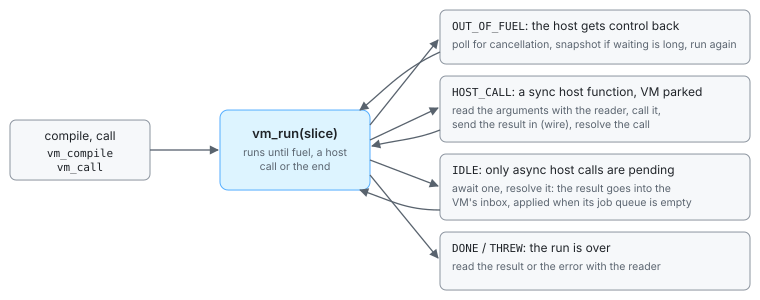

# The wasm boundary

djs never runs on its own. A host (an agent's codemode, a test runner, a browser page)
loads the djs-wasm module, gives it a script and the tools the script may call, and reads
the result. This chapter is about the boundary between the two at the level of the
module's exports: how a VM is made and driven, how host calls are reported and answered,
how values cross in each direction, how the base snapshot gets into the module, and which
builds of the module exist. Most hosts never see this level: the `Sandbox` of [the
JavaScript interface](js-api.md) wraps it, and [continuation dumps](dumps.md) shows how
it persists runs.

> **In short.** djs-wasm is a WebAssembly module with no imports and an ABI of integer
> functions. Data crosses through a staging buffer (in) and an out buffer, and values the
> host keeps are handles. The host drives a run by calling `vm_run` with a fuel slice and
> acting on the status it returns; host calls are records the host reads and answers by
> id. Values go in through a compact binary *wire format* that the VM decodes in one
> pass, and come out through the *reader*, which reads the VM's arena in place. The
> dumper lives in a second build of the module, because only hosts that persist runs
> need it.

## A module that needs nothing

`djs_wasm.wasm` ([`crates/djs-wasm`](../../crates/djs-wasm/)) is a thin export layer over
the Rust `Vm`. It has no imports at all: `WebAssembly.instantiate(module, {})` works in
node, in a browser or in any other wasm runtime. Everything a VM would normally ask its
environment for comes in as data instead. The clock is set before each slice
(`vm_set_now`), the random seed and the time zone are set explicitly, and there are no
files or network.

A panic in the engine (a bug, never something a script can cause: the heap is bounds
checked and every limit is a thrown error) traps, and the host discards the instance. A
debug build records the panic's message first, for the host to read (`djs_panic_ptr`,
`djs_panic_len`). The shipped module carries no panic messages, panic locations or
formatting code, to stay small: its standard library is built so that a panic is a bare
`unreachable` trap, and the `Sandbox` reports such a trap as an engine panic. A debug or
native build of the engine reproduces the real message. Every sandbox gets its own instance, so one trap cannot affect another.

One trap is not a bug. The parser's nesting limits keep its recursion within the
module's 128 KiB stack, but should some path still exhaust it, the stack pointer wraps
below 0 and the instance traps with "memory access out of bounds". The module exports
its stack pointer so that a host can tell: the `Sandbox` then reports "stack overflow:
the engine's wasm stack is exhausted" instead of a bare out-of-bounds access, and never
calls into that instance again.

> **Trade-off.** An import-free ABI of integer functions over a richer binding such as
> the component model or wasm-bindgen. The module runs anywhere with nothing to wire up,
> and the boundary is small enough to check in a table. The cost: the host does the
> bookkeeping (handles, buffers, re-deriving its views of memory after every call, since
> any call can grow memory), which is why the `Sandbox` class exists.

## Buffers, handles and numbers

The exports take and return `i32`s, except the `f64` clock of `vm_set_now` and
`vm_resolve_host_call_at`. Data crosses through two buffers in linear memory:

- the **staging** buffer, host to module: `djs_staging(len)` makes it at least `len`
  bytes and returns its address; the host writes source text, names, wire data or
  argument handles there and then calls the export that consumes them. Exports that take
  several pieces take their lengths and read them one after another (`vm_compile_file`:
  the file name, the parameter names, the source);
- the **out** buffer, module to host: exports that return data (an error message,
  display text, value bits, a host call record, a dump) fill it, and the host reads it at
  `djs_out_ptr()` and `djs_out_len()`.

Both stay valid until the next call into the module. Any call can grow memory, which
detaches the host's `ArrayBuffer`, so the host re-derives its views after every call.

VMs are numbered from 1, so one instance can hold several. A value that must outlive a
call is a **handle**: a slot in a table of GC roots in the VM's heap, numbered from 1.
As an argument, handle 0 means `undefined`; as a result, 0 means failure, with the reason
as UTF-8 text in the out buffer. The host frees handles with `vm_handle_free`. Using a
freed VM or handle traps. `djs_abi_version()` names the ABI, which changes with any
incompatible change to the exports, and the `Sandbox` checks it.

## The exports

The shipped module has <!--n wasm/exports-->63<!--/n--> exported functions. By area:

| area | exports |
| --- | --- |
| buffers and build | `djs_staging`, `djs_image_staging`, `djs_out_ptr`, `djs_out_len`, `djs_abi_version`, `djs_build_hash`, `djs_panic_ptr`, `djs_panic_len`, `djs_debug_panic` |
| the base snapshot | `djs_base_coded_ptr`, `djs_base_inject_ptr`, `djs_base_inject`, `djs_base_ptr`, `djs_base_len` ([below](#the-base-in-the-module)) |
| VMs | `vm_new`, `vm_new_reserved`, `vm_new_with` (flag 1: frozen builtins), `vm_frozen_builtins`, `vm_free`; images: `vm_arena_ptr`, `vm_arena_len`, `vm_from_bytes`, `vm_replace_image`, `vm_collect`, `vm_seal` |
| code | `vm_compile` (a Script, or a codemode body with parameter names; option bits for TypeScript and decorators), `vm_compile_file` (the same, with the file name stack traces show) |
| values in | `vm_decode_wire`, `vm_string_reserve`, `vm_parse_json`, `vm_global`, `vm_new_object`, `vm_define`, `vm_new_error` |
| values out | `vm_handle_bits` (a value's 64 bits, for the reader), `vm_display`, `vm_json_stringify`, `vm_promise_state`, `vm_handle_free` |
| running | `vm_call`, `vm_run`, `vm_fuel_used`, `vm_abort`, `vm_result`, `vm_outcome`, `vm_take_unhandled_rejections` |
| host functions and calls | `vm_new_host_function`, `vm_new_async_host_function`, `vm_host_call`, `vm_host_call_info`, `vm_new_host_calls`, `vm_resolve_host_call`, `vm_resolve_host_call_at` |
| the environment | `vm_set_now`, `vm_set_time_zone_offset`, `vm_set_random_seed`, `vm_set_math_random_seed`, `vm_set_weak_refs`, `vm_canonical_hash` ([determinism](determinism.md)) |
| loading a dump | `vm_dump_runtime`, `vm_open_call`, `vm_restore_math_random`, `vm_set_next_call_id` |

The dump build adds the dumper and what serves it:

| export | does |
| --- | --- |
| `vm_dump` | writes the idle VM as a dump into the out buffer, or the reasons it refuses, one per line. Staging names the host's globals, its function names by id, the values it wants back, its namespace objects and its state of each open call |
| `vm_set_dump_source_refs` | whether a dump names the script the run started with by reference (the default) or carries its text |
| `vm_call_site` | where the run waits on open call `id`: `line:col:file` in the out buffer, the position of the `await` of the innermost activation waiting on it, directly or through `Promise.all` and the like; 0 when nothing waits on it at a known position. The `Sandbox` offers it as `callSite(id)`, and the live examples of this site use it to say where a run paused |
| `vm_compile_cached`, `vm_dump_maps_export`, `vm_dump_maps_import` | the compile cache and the suspension maps across VMs ([the dumper's caches](continuations.md#the-dumpers-caches)) |

Loading a dump needs no export of its own: it is running a Script with `$djs` defined.
The four "loading a dump" exports serve the hooks while it runs: `vm_dump_runtime`
evaluates the runtime's helpers from text the host passes, `vm_open_call` reopens an open
call under its old id from inside the `$djs.resume` hook, and the other two restore
`Math.random`'s state and the next call id.

## Driving a run

A run is a loop on the host side. The host compiles the script as a codemode function
body (`vm_compile`), starts the call (`vm_call`, the argument handles in staging) and
then calls `vm_run` with a fuel slice. `vm_run` returns a status, the host acts on it and
runs again:

| status | the host then |
| --- | --- |
| 0 DONE, 1 THREW | takes the value with `vm_result` and reads it |
| 2 OUT_OF_FUEL | checks its deadline, runs again or gives up (`vm_abort`) |
| 3 HOST_CALL | serves the sync call the VM is parked on, resolves it, runs again |
| 4 IDLE | waits for one of the open async calls, resolves it, runs again |
| 5 HOST_OUT_OF_MEMORY | the host could not back the heap below its cap: the call is abandoned, the VM stays usable |

The fuel slice is how the host keeps control ([fuel](limits.md#fuel)). A slice of a
million fuel is a few milliseconds of work; a long leaf operation can overshoot its slice,
and the overshoot is charged to the next one. Between slices the host can check a
deadline, cancel the run with `vm_abort`, or simply leave the run where it stopped ([suspend
anywhere](goals.md#suspend-anywhere)). `vm_fuel_used` tells how much the last `vm_run`
used, so a host that stops at host calls can count fuel across them. `vm_run` also runs
the promise job queue to empty, so DONE means the script and everything it started have
finished.

## Host calls

A host function is made with a numeric id of the host's choosing and a name
(`vm_new_host_function`, `vm_new_async_host_function`) and bound wherever the host likes
with `vm_define`: as a global, as a member of a namespace object such as `tools`, or
passed as a parameter of the body. There are two kinds:

- A **sync host function** parks the VM: `vm_run` returns HOST_CALL, and
  `vm_host_call` writes the call's record to the out buffer: `[call id, function id,
  this, args...]`, each value as its 64 bits, for the reader. The raw bits stay valid
  until the next `vm_run` or collection, since a collection moves cells, so the host
  reads the arguments right away. It calls its function, sends the result in through the
  wire format and answers with `vm_resolve_host_call(call id, ok, value)`: `ok` 1
  returns the value from the call, `ok` 0 throws it at the call, where the script can
  catch it.
- An **async host function** returns a promise in the VM at once, and the script goes
  on. After every `vm_run`, `vm_new_host_calls` lists the ids of the calls made since the
  last check, and `vm_host_call_info(id)` gives each one's record. Several can be open
  together, as in `Promise.all(files.map(readFile))`. When nothing but open calls is
  left, `vm_run` returns IDLE. The host answers each with the same
  `vm_resolve_host_call`: `ok` 1 fulfills its promise, `ok` 0 rejects it.

The open calls are a table in the heap, so a VM that waits for ten tools is as complete
an image as any other ([suspension](suspension.md#host-calls)).

Results of async calls can come back at any time: after a fuel slice, while the VM is
parked on another call, several at once. If the VM applied each result as soon as the
host delivered it, the order in which promise callbacks run would depend on the fuel
slice and on network timing. So results are **macrotasks**: they wait in an inbox in the
heap, and `vm_run` takes the oldest one only when the job queue is empty, then drains the
queue again before the next. What a script does depends only on the order of the results,
as with I/O callbacks in an event loop. `vm_resolve_host_call_at` also gives the time
`Date` reads from when the result is applied: a virtual clock that moves only with
results, which is what [deterministic runs](determinism.md) build on.

> **Trade-off.** Results as macrotasks over delivering them immediately. Ordering by
> delivery, not by arrival time, makes runs reproducible and lets a replay deliver the
> results one at a time at any fuel slice. The cost: a result that arrives while the
> script is busy waits until its current job queue drains, which is the same latency an
> event loop has, and the host must not assume that a resolved call has run its
> callbacks by the time `vm_resolve_host_call` returns.

> **Trade-off.** Sync host functions park the whole VM. That keeps them simple to
> implement and to suspend (a parked call is just an entry in the heap), but only one can
> be outstanding at a time. Scripts that call tools concurrently need async host
> functions.

## The base in the module

A VM created with `vm_new` is a copy of the [base snapshot](snapshots.md#the-base-snapshot),
so creating one is a memory copy, not an initialization. The module carries the base
coded with djs's own small compressor (<!--n wasm/base-coded kb-->46 KB<!--/n--> for the full build's <!--n base/bytes kb-->186 KB<!--/n-->), in a
custom section named `djs_base`. A custom section is outside the instance's linear
memory: a copy in memory would cost every instance pages for bytes it reads once.

So the host hands the section to a fresh instance: `djs_base_coded_ptr(len)` returns room
for it, the host writes the bytes, and the instance decodes them when it needs the base,
which takes a few milliseconds. Every sandbox is its own instance, so a host decodes only
once per compiled module: it keeps the first instance's decoded copy (`djs_base_ptr`,
`djs_base_len`) and writes it into each new instance instead (`djs_base_inject_ptr`, then
`djs_base_inject`, which checks the bytes' length and hash before taking them).
[`js/src/base.ts`](../../js/src/base.ts) does this for the `Sandbox`.

The decoded or written bytes then become the first VM's arena as they are, grown in
place: the instance keeps no copy of its own. Only an instance that makes a second VM
decodes the base again and keeps that copy for any further VMs. A fresh sandbox is
<!--n heap/sandbox-memory kib-->640 KiB<!--/n--> of wasm memory: the stack, the static data, the allocator's first pages and the
base.

## Values in: the wire format

Tool results are the data a codemode script receives: long strings, arrays of similar
objects, base64 images. Converting them into VM values is on the hot path ([cheap data
passing](goals.md#cheap-data-passing)). The usual way, `JSON.stringify` on the host and
`JSON.parse` in the VM, parses text that the host has just produced, and has to escape
and copy every string twice.

djs uses its own binary format instead. [`js/src/wire.ts`](../../js/src/wire.ts) encodes
a host value in one pass: tagged numbers (`int8`, `int32`, `float64`), strings as UTF-8
written with `TextEncoder.encodeInto`, arrays with their holes, objects whose repeated
keys are interned in a key table, and `Uint8Array`s as raw bytes. The VM's decoder
(`vm_decode_wire`) allocates every cell at its final size in one pass and transcodes
UTF-8 to the VM's one-byte or two-byte strings natively. The format is validated as it
is decoded: malformed input is an error, never a corrupt heap. A host that holds JSON
text already can pass it to `vm_parse_json` instead.

A large string on its own skips the staging buffer when it is ASCII, which is the common
case for a tool result passed as JSON text. The encoder's output already shows it: the
UTF-8 is exactly as long as the string. The host then asks the VM for an empty one-byte
string of that length (`vm_string_reserve`), finds its characters in the arena (16 bytes
past the string's offset, which `vm_handle_bits` gives), and copies the encoded bytes
straight there. That saves the staging copy and the transcode, and the staging buffer,
which would otherwise keep the size of the largest result for the life of the instance,
does not grow: a 10 MiB result leaves a sandbox with <!--n heap/string-10mib-memory mib-->13.4 MiB<!--/n--> of wasm memory, against
<!--n heap/string-10mib-staged-memory mib-->33.5 MiB<!--/n--> for one with a non-ASCII character.
Any other string goes through the wire, so text with a single non-ASCII character pays
nothing for the attempt.

> **Trade-off.** A binary format over JSON. Measured in wasm, the VM decodes it
> <!--n wire/decode-vs-json-objects .1-->1.9<!--/n--> times as fast as it parses the same objects as JSON, and <!--n wire/decode-vs-json-string .0-->16<!--/n--> times as fast for one
> large string, which becomes a memory copy instead of an escaping serializer and a
> parser. The one place it loses is the encoder on many small objects, where V8's
> native `JSON.stringify` is faster than the JavaScript encoder; the decoder more than
> makes up for it. The cost: a format and two implementations (TypeScript and Rust) to
> keep in agreement, which cross-language tests check.

## Values out: the reader

Going the other way, the VM does no work at all. The host reads a value straight out of
the arena with [`js/src/reader.ts`](../../js/src/reader.ts): a value is 64 bits (see
[values](values.md)), which `vm_handle_bits` or a host call record gives; a reference is
an offset into the arena (`vm_arena_ptr`), and the reader decodes cells in place. A
one-byte string becomes a host string through `String.fromCharCode` over the bytes, a
two-byte one through `TextDecoder("utf-16le")`, and objects and arrays are walked.

The reader hard-codes nothing about the heap. It uses
[`js/src/layout.generated.ts`](../../js/src/layout.generated.ts), which is exported from
the same `cells!` table the collector and the image verifier use, so a change to a cell
layout is a regeneration, not a reader rewrite. The reader checks the layout hash in the
roots cell and refuses an arena from another build.

What the host gets is a tree, like JSON ([values in and
out](js-api.md#values-in-and-out) has the mapping): plain objects with the own enumerable
string-keyed data properties, arrays with their holes, typed arrays as copies, BigInts as
`bigint`, and `Opaque` markers for functions, symbols and other objects. A cycle is a
`TypeError` naming its path.

> **Trade-off.** Reading the arena directly over serializing in the VM. Reading a value
> takes less time than the VM alone needs to turn it into JSON, before the host has
> parsed anything: <!--n wire/read-vs-json-objects .1-->1.9<!--/n--> times less for many small objects, <!--n wire/read-vs-json-text .0-->10<!--/n--> times less for text with
> non-ASCII characters, and a 1 MiB string reads at memory-copy speed. The cost: the reader depends on the heap
> layout (made safe by generating it from the engine's own table), the VM must not run
> while a read is in progress (a collection moves cells), and sharing is not preserved,
> so a value with the same object at many places is read once per reference (a value
> budget turns a blow-up into an error).

## The module builds

[`scripts/build-wasm.sh`](../../scripts/build-wasm.sh) builds the module in four
variants from one source, by cargo features:

| build | features | what it is for |
| --- | --- | --- |
| shipped | `full`, `unicode` | every host: <!--n wasm/bytes mb-->1.0 MB<!--/n-->, <!--n wasm/gzip kb-->429 KB<!--/n--> with gzip |
| slim | none | hosts that can do without typed arrays, BigInt, iterator helpers and the other families scripts never use ([full and slim](builtins.md#two-builds-full-and-slim)): <!--n slim/bytes mb-->0.9 MB<!--/n-->, <!--n slim/gzip kb-->363 KB<!--/n--> with gzip |
| dump module | the shipped features and `dump` | the dumper, for hosts that persist runs: <!--n dump/bytes mb-->1.9 MB<!--/n-->, <!--n dump/gzip kb-->760 KB<!--/n--> with gzip |
| docs module | the dump module's and `docs` | this site's live examples: the dump module plus `djs_disasm`, the bytecode listing an edited example shows |

The `dump` feature brings the writer of continuation dumps, the suspension-map recording
in the compiler, the table of the base's builtin names, the compile cache, and lazy
compilation of functions at their first call. It does not change images: the dump module
loads the shipped module's images, because the two have the same dependency descriptor
([what an image depends on](snapshots.md#what-an-image-depends-on)).

A host that persists runs loads both modules. Its sandboxes run in the shipped one. To
dump, it copies the idle VM's image into a VM of the dump module (`djs_image_staging`,
then `vm_from_bytes` the first time and `vm_replace_image` after that, which replaces the
heap and keeps what the VM derived from the base) and calls `vm_dump` there; the
`Sandbox` keeps one such instance per process and memory limit for all its dumps. The
image never leaves the process, so neither module verifies it cell by cell, only that
its descriptor matches. Loading a dump runs it as a Script, which the shipped module does
alone.

> **Trade-off.** The dumper in a second module. The dumper and what serves it nearly
> double the module, and only hosts that persist runs need them. So the shipped module
> leaves it out, and a host that dumps pays for it only in a module it loads once per
> process. Keeping that instance between dumps makes a dump as fast as with the dumper in
> one module; the cost is a second module to ship and load, and a copy of the image per
> dump.

## Where to look

- [`crates/djs-wasm/src/lib.rs`](../../crates/djs-wasm/src/lib.rs): every export, with
  its contract in its doc comment; [`crates/djs-wasm/Cargo.toml`](../../crates/djs-wasm/Cargo.toml):
  the features of the builds; [`scripts/build-wasm.sh`](../../scripts/build-wasm.sh):
  how each is built.
- [`crates/djs-core/src/wire/`](../../crates/djs-core/src/wire/): the wire decoder;
  [`js/src/wire.ts`](../../js/src/wire.ts): the encoder.
- [`js/src/reader.ts`](../../js/src/reader.ts) and
  [`js/src/layout.generated.ts`](../../js/src/layout.generated.ts): the reader and the
  layout it reads by.
- [`js/src/base.ts`](../../js/src/base.ts): handing the base to an instance;
  [`js/src/trap.ts`](../../js/src/trap.ts): what a trap says.
- [`js/src/sandbox.ts`](../../js/src/sandbox.ts): the `Sandbox`, the client of all of
  the above, and how it uses the dump module.
