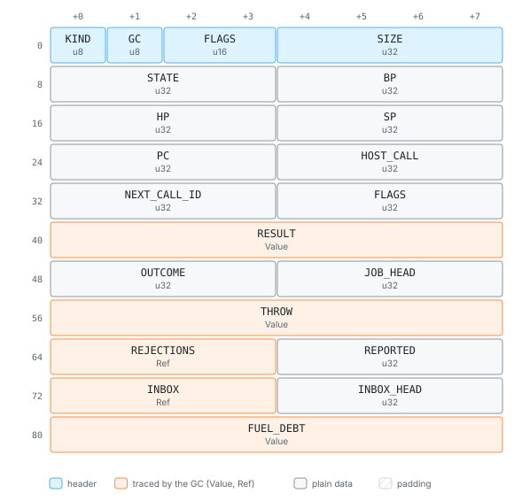

# The interpreter: frames in the heap

The interpreter runs the bytecode [the compiler](compiler.md) writes, and its shape
follows from the goal to [suspend anywhere](goals.md#suspend-anywhere): execution must be
able to stop between any two instructions and continue later. An interpreter that calls
itself recursively for every JavaScript call keeps half of the program's state on the
Rust stack, where no image can reach it. djs's interpreter never does. This page shows
how frames, calls, getters, conversions and exceptions work under that rule, and how the
interpreter stays fast anyway.

> **In short.** The interpreter is one loop. A JavaScript call writes a frame record onto
> a value stack that lives in the arena and continues the loop; a return pops it. An
> instruction that needs user code (a getter, `valueOf`, an iterator) pushes a frame for
> it with a fixed *continuation* that says what to do with the result, and finishes; it
> never resumes half-way. So the Rust stack is the same depth whatever JavaScript does,
> and the arena alone describes where execution is.

## One loop

In outline, `run` is this:

```text
loop {
    if fuel <= 0 { save the registers to the arena; return OutOfFuel }
    decode the instruction at pc; charge its fuel; execute it
}
```

The registers are a handful of indexes: `bp` and `hp` (the current frame's base and
header) and `sp` (the top) into the value stack, and `pc` into the current function's
bytecode. Whenever `run` returns, for whatever reason, they are written into the
`Interp` cell of the arena, next to the rest of the run's state: the host call the VM is
parked on, the job queue's head, the result of the last call, the fuel debt.

<!-- gen:cell Interp -->


<!-- /gen -->

What makes `run` return (fuel, a host call, the end of the work) and how the host
continues is the subject of [the next chapter](suspension.md#what-a-stop-looks-like).

## Frames on the value stack

The value stack is a growable array of values in the arena (`Roots::STACK`), addressed
by index, so growing it moves nothing the interpreter holds. A call frame is a stretch
of it:

```text
bp      callee            the function object
bp+1    this
bp+2    arg0 .. arg(n-1)  n = max(argc, declared parameters), padded with undefined
hp      prev_bp           int32
hp+1    prev_hp           int32
hp+2    ret_pc            int32: the caller's pc to resume
hp+3    argc              int32: actual argument count
hp+4    flags             int32: continuation | construct bit | native bit
hp+5    new_target        Value
lp      locals            lp = hp + 6, filled with undefined
sb      operand stack     sb = lp + locals
```

A call instruction finds the callee, `this` and the arguments already on the operand
stack in exactly this order, so they *become* the new frame's first slots with no
copying. The call writes the six header words, fills the locals with `undefined`, and
jumps to the callee's first instruction. A return reads the header, puts the result
where the continuation says, and restores the caller's registers.

Every header word is an ordinary value (the indexes are int32 values), so the collector
traces the stack as a plain array of values, and an image needs no frame serializer: the
stack is just a cell. A frame holds no pointer into another frame either, because
closures capture boxes, not stack slots ([the compiler](compiler.md#names-are-resolved-after-parsing)).
That is what lets a generator or an async function park its frame by copying its slice
of the stack into a heap object and resume it later at any depth ([generators and async
functions](suspension.md#generators-and-async-functions)).

```js live
function depth(n) { return n === 0 ? 0 : 1 + depth(n - 1); }
console.log(depth(10000));
```
<!-- gen:run -->
```text
10000
```
<!-- /gen -->

Ten thousand nested JavaScript calls use ten thousand frames in the arena and one Rust
stack frame. The limit is the size of the value stack, 2²⁰ slots by default; beyond it a
call throws `RangeError: Maximum call stack size exceeded`, the message QuickJS and V8
give ([limits](limits.md#stack-depth)).

> **Trade-off.** A stackless interpreter over a recursive one. A recursive interpreter
> gets its frames for free from the native stack and can call back into JavaScript from
> anywhere in Rust. djs writes every frame into the arena instead, a few stores per
> call, and gives up calling JavaScript from Rust entirely. What it gets is that any
> instruction boundary is a complete, copyable state: suspension, images and fuel limits
> cost nothing extra.

## What a call does

The call instructions all end in one routine that looks at the callee's object class:

| callee | what happens |
| --- | --- |
| a closure of bytecode | a frame is pushed and the loop continues at its first instruction |
| a lazy closure | the same; its only instruction, `lazy`, compiles the body and continues in the same frame ([lazy functions](compiler.md#lazy-functions)) |
| a builtin with a `@fast` entry | the entry runs in Rust and either completes the call or declines, and the call goes on as below |
| a `@native` builtin | a **native frame** is pushed: a Rust state machine runs in it |
| a bound function or a Proxy | the frame is rewritten (the target, the bound `this` and arguments, or the trap) and dispatched again |
| a builtin closure | the frame is rewritten to call the builtin it names, with its data as `this` |
| a host function | the call is recorded in the heap for the host |

Builtins are mostly ordinary closures: they are bytecode compiled from TypeScript and
installed in the base image ([builtins](builtins.md)), so calling `Array.prototype.map`
is the same frame push as calling a script's own function. Their bytecode reaches Rust
through `call_intrinsic`, an instruction that only privileged code can contain and that
runs a leaf operation in Rust, one that never runs user code, or pushes a frame where it
must. Builtin closures cover the small functions the specification creates on the fly,
such as a promise's resolving functions: an object that names a builtin and holds one
data value.

A **native frame** is the same frame record with a bit set in its flags, the state
number where a bytecode frame keeps its `pc`, and the builtin's locals in the frame's
slots. When `sort` calls its comparator, it does not call it from Rust: it writes the
callee's frame on top of its own, saves the state to resume at, and returns to the loop.
The loop runs the comparator like any other closure, and its return re-enters the native
frame at the saved state. A native builtin in the middle of its loop is therefore as
suspendable as bytecode. [Builtins](builtins.md#two-backends-from-one-source) shows the
generated code.

A **host function** never runs inside the loop at all. A synchronous one parks the VM:
the call copies its arguments into a pending-call cell, sets `pc` past the call as if a
callee had been entered, and `run` returns to the host, which later resolves the call
with a value that lands where a return value would. An asynchronous one returns a new
promise at once and the run goes on; the host settles it later. [Host
calls](suspension.md#host-calls) describes both from the host's side.

## Instructions that call user code

Many instructions can run user code: `get_field` on a getter, `+` on an object with
`valueOf`, `for-of` on a user iterator, `instanceof` with `Symbol.hasInstance`, anything
on a Proxy. A recursive interpreter would call the user function from inside the
instruction and wait. djs's rule is that **an instruction never resumes in the middle**:

1. It runs its fast path, in plain Rust that runs no user code.
2. If user code is needed, it pushes a frame for the callee, with a continuation in the
   frame's flags, and is finished.
3. When that frame returns, the continuation completes the instruction's job.

There are only a few continuations:

| continuation | on return |
| --- | --- |
| `PushResult` | push the value on the caller's operand stack (calls, getters) |
| `DiscardResult` | drop it (setters) |
| `ConstructResult` | use it if it is an object, else the frame's `this` (constructors) |
| `Entry` | the bottom frame of the embedder's call: `run` returns `Done` |
| `Job` | the bottom frame of a promise job: drop it and run the next job |
| `Replace(slot)` | store it in a stack slot of the caller and continue after the instruction |
| `Retry(slot)` | store it in a stack slot and run the same instruction again |
| `Each` | a callback of `%EachDense`: complete the loop's step, then enter the same frame again for the next element, or hand the builtin the index its own loop goes on from |

`Retry` is how conversions work. When `+` finds an object operand, it calls the builtin
`%ToPrimitive` on it with `Retry` aimed at the operand's own stack slot. When
`%ToPrimitive` returns, the primitive replaces the object and the `+` runs again from
the start, this time on primitives. The multi-step logic (look up `Symbol.toPrimitive`,
then `valueOf`, then `toString`) lives in a builtin, where stopping is free, and the
interpreter has no per-instruction state machines.

```js live
const price = { valueOf() { console.log("valueOf runs"); return 40; } };
const order = { get total() { console.log("getter runs"); return price + 2; } };
console.log(order.total);
```
<!-- gen:run -->
```text
getter runs
valueOf runs
42
```
<!-- /gen -->

Here `get_field total` pushes a frame for the getter with `PushResult`; inside it, `add`
pushes a frame for `%ToPrimitive` with `Retry`, which calls `valueOf` with `PushResult`.
Three frames deep, and the Rust stack never grew. Each of those calls is an instruction
boundary at which the VM could have stopped and been copied.

> **Trade-off.** Re-entry through frames over per-instruction resume states. An
> instruction could instead keep a small numbered state and pick up in the middle after
> the user code returns, but every such state would have to be saved where an image can
> see it, and tested at every point it can stop. Pushing a frame and finishing keeps the
> interpreter free of that. The cost is speed on the slow path: an object operand to `+`
> takes a call into a builtin and a second execution of the instruction, which is fine
> because the fast path covers the common cases.

## Exceptions

Each function template has a **handler table** of `(start, end, handler, depth)`
entries, innermost first. A throw at `pc` looks for the first entry covering `pc`. If
there is one, the operand stack is cut to `depth`, the exception is pushed, and
execution jumps to the handler. If not, the frame is popped and the search continues in
the caller, at the call instruction. An `Entry` frame without a handler makes `run`
return `Threw(value)`.

Errors raised in Rust, a TypeError from a property access on `undefined` or a RangeError
from a conversion, take the same path. A Rust operation returns a fault instead of
throwing; the loop turns it into an error object, with a QuickJS-style stack trace read
from the frame records and the templates' line tables, and throws it at the instruction
that failed. An allocation that hits the heap cap is a fault too: for instructions that
allocate before they change anything, the loop collects and runs the instruction once
more before it gives up ([out of memory](gc.md#out-of-memory)).

`finally` blocks are compiled once and entered with a plain jump. Normal exit,
`return`, `break`, `continue` and a thrown exception all reach the same code after
storing their **completion** in two hidden locals: a kind (0 normal, 1 throw, 2 return,
or a number naming the statement a `break` or `continue` goes to) and a value (the
exception or the return value). The end of the block looks at the kind and goes on: past
the `try`, rethrowing, returning, or jumping, through the next `finally` block out if
there is one:

```js
let log = [];
try {
  log.push("try");
} finally {
  log.push("finally");
}
return log;
```

<!-- gen:disasm -->
```text
function 0 <anonymous>: params=0 locals=4 stack=3 captures=0
  handler [7, 19) -> 40 depth 0
  handler [3, 49) -> 49 depth 0
    0  async_start loc0 (<state>)
    3  array_from 0
    6  put_loc1 (log)
    7  get_loc1 (log)  ; 3:3
    8  get_method "push" ic0  ; 3:6
   15  push_const8 #0 ("try")
   17  call1  ; 3:11
   18  drop
   19  push0
   20  put_loc2 (<temp>)
   21  get_loc1 (log)  ; 5:3
   22  get_method "push" ic1  ; 5:6
   29  push_const8 #1 ("finally")
   31  call1  ; 5:11
   32  drop
   33  get_loc2 (<temp>)
   34  jump_if_false8 -> 45
   36  get_loc3 (<temp>)
   37  undefined
   38  put_loc3 (<temp>)
   39  throw
   40  put_loc3 (<temp>)
   41  push1
   42  put_loc2 (<temp>)
   43  jump8 -> 21
   45  get_loc1 (log)  ; 7:8
   46  async_return loc0 (<state>)
   49  async_reject loc0 (<state>)
```
<!-- /gen -->

The completion is in locals, not on the operand stack, so a function stopped inside a
`finally` block holds nothing an image or a dump has to interpret: the kind is a number
that means the same in any build. Closing a `for-of` loop's iterator when a jump or a
`return` leaves the loop works the same way.

> **Trade-off.** Handler tables over a stack of catch offsets. QuickJS pushes catch
> offsets onto the value stack and scans for them while unwinding. A table keeps the
> stack plain, so the collector and images never need to know about `try`. The cost is
> a table lookup per frame while unwinding, which only happens on a throw.

## Making it fast

A straightforward loop that decodes an instruction, dispatches through a large `match`
and returns a `Result` from every arm spends more time on its own bookkeeping than on
simple instructions. djs keeps the general path for the full semantics and puts a
faster loop in front of it:

- **The tier-0 loop** (`run_hot`) is the main loop. It keeps `pc`, `sp`, the fuel and
  the current frame's data in Rust locals and handles the hottest cases itself: locals,
  constants, int32 and float arithmetic, comparisons, jumps, calls of plain closures and
  returns, inline-cache hits, dense array elements, `@fast` builtin calls and the
  builtins' pure leaf intrinsics: type tests, conversions of primitives, the string and
  `Math` leaves. A leaf that throws is declined and runs again on the general path,
  which throws from there; leaves change nothing before they fail, so the second run
  sees what the first one saw. Anything
  else, and any case it declines (an int overflow, an object operand), goes to the
  general path (`step_once`), which runs that one instruction after the locals have been
  written back. Two declined cases are finished on the way out instead, by one call that
  keeps the loop's own code as small as it is: a `@fast` builtin call (with `arr.push(x)`
  appended straight to the array) and `+` of a string with a primitive. V8 compiles the
  whole loop as one function, and even small additions to it slowed every plain call. Nothing the tier-0 loop does itself can collect or run user code, which
  is why it may hold the state in locals. It charges the same fuel and stops at the same
  safepoints as the general path, so turning it off changes no result, no fuel count and
  no image.
- **Inline caches.** Property and global accesses carry a cache slot number (the `ic0`
  in the disassembly), and the slots live with the function's template. A slot remembers
  where a property was found: a shape, a table index, or a prototype holder validated by
  an epoch. A hit is a compare and a load; a stale slot is a miss and is refilled, so
  caches never change what a program does. The collector empties the slots that hold
  heap offsets, so a VM restored with warm caches behaves exactly like one with cold
  caches.
- **Iteration without result objects.** `for-of` and array destructuring over arrays,
  strings, Maps and Sets step the iterator inside the interpreter when `next` is the
  original builtin, without allocating `{value, done}` objects (`iter_next`); a loop
  keeps its iterator and `next` in two locals, which `iter_next_loc` reads in the same
  instruction.
- **Callbacks in one frame.** `map`, `forEach`, `filter` and the other callback loops
  hand their dense part to the intrinsic `%EachDense`, which keeps the loop's state in
  its own arguments below the callback's frame and pushes that frame once, with the
  `Each` continuation. When the callback returns, the loop completes the step (the
  store into `map`'s result, say) and rewrites the same frame for the next element:
  arguments, `undefined` locals, `pc` 0.

Each of these is measured in wasm under V8 before it is kept, because the register
allocation of a dispatch loop is fragile and an extra arm can make the hottest
instructions slower. One rule follows from V8's machine code for the loop: nothing
computed for every instruction (the instruction word, an immediate, the opcode) may stay
alive across a heap call in any arm. V8 spills such a value where it is defined, so
every instruction would pay a store. The arms therefore extract their own immediates and
read the opcode again after a call. The tier-0 loop also returns to the outer loop every
16,384 backward jumps, because V8 moves wasm code to its optimizing tier only between
calls, and a loop that never left would stay in the baseline code.

## Where to look

- [`crates/djs-core/src/interp/frame.rs`](../../crates/djs-core/src/interp/frame.rs):
  the frame layout and the continuations.
- [`crates/djs-core/src/interp/run.rs`](../../crates/djs-core/src/interp/run.rs): the
  run loop, `step`, and `call` with its dispatch on the callee.
- [`crates/djs-core/src/interp/run/hot.rs`](../../crates/djs-core/src/interp/run/hot.rs):
  the tier-0 loop; [`run/ic.rs`](../../crates/djs-core/src/interp/run/ic.rs): inline
  caches; [`run/iter.rs`](../../crates/djs-core/src/interp/run/iter.rs): iteration
  without result objects.
- [`crates/djs-core/src/interp/run/native.rs`](../../crates/djs-core/src/interp/run/native.rs):
  native frames; [`run/fastpath.rs`](../../crates/djs-core/src/interp/run/fastpath.rs):
  calls of `@fast` builtins; [`run/each.rs`](../../crates/djs-core/src/interp/run/each.rs):
  `%EachDense`.
- [`crates/djs-core/src/interp/run/stack.rs`](../../crates/djs-core/src/interp/run/stack.rs):
  stack traces and throwing faults.
- [`crates/djs-core/src/bytecode/handlers.rs`](../../crates/djs-core/src/bytecode/handlers.rs):
  the handler table.
- [`crates/djs-core/src/bytecode/ops.rs`](../../crates/djs-core/src/bytecode/ops.rs):
  every instruction's cost and stack effect ([reference](ref-opcodes.md)).
