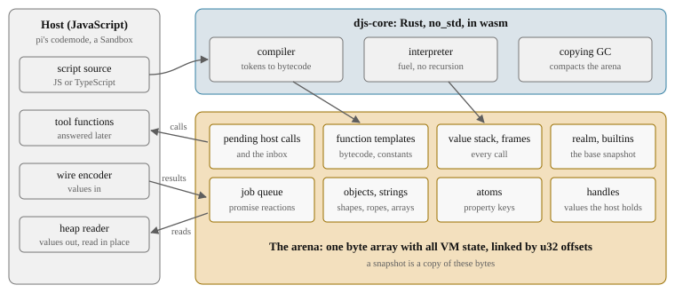

# What djs is for

djs is a small JavaScript and TypeScript engine written in Rust. It exists for one job:
running the scripts that a language model writes in pi's **codemode**, inside a
WebAssembly sandbox, in place of QuickJS. This guide explains how it works and, above
all, why it is built the way it is. Almost every unusual decision in djs follows from
that one job, so this page starts there.

> **In short.** A codemode script is short, calls slow tools, moves a lot of data, and
> must be stoppable and resumable at any moment. djs therefore keeps *all* of its state
> in one byte array that it can copy, never uses the Rust stack for JavaScript calls,
> lets the host read values straight out of memory, and compiles source to bytecode in
> one pass.

## A codemode script

Instead of calling tools one at a time, the model writes a small program that calls
them, combines their results and returns what it wants to show:

```js live
// A stand-in for a tool the host provides; in pi it is `tools.search`.
const search = async (q) => [
  { name: "djs", stars: 120, lang: "Rust" },
  { name: "quickjs", stars: 9000, lang: "C" },
];
const hits = await search("small js engines");
const rust = hits.filter((h) => h.lang === "Rust");
console.log(`${rust.length} of ${hits.length} in Rust:`, rust.map((h) => h.name).join(", "));
return rust;
```
<!-- gen:run -->
```text
1 of 2 in Rust: djs
```
<!-- /gen -->

Such scripts have a particular profile, and each part of it became a design goal:

| What a codemode script does | What djs needs to do | Goal |
| --- | --- | --- |
| Receives tool results: long strings, arrays of similar objects, base64 images | Get data in and out with as little copying and conversion as possible | [cheap data passing](goals.md#cheap-data-passing) |
| Runs for milliseconds, once, then is thrown away | Start in microseconds; compile fast; keep the wasm module small | [fast startup in wasm](goals.md#fast-startup-in-wasm) |
| Is written fresh every time | Compile in one pass, straight to bytecode | [no syntax tree](goals.md#no-syntax-tree) |
| Waits for tools that may take minutes | Write the run out while it waits, continue it elsewhere, also in a later djs | [persistence](goals.md#persistence) |
| Must not hog the host, may loop forever, may be cancelled | Stop between any two instructions and resume later, even inside a `map` callback or a getter | [suspend anywhere](goals.md#suspend-anywhere) |

The goals are in priority order, and the next chapter, [what djs optimizes
for](goals.md), explains each of them. Two more constraints shape everything: **wasm32
is the target that counts** (memory and speed are judged in V8's wasm tier, D016), and
**behavior matches QuickJS**, down to error messages, because models read those messages
and pi's tests expect them.

## The shape of the system



- The **compiler** turns source text (JavaScript or TypeScript; types are erased while
  parsing) into bytecode in a single pass, without building a syntax tree.
- The **interpreter** runs that bytecode. JavaScript calls do not recurse on the Rust
  stack: every frame lives in the arena, so the interpreter can return to the host after
  any instruction and pick up exactly where it stopped.
- The **arena** holds everything: objects, strings, bytecode, the value stack, the call
  frames, the promise job queue, the pending tool calls. Values refer to each other by
  `u32` offsets, never by pointers, so the arena can move, be copied and be read from
  the outside.
- The **garbage collector** compacts the arena in place, which keeps images small and
  makes the heap image of a program a deterministic function of the program.
- The **builtins** (`Array.prototype.map`, `JSON.parse`, ...) are written in a strict
  subset of TypeScript and compiled twice: to bytecode that ships in the base snapshot,
  and, for the hot ones, to Rust state machines that can suspend in the middle.
- The **host** (pi's codemode, or the `Sandbox` class of the `@djs/host` package) sends
  values in through a compact wire format and reads results by walking the arena
  directly, with a reader generated from the same layout tables as the engine.

## What djs is not

djs is always in strict mode, has no ES modules, no `Intl` and no JIT, among other
things left out on purpose; [the non-goals](goals.md#non-goals) lists them and why.

## How to read this guide

The tour goes from the bottom up: the arena and values, cells and objects, the compiler,
the interpreter, suspension, the collector, images and dumps, the builtins, determinism, and
the host interface. Each chapter explains its **trade-offs**: what the design costs, and
the alternatives that were not taken. The chapters explain each decision where it
matters; the decision's ID (D1050) links to its entry in the [decision
log](../decisions.md), the record kept while djs was built, with the full reasoning and
the measurements behind it.

Code samples marked *live* run in djs-wasm in your browser on the docs site. The output
shown under each sample was produced by running it in this build of djs when the guide
was checked, so it cannot drift from what djs actually does.

Decisions on this page:

<!-- gen:decisions D016 D008 D1100 -->
- D016: wasm32 is the primary target for performance and memory design
- D008: Codemode top level is a function body
- D1100: Difftest compares what pi's codemode shows the model
<!-- /gen -->
