# Cell layouts

Every cell kind in the arena, drawn from `LAYOUTS` (the `cells!` declarations in
`crates/djs-core/src/heap/cells.rs`). The garbage collector traces exactly the orange
fields, and the host's reader (`js/src/layout.generated.ts`) is generated from the same
table.

<!-- gen:cell-all -->
## Roots (kind 1)

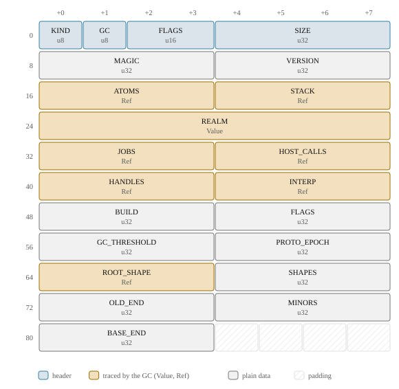

## Str8 (kind 2)

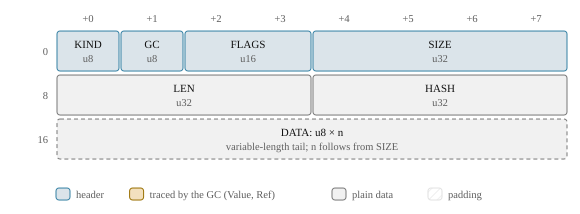

## Str16 (kind 3)

## Rope (kind 4)

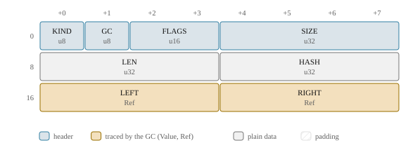

## Slice (kind 22)

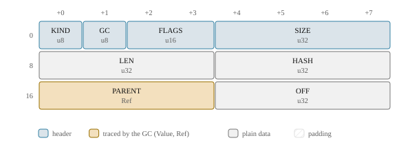

## Symbol (kind 5)

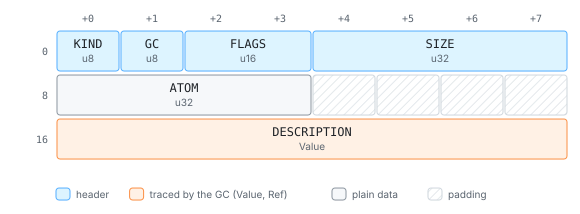

## Object (kind 6)

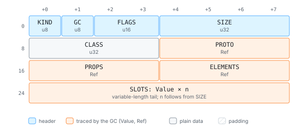

## PropTable (kind 7)

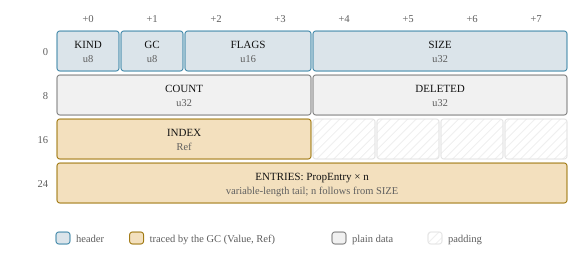

## ValueArray (kind 8)

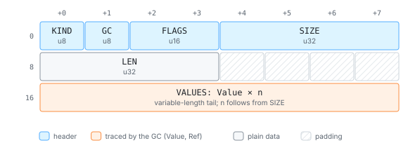

## U32Array (kind 9)

## AtomTable (kind 10)

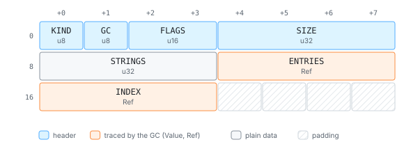

## HandleTable (kind 11)

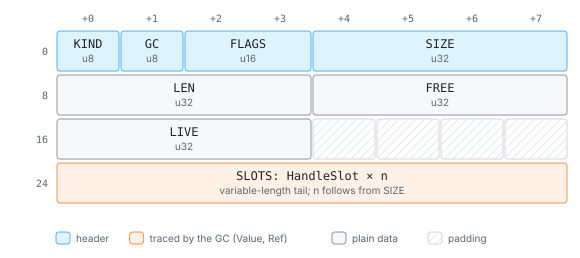

## FuncTemplate (kind 12)

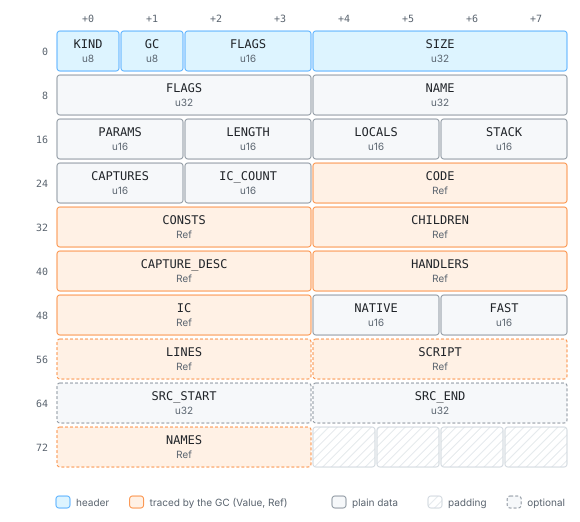

## Script (kind 13)

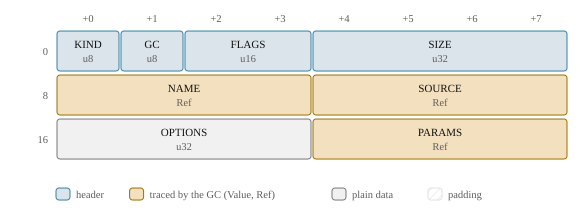

## BoxCell (kind 14)

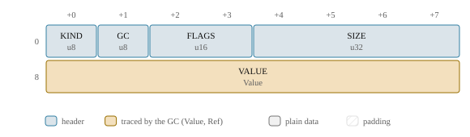

## Bytes (kind 15)

## RefArray (kind 16)

## FuncInfo (kind 21)

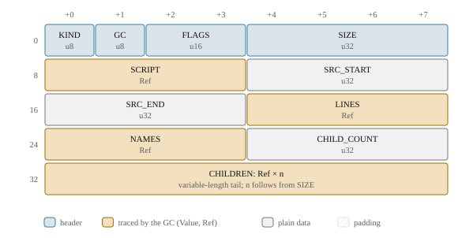

## Interp (kind 17)

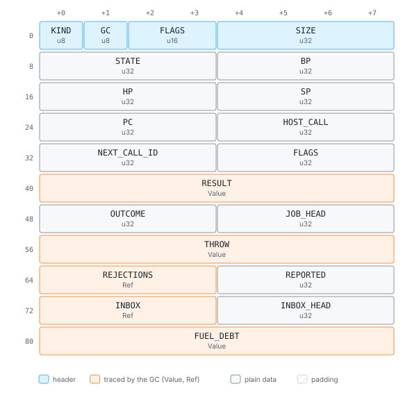

## Realm (kind 18)

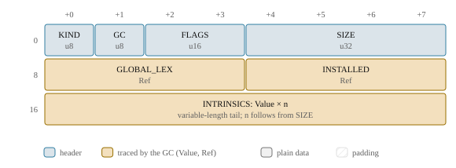

## HostCall (kind 19)

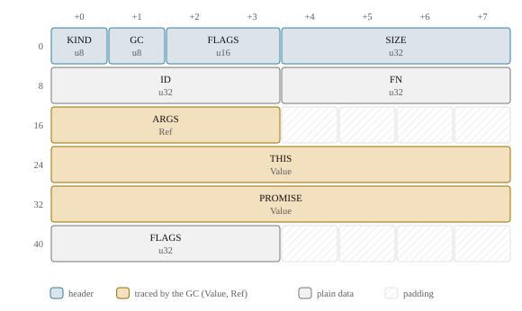

## EphemeronArray (kind 20)

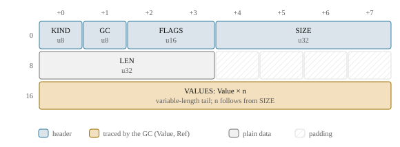

## AccessorPair (kind 25)

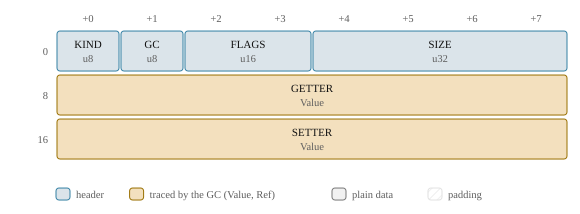

## Shape (kind 26)

## PropValues (kind 27)

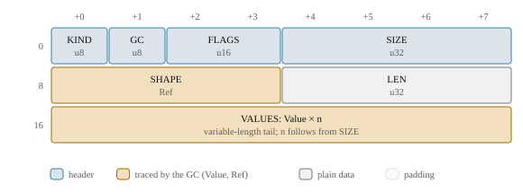

## BigInt (kind 24)

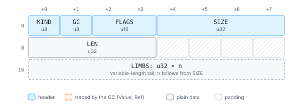

<!-- /gen -->
