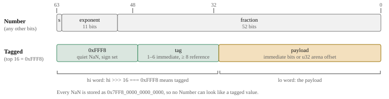
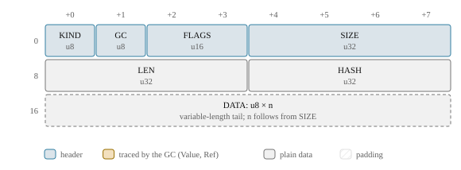
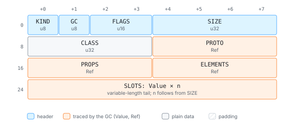

# Values and NaN-boxing

Every JavaScript value djs handles (a number, a string, an object, `undefined`) fits in
64 bits. Local variables, the operand stack, array elements and object slots all hold
these 64-bit words, and the host reads them straight out of wasm memory. This page
explains the encoding, why it looks the way it does, and what it costs.

> **In short.** A value is a `u64`. If it is not one particular kind of NaN, it is a
> plain `f64`. Otherwise its upper half says what it is and its lower half carries the
> payload: a small immediate, or the *byte offset* of a heap cell in the arena. There
> are no pointers in values.

## Two readings of 64 bits

IEEE-754 doubles waste a large space of bit patterns on NaN: any value with all exponent
bits set and a non-zero fraction is "not a number", and JavaScript cannot tell them
apart. djs claims one corner of that space for everything that is not a number:

<!-- gen:value-bits -->

<!-- /gen -->

Whenever arithmetic produces a NaN, djs stores the one canonical NaN
(`0x7FF8_0000_0000_0000`). The tagged corner (`0xFFF8…`) is therefore never produced by
arithmetic, and the test "is this a number?" is a single compare of the top 16 bits.

The tags in use, generated from the engine's layout export:

<!-- gen:value-tags -->
| tag | name | high word | payload |
| ---: | --- | --- | --- |
| 1 | `UNDEFINED` | `0xFFF8_0001` | immediate |
| 2 | `NULL` | `0xFFF8_0002` | immediate |
| 3 | `BOOL` | `0xFFF8_0003` | immediate |
| 4 | `INT` | `0xFFF8_0004` | immediate |
| 5 | `HOLE` | `0xFFF8_0005` | immediate |
| 6 | `UNINITIALIZED` | `0xFFF8_0006` | immediate |
| 8 | `STRING` | `0xFFF8_0008` | `u32` arena offset of a cell |
| 9 | `OBJECT` | `0xFFF8_0009` | `u32` arena offset of a cell |
| 10 | `SYMBOL` | `0xFFF8_000A` | `u32` arena offset of a cell |
| 11 | `BIGINT` | `0xFFF8_000B` | `u32` arena offset of a cell |
| 12 | `HOST_REF` | `0xFFF8_000C` | `u32` arena offset of a cell |
| 13 | `INTERNAL` | `0xFFF8_000D` | `u32` arena offset of a cell |
<!-- /gen -->

A few of these deserve a word:

- **`INT`** is a second form of Number: an `i32` in the payload. Loop counters, array
  indices and lengths stay in this form, and the interpreter has fast paths for it.
  `1` as `INT` and `1.0` as `f64` are different bits for the same JavaScript value, which
  is why `==` on a Rust `Value` means *bit identity*, never JavaScript equality.
- **`HOLE`** and **`UNINITIALIZED`** are internal markers: an empty slot in a sparse
  array literal, and a `let` binding still in its temporal dead zone. Neither can reach
  JavaScript code.
- **`BIGINT`** is always a heap cell, even for small values, and compares by value
  (D1460). BigInt is rare in codemode scripts, so a second, inline form would double
  every BigInt code path for little gain.
- **`INTERNAL`** lets VM-internal cells (a closure's function template, a captured
  variable's box) sit in ordinary value slots, so the garbage collector traces them like
  any other reference (D007).

Try it. On the docs site this example runs in djs-wasm, right in the page; its output
below was generated by running it in a djs VM when the docs were built (suspended and
resumed from a heap image every 50 units of fuel, as the test suite does):

```js live
const xs = [1, 2.5, -0, NaN, 2 ** 31, 10n ** 20n];
for (const x of xs) console.log(typeof x, x, Object.is(x, -0));
let s = "codemode";
s += " builds strings with +=";
console.log(s, s.length);
```
<!-- gen:run -->
```text
number 1 false
number 2.5 false
number -0 true
number NaN false
number 2147483648 false
bigint 100000000000000000000n false
codemode builds strings with += 31
```
<!-- /gen -->

## Numbers in the bytecode

The compiler picks the cheapest way to materialize a number. Small integers are
immediates in the instruction, and so are `true`, `null` and friends; anything else
comes from the function's constant pool:

```js
let a = 1, b = 1000000, c = 2.5;
```

<!-- gen:disasm -->
```text
function 0 <anonymous>: params=2 locals=4 stack=1 captures=0
  handler [3, 28) -> 28 depth 0
    0  async_start loc0 (<state>)
    3  push_i8 1
    5  put_loc loc1 (a)
    8  push_i32 1000000
   13  put_loc loc2 (b)
   16  push_const #0 (2.5)
   21  put_loc loc3 (c)
   24  undefined
   25  async_return loc0 (<state>)
   28  async_reject loc0 (<state>)
```
<!-- /gen -->

<!-- gen:ops push_i8 push_i32 push_const push_true undefined -->
| opcode | byte | immediates | size | pop → push | cost | description |
| --- | ---: | --- | ---: | --- | --- | --- |
| `push_i8` | 4 | I8 | 2 | 0 → 1 | Basic | `-> n`: a small integer constant. |
| `push_i32` | 5 | I32 | 5 | 0 → 1 | Basic | `-> n`: an integer constant. |
| `push_const` | 6 | Const | 5 | 0 → 1 | Basic | `-> v`: a constant pool entry (non-int32 numbers, strings). |
| `push_true` | 2 | – | 1 | 0 → 1 | Basic | `-> true` |
| `undefined` | 0 | – | 1 | 0 → 1 | Basic | `-> undefined` |
<!-- /gen -->

## References are offsets, not pointers

A reference payload is a `u32` byte offset into the VM's **arena**, the single byte
array that holds all VM state (D1051). Offset 0 is the `Roots` cell, so 0 doubles as
"null", and the all-zero bit pattern is the number `+0`, not a reference. Freshly
zeroed memory is therefore always safe for the garbage collector to scan.

Every offset points at a **cell**: an 8-byte header (kind, GC bits, flags, size)
followed by the fields of that kind. A one-byte string, for example:

<!-- gen:cell Str8 -->


<!-- /gen -->

and an object, whose `PROTO`, `PROPS` and `ELEMENTS` are references the collector
follows, and whose tail of value slots it scans:

<!-- gen:cell Object -->


<!-- /gen -->

These diagrams are drawn from `LAYOUTS`, the table the `cells!` macro generates
(D1052). The same table drives the collector's tracing, the image verifier (D1056), the
layout hash in every image's build hash, and the host's reader
(`js/src/layout.generated.ts`, D1210).

## How the host reads a value

On the JavaScript side a value is two little-endian `u32` words. Decoding one takes one
comparison:

```ts
if (hi >>> 16 !== TAG_PREFIX) {
  // a Number: reinterpret the 8 bytes as an f64
} else {
  const tag = hi & 0xffff;   // STRING, OBJECT, ...
  const cell = lo >>> 0;     // the cell's offset in the arena
}
```

That is what makes passing data out of the sandbox cheap (goal G1): a tool result that
became a large array of objects in the VM is read by walking cells in wasm memory, with
no serialization step inside the VM.

## Trade-offs

> **Trade-off.** NaN-boxing over a tag-plus-payload struct. QuickJS uses a 16-byte
> struct on 64-bit hosts (and NaN-boxes on 32-bit ones). Eight bytes per value halves
> the size of every stack, array and slot, and in wasm a value is one native `i64` load
> or store (D016). The cost: NaNs must be canonicalized whenever a computation could
> produce one, and type tests decode bits instead of reading a tag field.

> **Trade-off.** NaN-boxing over pointer tagging (V8's small integers). With a tagged
> pointer word, every double that is not a small integer becomes a heap allocation.
> Codemode scripts handle JSON with many non-integral numbers, and boxing them would
> put pressure on the collector. NaN-boxing keeps every Number inline.

> **Trade-off.** `u32` offsets instead of pointers. Offsets make the heap position
> independent: a snapshot is a copy of the arena, the arena can grow and move without
> fixups, the host can read it, and a corrupt offset is a bounds-checked panic (a wasm
> trap), never undefined behavior. The price is an add and a bounds check on every
> access, and a 4 GiB limit per arena (offsets could be scaled by the 8-byte alignment if
> that ever matters).

## Where to look

- `crates/djs-core/src/value.rs`: the `Value` type and the encoding.
- `crates/djs-core/src/heap/cells.rs`: every cell kind ([all layouts](ref-cells.md)).
- `js/src/reader.ts`: the host-side decoder.

Decisions on this page:

<!-- gen:decisions D1050 D1051 D1052 D007 D1460 D1210 D016 -->
- D1050: Value encoding
- D1051: Arena and cell header
- D1052: Layout description macro
- D007: Internal-reference Value tag
- D1460: BigInt values are always heap cells, compared by value
- D1210: Exported heap layout drives the host-side reader
- D016: wasm32 is the primary target for performance and memory design
<!-- /gen -->
